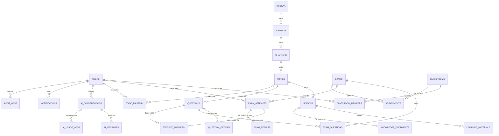

# DATABASE SCHEMA SPECIFICATION — SMART LEARNING PRO

Hệ thống cơ sở dữ liệu được thiết kế theo chuẩn CSDL quan hệ chuẩn hóa 3NF, tương thích hoàn toàn giữa **PostgreSQL 16 (có pgvector)** và **SQLite 3 (với JSON support)**.

---

## 1. SƠ ĐỒ THỰC THỂ LIÊN KẾT (ERD OVERVIEW)

---

## 2. CHI TIẾT CÁC BẢNG DỮ LIỆU (DETAILED TABLES)

### 2.1. Nhóm Người Dùng & Xác Thực (Identity & Auth)
1. **`users`**:
   - `id`: VARCHAR(36) / UUID, Primary Key
   - `email`: VARCHAR(255), UNIQUE, NOT NULL, Index
   - `hashed_password`: VARCHAR(255), NOT NULL (Argon2id)
   - `full_name`: VARCHAR(150), NOT NULL
   - `role`: VARCHAR(20), NOT NULL (STUDENT, TEACHER, ADMIN, SUPERADMIN)
   - `avatar_url`: VARCHAR(500), NULL
   - `phone`: VARCHAR(20), NULL
   - `is_active`: BOOLEAN, DEFAULT TRUE
   - `is_verified`: BOOLEAN, DEFAULT FALSE
   - `grade_level`: INTEGER, NULL (Lớp 6 đến 12 đối với học sinh)
   - `xp_points`: INTEGER, DEFAULT 0
   - `current_level`: INTEGER, DEFAULT 1
   - `streak_days`: INTEGER, DEFAULT 0
   - `last_active_date`: DATE, NULL
   - `created_at`: TIMESTAMP WITH TIME ZONE, DEFAULT NOW()
   - `updated_at`: TIMESTAMP WITH TIME ZONE, DEFAULT NOW()

2. **`user_sessions`**:
   - `id`: VARCHAR(36), PK
   - `user_id`: VARCHAR(36), FK -> `users.id`, ON DELETE CASCADE
   - `refresh_token_hash`: VARCHAR(255), NOT NULL
   - `ip_address`: VARCHAR(45)
   - `user_agent`: VARCHAR(255)
   - `expires_at`: TIMESTAMP WITH TIME ZONE, NOT NULL
   - `created_at`: TIMESTAMP WITH TIME ZONE, DEFAULT NOW()

### 2.2. Nhóm Chương Trình Học (Curriculum & Lessons)
3. **`grades`**:
   - `id`: INTEGER, PK (6, 7, 8, 9, 10, 11, 12)
   - `name`: VARCHAR(50), NOT NULL (ví dụ: "Lớp 11")
   - `description`: TEXT
   - `order_index`: INTEGER, DEFAULT 0

4. **`subjects`**:
   - `id`: VARCHAR(50), PK (ví dụ: "toan-11", "vat-ly-11")
   - `grade_id`: INTEGER, FK -> `grades.id`, ON DELETE CASCADE
   - `name`: VARCHAR(100), NOT NULL (ví dụ: "Toán học 11")
   - `code`: VARCHAR(20), NOT NULL (ví dụ: "MATH11")
   - `icon`: VARCHAR(100)
   - `color`: VARCHAR(20)
   - `is_published`: BOOLEAN, DEFAULT TRUE
   - `order_index`: INTEGER, DEFAULT 0

5. **`chapters`**:
   - `id`: VARCHAR(36), PK
   - `subject_id`: VARCHAR(50), FK -> `subjects.id`, ON DELETE CASCADE
   - `title`: VARCHAR(200), NOT NULL (ví dụ: "Chương 1: Hàm số lượng giác")
   - `order_index`: INTEGER, DEFAULT 0

6. **`topics`**:
   - `id`: VARCHAR(36), PK
   - `chapter_id`: VARCHAR(36), FK -> `chapters.id`, ON DELETE CASCADE
   - `title`: VARCHAR(200), NOT NULL (ví dụ: "Phương trình lượng giác cơ bản")
   - `description`: TEXT
   - `order_index`: INTEGER, DEFAULT 0

7. **`lessons`**:
   - `id`: VARCHAR(36), PK
   - `topic_id`: VARCHAR(36), FK -> `topics.id`, ON DELETE CASCADE
   - `title`: VARCHAR(200), NOT NULL
   - `content_markdown`: TEXT, NOT NULL (Hỗ trợ công thức KaTeX)
   - `video_url`: VARCHAR(500), NULL
   - `duration_minutes`: INTEGER, DEFAULT 45
   - `order_index`: INTEGER, DEFAULT 0
   - `created_at`: TIMESTAMP WITH TIME ZONE, DEFAULT NOW()

8. **`learning_materials`**:
   - `id`: VARCHAR(36), PK
   - `lesson_id`: VARCHAR(36), FK -> `lessons.id`, ON DELETE CASCADE
   - `title`: VARCHAR(200), NOT NULL
   - `file_type`: VARCHAR(50) (PDF, DOCX, VIDEO, SLIDE)
   - `file_url`: VARCHAR(500), NOT NULL
   - `file_size_bytes`: BIGINT

### 2.3. Nhóm Ngân Hàng Câu Hỏi & Đề Thi (Questions & Exams)
9. **`questions`**:
   - `id`: VARCHAR(36) / UUID, Primary Key
   - `topic_id`: VARCHAR(36), FK -> `topics.id`, ON DELETE SET NULL
   - `lesson_id`: VARCHAR(36), FK -> `lessons.id`, ON DELETE SET NULL
   - `creator_id`: VARCHAR(36), FK -> `users.id`, ON DELETE SET NULL
   - `question_type`: VARCHAR(30), NOT NULL (SINGLE_CHOICE, MULTIPLE_CHOICE, TRUE_FALSE, SHORT_ANSWER, NUMERIC, ESSAY)
   - `content`: TEXT, NOT NULL (Hỗ trợ công thức KaTeX)
   - `difficulty_level`: VARCHAR(20), NOT NULL (RECOGNITION, COMPREHENSION, APPLICATION, HIGH_APPLICATION)
   - `explanation`: TEXT (Lời giải chi tiết chuẩn kèm công thức KaTeX)
   - `hint`: TEXT (Gợi ý Socratic khi học sinh gặp khó khăn)
   - `tags`: VARCHAR(255) (Thẻ chủ đề, từ khóa tìm kiếm)
   - `is_public`: BOOLEAN, DEFAULT TRUE (Trạng thái xuất bản: True = công khai, False = bản nháp)
   - `created_at`: TIMESTAMP WITH TIME ZONE, DEFAULT NOW()
   - `updated_at`: TIMESTAMP WITH TIME ZONE, DEFAULT NOW()

10. **`question_options`**:
    - `id`: VARCHAR(36), PK
    - `question_id`: VARCHAR(36), FK -> `questions.id`, ON DELETE CASCADE
    - `option_key`: VARCHAR(10), NOT NULL (A, B, C, D...)
    - `content`: TEXT, NOT NULL
    - `is_correct`: BOOLEAN, NOT NULL DEFAULT FALSE
    - `order_index`: INTEGER, DEFAULT 0

11. **`exams`**:
    - `id`: VARCHAR(36), PK
    - `creator_id`: VARCHAR(36), FK -> `users.id`
    - `subject_id`: VARCHAR(50), FK -> `subjects.id`
    - `grade_id`: INTEGER, FK -> `grades.id`, ON DELETE SET NULL
    - `title`: VARCHAR(255), NOT NULL
    - `description`: TEXT
    - `duration_minutes`: INTEGER, NOT NULL (ví dụ: 45, 60, 90)
    - `total_points`: DOUBLE PRECISION, DEFAULT 10.0
    - `passing_points`: DOUBLE PRECISION, DEFAULT 5.0
    - `shuffle_questions`: BOOLEAN, DEFAULT TRUE
    - `shuffle_options`: BOOLEAN, DEFAULT TRUE
    - `allow_review`: BOOLEAN, DEFAULT TRUE
    - `max_attempts`: INTEGER, DEFAULT 1
    - `status`: VARCHAR(20), DEFAULT 'PUBLISHED' (DRAFT, PUBLISHED, ARCHIVED)
    - `is_published`: BOOLEAN, DEFAULT TRUE
    - `start_time`: TIMESTAMP WITH TIME ZONE, NULL (Thời điểm mở đề thi theo lịch)
    - `end_time`: TIMESTAMP WITH TIME ZONE, NULL (Thời điểm đóng đề thi theo lịch)
    - `created_at`: TIMESTAMP WITH TIME ZONE, DEFAULT NOW()
    - `updated_at`: TIMESTAMP WITH TIME ZONE, DEFAULT NOW()

12. **`exam_questions`**:
    - `id`: VARCHAR(36), PK
    - `exam_id`: VARCHAR(36), FK -> `exams.id`, ON DELETE CASCADE
    - `question_id`: VARCHAR(36), FK -> `questions.id`, ON DELETE CASCADE
    - `points`: DOUBLE PRECISION, DEFAULT 0.2
    - `order_index`: INTEGER, DEFAULT 0

13. **`exam_attempts`**:
    - `id`: VARCHAR(36), PK
    - `exam_id`: VARCHAR(36), FK -> `exams.id`, ON DELETE CASCADE
    - `student_id`: VARCHAR(36), FK -> `users.id`, ON DELETE CASCADE
    - `attempt_number`: INTEGER, DEFAULT 1
    - `status`: VARCHAR(20), DEFAULT 'IN_PROGRESS' (IN_PROGRESS, SUBMITTED, AUTO_SUBMITTED, GRADED, ABANDONED)
    - `started_at`: TIMESTAMP WITH TIME ZONE, DEFAULT NOW()
    - `deadline_at`: TIMESTAMP WITH TIME ZONE, NULL (Thời hạn kết thúc phòng thi = started_at + duration_minutes)
    - `submitted_at`: TIMESTAMP WITH TIME ZONE, NULL
    - `score`: DOUBLE PRECISION, NULL
    - `maximum_score`: DOUBLE PRECISION, DEFAULT 10.0
    - `time_spent_seconds`: INTEGER, DEFAULT 0
    - `questions_snapshot_json`: TEXT, NULL (Bản chụp đề thi bất biến đã ẩn đáp án đúng, cách ly với ngân hàng đề gốc)
    - `created_at`: TIMESTAMP WITH TIME ZONE, DEFAULT NOW()
    - `updated_at`: TIMESTAMP WITH TIME ZONE, DEFAULT NOW()

14. **`student_answers`**:
    - `id`: VARCHAR(36), PK
    - `attempt_id`: VARCHAR(36), FK -> `exam_attempts.id`, ON DELETE CASCADE
    - `question_id`: VARCHAR(36), FK -> `questions.id`, ON DELETE CASCADE
    - `selected_option_id`: VARCHAR(36), NULL (Dành cho câu hỏi đơn lựa chọn)
    - `selected_option_ids_json`: TEXT, NULL (Dành cho câu hỏi nhiều lựa chọn JSON list)
    - `answer_text`: TEXT, NULL (Dành cho câu hỏi tự luận ngắn / số học)
    - `is_correct`: BOOLEAN, NULL
    - `points_awarded`: DOUBLE PRECISION, DEFAULT 0.0
    - `is_flagged`: BOOLEAN, DEFAULT FALSE
    - `time_spent_seconds`: INTEGER, DEFAULT 0
    - `answered_at`: TIMESTAMP WITH TIME ZONE, DEFAULT NOW()
    - `updated_at`: TIMESTAMP WITH TIME ZONE, DEFAULT NOW()

15. **`exam_results`**:
    - `id`: VARCHAR(36), PK
    - `attempt_id`: VARCHAR(36), FK -> `exam_attempts.id`, ON DELETE CASCADE, UNIQUE
    - `total_score`: DOUBLE PRECISION, NOT NULL
    - `correct_answers_count`: INTEGER, NOT NULL
    - `wrong_answers_count`: INTEGER, NOT NULL
    - `skipped_answers_count`: INTEGER, NOT NULL
    - `accuracy_percentage`: DOUBLE PRECISION, NOT NULL
    - `feedback_summary`: TEXT
    - `created_at`: TIMESTAMP WITH TIME ZONE, DEFAULT NOW()

### 2.4. Nhóm Lớp Học & Bài Tập (Classrooms & Assignments)
16. **`classrooms`**:
    - `id`: VARCHAR(36), PK
    - `teacher_id`: VARCHAR(36), FK -> `users.id`, ON DELETE CASCADE
    - `name`: VARCHAR(150), NOT NULL (ví dụ: "Lớp 11A1 - THPT Chuyên")
    - `code`: VARCHAR(12), UNIQUE, NOT NULL (Mã lớp mời học sinh)
    - `grade_id`: INTEGER, FK -> `grades.id`
    - `description`: TEXT
    - `created_at`: TIMESTAMP WITH TIME ZONE, DEFAULT NOW()

17. **`classroom_members`**:
    - `id`: VARCHAR(36), PK
    - `classroom_id`: VARCHAR(36), FK -> `classrooms.id`, ON DELETE CASCADE
    - `student_id`: VARCHAR(36), FK -> `users.id`, ON DELETE CASCADE
    - `joined_at`: TIMESTAMP WITH TIME ZONE, DEFAULT NOW()

18. **`assignments`**:
    - `id`: VARCHAR(36), PK
    - `classroom_id`: VARCHAR(36), FK -> `classrooms.id`, ON DELETE CASCADE
    - `exam_id`: VARCHAR(36), FK -> `exams.id`, ON DELETE CASCADE
    - `title`: VARCHAR(255), NOT NULL
    - `due_date`: TIMESTAMP WITH TIME ZONE, NOT NULL
    - `created_at`: TIMESTAMP WITH TIME ZONE, DEFAULT NOW()

### 2.5. Nhóm Năng Lực Học Tập & Đề Xuất (Mastery & Analytics)
19. **`topic_mastery`**:
    - `id`: VARCHAR(36), PK
    - `student_id`: VARCHAR(36), FK -> `users.id`, ON DELETE CASCADE
    - `topic_id`: VARCHAR(36), FK -> `topics.id`, ON DELETE CASCADE
    - `mastery_score`: DOUBLE PRECISION, DEFAULT 0.0 (0.0 đến 100.0)
    - `total_attempted`: INTEGER, DEFAULT 0
    - `total_correct`: INTEGER, DEFAULT 0
    - `last_practiced_at`: TIMESTAMP WITH TIME ZONE, DEFAULT NOW()

20. **`knowledge_gaps`**:
    - `id`: VARCHAR(36), PK
    - `student_id`: VARCHAR(36), FK -> `users.id`, ON DELETE CASCADE
    - `topic_id`: VARCHAR(36), FK -> `topics.id`, ON DELETE CASCADE
    - `gap_severity`: VARCHAR(20) (LOW, MEDIUM, HIGH, CRITICAL)
    - `detected_pattern`: TEXT (ví dụ: "Nhầm lẫn công thức cộng lượng giác sin(a+b)")
    - `recommended_action`: TEXT
    - `is_resolved`: BOOLEAN, DEFAULT FALSE
    - `detected_at`: TIMESTAMP WITH TIME ZONE, DEFAULT NOW()

### 2.6. Nhóm AI Tutor & RAG (AI & Knowledge Retrieval)
21. **`ai_conversations`**:
    - `id`: VARCHAR(36), PK
    - `user_id`: VARCHAR(36), FK -> `users.id`, ON DELETE CASCADE
    - `topic_id`: VARCHAR(36), NULL
    - `title`: VARCHAR(255), DEFAULT 'Đoạn hội thoại học tập'
    - `created_at`: TIMESTAMP WITH TIME ZONE, DEFAULT NOW()

22. **`ai_messages`**:
    - `id`: VARCHAR(36), PK
    - `conversation_id`: VARCHAR(36), FK -> `ai_conversations.id`, ON DELETE CASCADE
    - `role`: VARCHAR(20), NOT NULL (user, assistant, system)
    - `content`: TEXT, NOT NULL
    - `metadata_json`: TEXT, NULL (Chứa structured breakdown, formula, remedial questions)
    - `created_at`: TIMESTAMP WITH TIME ZONE, DEFAULT NOW()

23. **`ai_usage_logs`**:
    - `id`: VARCHAR(36), PK
    - `user_id`: VARCHAR(36), FK -> `users.id`, ON DELETE SET NULL
    - `feature`: VARCHAR(50), NOT NULL (WRONG_ANSWER_ANALYSIS, TUTOR_CHAT, SIMILAR_QUESTION_GEN)
    - `model_name`: VARCHAR(50), NOT NULL (gemini-1.5-flash)
    - `prompt_tokens`: INTEGER, DEFAULT 0
    - `completion_tokens`: INTEGER, DEFAULT 0
    - `estimated_cost_usd`: DOUBLE PRECISION, DEFAULT 0.0
    - `created_at`: TIMESTAMP WITH TIME ZONE, DEFAULT NOW()

24. **`knowledge_documents` (RAG)**:
    - `id`: VARCHAR(36), PK
    - `topic_id`: VARCHAR(36), FK -> `topics.id`, ON DELETE CASCADE
    - `chunk_content`: TEXT, NOT NULL
    - `embedding_json`: TEXT, NULL (Danh sách vector float tương thích SQLite/PostgreSQL)
    - `source_reference`: VARCHAR(255)

### 2.7. Nhóm Gamification & Thông Báo & Audit
25. **`notifications`**:
    - `id`: VARCHAR(36), PK
    - `user_id`: VARCHAR(36), FK -> `users.id`, ON DELETE CASCADE
    - `title`: VARCHAR(255), NOT NULL
    - `message`: TEXT, NOT NULL
    - `type`: VARCHAR(30) (ASSIGNMENT_DUE, EXAM_GRADED, STREAK_REMINDER, SYSTEM)
    - `link_url`: VARCHAR(255), NULL
    - `is_read`: BOOLEAN, DEFAULT FALSE
    - `created_at`: TIMESTAMP WITH TIME ZONE, DEFAULT NOW()

26. **`audit_logs`**:
    - `id`: VARCHAR(36), PK
    - `user_id`: VARCHAR(36), NULL
    - `action`: VARCHAR(100), NOT NULL
    - `resource_type`: VARCHAR(50), NOT NULL
    - `resource_id`: VARCHAR(36), NULL
    - `details_json`: TEXT, NULL
    - `ip_address`: VARCHAR(45)
    - `created_at`: TIMESTAMP WITH TIME ZONE, DEFAULT NOW()
