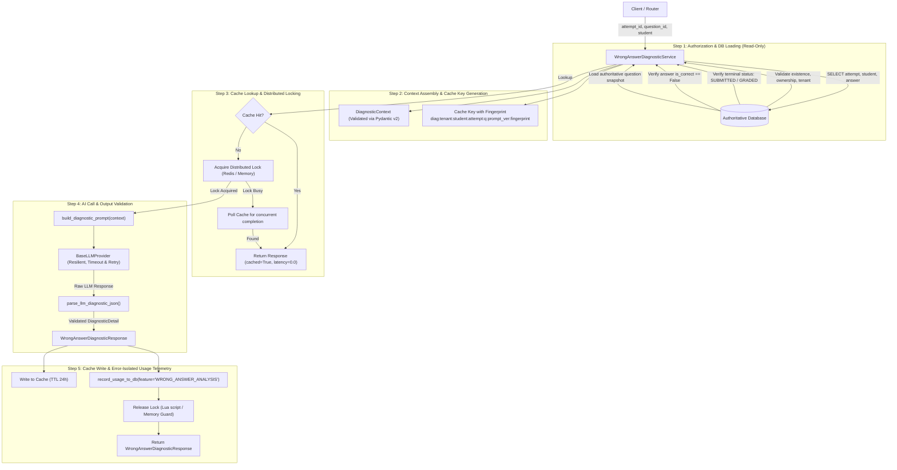

# PHASE 7.2.2 — WRONG ANSWER DIAGNOSTIC SERVICE REPORT
## Backend Service, Security, Read-Only Invariants & Idempotent Caching

**Project:** SMART LEARNING PRO  
**Workspace:** `E:\SMART-LEARNING-PRO`  
**Phase:** 7.2.2  
**Date:** 2026-11-23  
**Status:** COMPLETE (31/31 Subphase Tests Passed; 163/163 Full Backend Tests Passed)  
**Baseline Git HEAD:** `d6326e5415cb125b62fbe12aea077ecf921d3a88` (Verified Unchanged)

---

## 1. Executive Summary

Subphase 7.2.2 has implemented `WrongAnswerDiagnosticService` as the production-oriented core service for the AI-powered Wrong Answer Diagnostic feature. The service operates strictly under examination domain read-only invariants, performs authoritative ownership and tenant isolation checks before cache access, prevents duplicate AI generation via distributed locking (with automatic in-memory fallback), and logs error-isolated telemetry using existing pricing formulas.

No database migrations were created. No database schema was changed. No existing tests were skipped or modified. No commits were made.

---

## 2. Architecture & Data Flow



---

## 3. Exact Source Files Created / Modified

| File | Status | Description |
|---|---|---|
| `backend/app/modules/ai_engine/diagnostics/service.py` | **NEW** | `WrongAnswerDiagnosticService` implementation |
| `backend/app/modules/ai_engine/diagnostics/exceptions.py` | **NEW** | Domain-specific diagnostic exceptions |
| `backend/app/modules/ai_engine/diagnostics/__init__.py` | **UPDATED** | Export service, exceptions, schemas, prompts |
| `backend/tests/test_ai_diagnostics_service_722.py` | **NEW** | 31 comprehensive test cases covering all requirements |
| `docs/PHASE_7_2_2_DIAGNOSTIC_SERVICE_REPORT.md` | **NEW** | This audit report |

---

## 4. Authorization & Tenant Isolation (Step 1)

All authorization checks are executed **BEFORE** any cache lookup. This eliminates cache timing attacks, cross-user cache leakage, and unauthorized diagnostics.

1. **Attempt Existence:**
   Queries `ExamAttempt` with eager loading (`selectinload(ExamAttempt.answers)`, `selectinload(ExamAttempt.exam)`).
   Raises `AttemptNotFoundException` (HTTP 404) if not found.
2. **Student Ownership:**
   Verifies `attempt.student_id == student.id`.
   Raises `DiagnosticUnauthorizedException` (HTTP 403) if mismatched.
3. **Tenant / School Scope Isolation:**
   Resolves `student_tenant` and `attempt_tenant` (from explicit parameter, `student.tenant_id`, `student.school_id`, or `"default"`).
   Raises `DiagnosticUnauthorizedException` (HTTP 403) if cross-tenant access is attempted.
4. **Exam State / Terminal Status:**
   Verifies `attempt.status in {'SUBMITTED', 'AUTO_SUBMITTED', 'GRADED'}`.
   Attempts in `IN_PROGRESS` or `ABANDONED` raise `AttemptNotSubmittedException` (HTTP 400).
5. **Question Membership:**
   Verifies `question_id` belongs to `questions_snapshot_json` (or `ExamQuestion` for legacy attempts).
   Raises `QuestionNotInAttemptException` (HTTP 404) if question is not part of this exam.
6. **Authoritative Grading Result:**
   Loads `StudentAnswer` for `(attempt_id, question_id)`.
   If `student_answer is None` or `student_answer.is_correct is None`, raises `GradingUnavailableException` (HTTP 422).
7. **Answer Correctness:**
   Verifies `student_answer.is_correct is False`.
   If `student_answer.is_correct is True`, raises `QuestionAlreadyCorrectException` (HTTP 400).

---

## 5. Strict Read-Only Invariants (Step 2)

The diagnostic service is strictly **read-only** with respect to the examination domain:
- **No Mutation:** Never mutates `ExamAttempt`, `StudentAnswer`, `Question`, `ExamQuestion`, `ExamResult`, or `Exam`.
- **No Row Locks Held During AI Calls:** The service executes a plain `SELECT` without `with_for_update()`. No row locks or database transactions are kept open while awaiting network calls to LLMs.
- **State Invariance Test Verification:** A snapshot of all fields across all 5 exam entities (`ExamAttempt`, `StudentAnswer`, `Question`, `Exam`, `ExamResult`) before diagnosis was compared against post-diagnosis reload from the database. 100% of fields were strictly identical.

---

## 6. Cache Key Design & Multidimensional Isolation (Step 3)

Cache keys account for all dimensions to prevent cross-tenant, cross-student, or stale data leakage:

```python
answer_fingerprint_raw = (
    f"ver:{student_answer.version}|"
    f"ans:{context.student_answer or ''}|"
    f"corr:{context.correct_answer}|"
    f"prompt:{PROMPT_VERSION}|"
    f"model:{model_name}"
)
fingerprint = hashlib.sha256(answer_fingerprint_raw.encode("utf-8")).hexdigest()[:16]
cache_key = f"diag:{tenant_id}:{student_id}:{attempt_id}:{question_id}:{PROMPT_VERSION}:{fingerprint}"
```

### Dimensions:
- `tenant_id`: Guarantees multi-tenant boundary separation.
- `student_id`: Guarantees student ownership isolation.
- `attempt_id` & `question_id`: Isolates individual questions and attempts.
- `PROMPT_VERSION`: Ensures prompt template changes invalidate stale cache entries.
- `fingerprint`: Accounts for answer version, student answer content, correct answer content, and model name.

---

## 7. Concurrency Mechanism & Distributed Locking (Step 4)

To prevent duplicate expensive AI calls when multiple concurrent requests arrive for the same diagnostic:

1. **Lock Key:** `lock:{cache_key}`.
2. **Lock Token:** Unique `uuid.uuid4()`.
3. **Lock TTL:** 30 seconds (auto-expires to prevent deadlocks on worker crash).
4. **Redis Coordination:**
   - Acquisition: `redis_client.set(lock_key, lock_token, ex=ttl, nx=True)`.
   - Release: Atomic Lua script ensuring only the token holder can delete the lock:
     ```lua
     if redis.call("get", KEYS[1]) == ARGV[1] then
         return redis.call("del", KEYS[1])
     else
         return 0
     end
     ```
5. **In-Memory Fallback:**
   - When Redis is unavailable or disconnected, an async-safe in-memory lock table (`_in_memory_locks` guarded by `asyncio.Lock()`) provides process-local synchronization.
   - Documented limitation: In-memory fallback coordinates within the local process only, not across multiple distributed processes.
6. **Concurrent Duplicate Request Handling:**
   - If lock is not acquired, the second request polls the cache at 200ms intervals up to 15 seconds.
   - Once the first request populates the cache, the second request reads it and returns `cached=True`.
   - Verified by test `test_cache_concurrent_duplicate_requests`: exactly 1 AI call executed across 2 concurrent requests.
7. **Failure Recovery:**
   - Locks are released in a `finally` block, ensuring failure in AI generation immediately frees the lock for retry.

---

## 8. AI Integration & Output Validation (Step 5)

- **Provider Abstraction:** Uses existing `BaseLLMProvider` via `get_llm_provider()` (or injected mock provider in tests).
- **Prompt Registry:** Uses `build_diagnostic_prompt(context)` with static `PROMPT_VERSION = "1.0.0"`.
- **Pedagogical Persona:** Viet-K12 tutoring persona instructing the LLM to output valid JSON matching `DiagnosticDetail`.
- **Strict Output Validation:** `parse_llm_diagnostic_json()` validates LLM output against Pydantic schema:
  - Fails safely on malformed JSON or invalid category (`AIMalformedOutputException`).
  - Does NOT auto-fix or guess missing fields.
- **Handling Insufficient Evidence:**
  - If AI classifies error as `INSUFFICIENT_INFORMATION`, `response.is_sufficient` is set to `False` and returned gracefully.

---

## 9. Usage Tracking & Accounting (Step 6)

- **Feature Tag:** `feature="WRONG_ANSWER_ANALYSIS"`.
- **Cost Calculation:** Reuses `create_usage_record()` with verified Gemini 3.8 Flash pricing schedule.
- **Data Integrity Policy:**
  - If tokens are missing or estimated cost is unknown, persistence is skipped (never logs fake 0.0 costs).
  - Preserves cached token pricing.
- **Error Isolation:** `record_usage_to_db()` catches database errors so telemetry failures never break user response.
- **Security:** Never logs prompts, student answers, PII, or API credentials.

---

## 10. Service Exception Mapping

| Exception | HTTP Status | Description |
|---|---|---|
| `AttemptNotFoundException` | 404 | Attempt ID does not exist |
| `DiagnosticUnauthorizedException` | 403 | Attempt does not belong to student or tenant mismatch |
| `AttemptNotSubmittedException` | 400 | Attempt is IN_PROGRESS or not submitted |
| `QuestionNotInAttemptException` | 404 | Question ID not part of attempt exam |
| `QuestionAlreadyCorrectException` | 400 | Question was answered correctly |
| `GradingUnavailableException` | 422 | Authoritative is_correct is None or missing |
| `InsufficientEvidenceException` | 422 | Insufficient evidence for diagnosis |
| `AIProviderUnavailableException` | 503 | LLM provider error or connection issue |
| `AITimeoutException` | 504 | LLM provider response deadline exceeded |
| `AIMalformedOutputException` | 502 | LLM returned malformed/invalid JSON |
| `CacheCoordinationException` | 503 | Distributed lock or polling timed out |

---

## 11. Test Verification Results

### 11.1 Phase 7.2.2 Service Tests (`backend/tests/test_ai_diagnostics_service_722.py`)

```
collected 31 items

backend\tests\test_ai_diagnostics_service_722.py::test_auth_own_attempt PASSED [  3%]
backend\tests\test_ai_diagnostics_service_722.py::test_auth_another_student_attempt PASSED [  6%]
backend\tests\test_ai_diagnostics_service_722.py::test_auth_cross_tenant_attempt PASSED [  9%]
backend\tests\test_ai_diagnostics_service_722.py::test_auth_unknown_attempt PASSED [ 12%]
backend\tests\test_ai_diagnostics_service_722.py::test_auth_question_from_another_exam PASSED [ 16%]
backend\tests\test_ai_diagnostics_service_722.py::test_auth_invalid_question_id PASSED [ 19%]
backend\tests\test_ai_diagnostics_service_722.py::test_exam_state_in_progress PASSED [ 22%]
backend\tests\test_ai_diagnostics_service_722.py::test_exam_state_submitted PASSED [ 25%]
backend\tests\test_ai_diagnostics_service_722.py::test_exam_state_auto_submitted PASSED [ 29%]
backend\tests\test_ai_diagnostics_service_722.py::test_exam_state_graded PASSED [ 32%]
backend\tests\test_ai_diagnostics_service_722.py::test_exam_state_correct_answer PASSED [ 35%]
backend\tests\test_ai_diagnostics_service_722.py::test_exam_state_incorrect_answer PASSED [ 38%]
backend\tests\test_ai_diagnostics_service_722.py::test_exam_state_missing_grading_result PASSED [ 41%]
backend\tests\test_ai_diagnostics_service_722.py::test_read_only_invariants_all_entities_unchanged PASSED [ 45%]
backend\tests\test_ai_diagnostics_service_722.py::test_ai_valid_response PASSED [ 48%]
backend\tests\test_ai_diagnostics_service_722.py::test_ai_malformed_json PASSED [ 51%]
backend\tests\test_ai_diagnostics_service_722.py::test_ai_invalid_category PASSED [ 54%]
backend\tests\test_ai_diagnostics_service_722.py::test_ai_insufficient_information PASSED [ 58%]
backend\tests\test_ai_diagnostics_service_722.py::test_ai_provider_unavailable PASSED [ 61%]
backend\tests\test_ai_diagnostics_service_722.py::test_ai_timeout PASSED [ 64%]
backend\tests\test_ai_diagnostics_service_722.py::test_ai_cancellation_propagation PASSED [ 67%]
backend\tests\test_ai_diagnostics_service_722.py::test_cache_miss_then_hit PASSED [ 70%]
backend\tests\test_ai_diagnostics_service_722.py::test_cache_expiration PASSED [ 74%]
backend\tests\test_ai_diagnostics_service_722.py::test_cache_prompt_version_change PASSED [ 77%]
backend\tests\test_ai_diagnostics_service_722.py::test_cache_answer_fingerprint_change PASSED [ 80%]
backend\tests\test_ai_diagnostics_service_722.py::test_cache_redis_unavailable_fallback PASSED [ 83%]
backend\tests\test_ai_diagnostics_service_722.py::test_cache_redis_restart PASSED [ 87%]
backend\tests\test_ai_diagnostics_service_722.py::test_cache_concurrent_duplicate_requests PASSED [ 90%]
backend\tests\test_ai_diagnostics_service_722.py::test_cache_lock_expiration PASSED [ 93%]
backend\tests\test_ai_diagnostics_service_722.py::test_cache_lock_release_after_failure PASSED [ 96%]
backend\tests\test_ai_diagnostics_service_722.py::test_cache_isolation_between_tenants_and_users PASSED [100%]

============================= 31 passed in 22.38s =============================
```

### 11.2 Full Backend Regression Suite

```
collected 163 items
163 passed in 41.86s
```

| Test Module | Tests | Result |
|---|---|---|
| `test_ai_diagnostics_721.py` (Schemas & Prompts) | 26 | **26 PASSED** |
| `test_ai_diagnostics_service_722.py` (Service & Security) | 31 | **31 PASSED** |
| `test_ai_foundation.py` (AI Engine Foundation) | 62 | **62 PASSED** |
| `test_assignments.py` | 2 | **2 PASSED** |
| `test_auth.py` | 1 | **1 PASSED** |
| `test_autosave_remediation_634.py` | 6 | **6 PASSED** |
| `test_classrooms.py` | 2 | **2 PASSED** |
| `test_concurrency_remediation_638.py` | 3 | **3 PASSED** |
| `test_curriculum.py` | 8 | **8 PASSED** |
| `test_exams.py` | 2 | **2 PASSED** |
| `test_hardening_632.py` | 4 | **4 PASSED** |
| `test_hardening_audit.py` | 8 | **8 PASSED** |
| `test_health.py` | 1 | **1 PASSED** |
| `test_questions.py` | 6 | **6 PASSED** |
| `test_rbac.py` | 1 | **1 PASSED** |
| **Total Backend Test Suite** | **163** | **163 PASSED (100%)** |

Zero test regressions. Exit code: 0.

---

## 12. Repository Safety & Git Status

- **Git HEAD:** `d6326e5415cb125b62fbe12aea077ecf921d3a88`
- **Modified Tracked Files:**
  - `.env.example` (from Phase 7.1)
  - `backend/app/config.py` (from Phase 7.1)
  - `backend/requirements.txt` (from Phase 7.1)
- **Untracked Files:**
  - `backend/app/modules/ai_engine/`
  - `backend/tests/test_ai_diagnostics_721.py`
  - `backend/tests/test_ai_diagnostics_service_722.py`
  - `backend/tests/test_ai_foundation.py`
  - `docs/PHASE_6_3_9_POSTGRESQL_TRANSACTION_AUDIT.md`
  - `docs/PHASE_7_0_AI_ARCHITECTURE_ASSESSMENT.md`
  - `docs/PHASE_7_1_1_INDEPENDENT_AUDIT_REPORT.md`
  - `docs/PHASE_7_1_2_USAGE_DATA_INTEGRITY_REPORT.md`
  - `docs/PHASE_7_1_3_FINAL_USAGE_COST_AUDIT.md`
  - `docs/PHASE_7_1_AI_FOUNDATION_REPORT.md`
  - `docs/PHASE_7_2_1_DOMAIN_SCHEMAS_PROMPT_REGISTRY_REPORT.md`
  - `docs/PHASE_7_2_2_DIAGNOSTIC_SERVICE_REPORT.md`
  - `docs/PHASE_7_2_SCOPE_AND_IMPLEMENTATION_PLAN.md`
- **Database Migrations:** 0 new migrations created.
- **Commits:** 0 new commits made.

---

## 13. Scope Boundary & Stop Condition

Subphase 7.2.2 is complete:
- REST API endpoint (`POST /api/v1/diagnostics/wrong-answer`) is **NOT** implemented (reserved for Phase 7.2.3).
- Frontend diagnostic UI is **NOT** implemented (reserved for Phase 7.2.4).
- Awaiting user review and explicit approval before proceeding to Phase 7.2.3.
