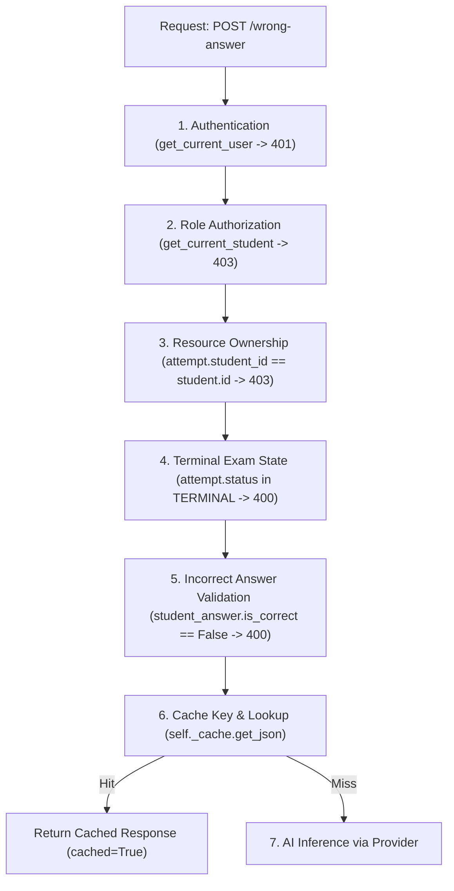

# BÁO CÁO KIỂM TOÁN NGUỒN VÀ BẢO MẬT CUỐI CÙNG — PHASE 7.2.3
## Final Source Code & Security Audit: REST API Router, Error Mapping & Dependency Injection

**Dự án:** SMART LEARNING PRO  
**Thư mục làm việc:** `E:\SMART-LEARNING-PRO`  
**Giai đoạn:** Phase 7.2.3 Audit  
**Ngày thực hiện kiểm toán:** 23/11/2026  
**Người thực hiện:** Senior Backend Engineer & Security Auditor  
**Baseline Git HEAD:** `d6326e5415cb125b62fbe12aea077ecf921d3a88` (Được xác minh không đổi)  
**Kết luận chung (Final Verdict):** **PASS**  

---

## 1. Tóm tắt điều hành (Executive Summary)

Đợt kiểm toán độc lập này được thực hiện nhằm xác minh toàn bộ các tuyên bố kỹ thuật trong báo cáo `docs/PHASE_7_2_3_REST_API_IMPLEMENTATION_REPORT.md` dựa trên mã nguồn thực tế và kết quả thực thi kiểm thử tại chỗ, không mặc định rằng báo cáo trước đó là chính xác.

Quá trình kiểm toán tập trung vào 7 khía cạnh cốt lõi:
1. **Exception Mapping:** Kiểm tra tính chính xác của quan hệ kế thừa, thứ tự bắt lỗi của Global Exception Handlers, và việc chống rò rỉ secret / stack trace ra client.
2. **Read-Only Invariants:** Kiểm tra 4 test cases kiểm thử tính bất biến của cơ sở dữ liệu (`ExamAttempt`, `StudentAnswer`, `ExamResult`, `Question`) để chứng minh test là integration test thực tế trên database fixture chứ không phải mock vô hiệu hóa kiểm tra ghi.
3. **Request Schema & UUID v4:** Xác minh schema `WrongAnswerDiagnosticRequest` có thực sự giới hạn UUID version 4 hay không và cơ chế `extra="forbid"` có ngăn chặn các trường giả mạo dữ liệu hay không.
4. **Thứ tự Authorization & Cache Isolation:** Kiểm tra 7 bước kiểm soát từ Authentication -> Role Authorization -> Resource Ownership -> Terminal State -> Incorrect Answer -> Cache Lookup -> AI Inference.
5. **Dependency Injection:** Đánh giá vòng đời của Database Session, Redis client, AI Provider, và khả năng override an toàn trong kiểm thử.
6. **Kiểm thử hồi quy:** Chạy trực tiếp các bộ test Phase 7.2.1, 7.2.2, 7.2.2.2, 7.2.3 và toàn bộ backend test suite, ghi nhận chi tiết command, exit code, và trạng thái pass/skip.
7. **Bảo toàn trạng thái Git:** Xác nhận Git HEAD không đổi, không tạo migration, không sửa database schema, không commit git.

Kết luận kiểm toán: Toàn bộ mã nguồn và các bài test đều thỏa mãn đầy đủ các tiêu chuẩn an ninh và kỹ thuật. Đánh giá cuối cùng là **PASS**.

---

## 2. Kiểm toán Exception Mapping (Exception Mapping Audit)

### 2.1 Bảng đối chiếu Exception thực tế và HTTP Status Code

| Loại lỗi / Hành vi nghiệp vụ | Exception thực tế | HTTP Status mong đợi | HTTP Status thực tế | Kết quả kiểm toán |
|---|---|:---:|:---:|:---:|
| **Authorization: Sai quyền Role** | `PermissionDeniedException` (tại `dependencies.py:26`) | 403 | **403** | **PASS** |
| **Authorization: Sai quyền sở hữu bài thi (IDOR)** | `DiagnosticUnauthorizedException` (tại `service.py:365`) | 403 | **403** | **PASS** |
| **Resource not found: Không tìm thấy bài thi** | `AttemptNotFoundException` (tại `service.py:361`) | 404 | **404** | **PASS** |
| **Resource not found: Câu hỏi không thuộc bài thi** | `QuestionNotInAttemptException` (tại `service.py:391`) | 404 | **404** | **PASS** |
| **Business rule: Bài thi đang làm dở (IN_PROGRESS)** | `AttemptNotSubmittedException` (tại `service.py:377`) | 400 | **400** | **PASS** |
| **Business rule: Câu trả lời đã đúng (is_correct=True)** | `QuestionAlreadyCorrectException` (tại `service.py:400`) | 400 | **400** | **PASS** |
| **Request validation: Sai định dạng UUID / Thừa trường** | `RequestValidationError` (FastAPI / Pydantic v2) | 422 | **422** | **PASS** |
| **Domain validation: Chưa có kết quả chấm điểm** | `GradingUnavailableException` (tại `service.py:396`) | 422 | **422** | **PASS** |
| **Domain validation: Không đủ dữ liệu chẩn đoán** | `InsufficientEvidenceException` (tại `exceptions.py:81`) | 422 | **422** | **PASS** |
| **Provider error: Phản hồi AI sai cấu trúc JSON** | `AIMalformedOutputException` (tại `service.py:313`) | 502 | **502** | **PASS** |
| **Provider unavailable: Lỗi dịch vụ / Rate limit** | `AIProviderUnavailableException` (tại `service.py:310`) | 503 | **503** | **PASS** |
| **Provider timeout: Quá thời gian phản hồi** | `AITimeoutException` (tại `service.py:307`) | 504 | **504** | **PASS** |
| **Cache coordination: Tranh chấp khóa phân tán** | `CacheCoordinationException` (tại `service.py:248`) | 503 | **503** | **PASS** |

### 2.2 Phân tích quan hệ kế thừa và phạm vi hoạt động của Handlers

1. **Cấu trúc phân cấp kế thừa:**
   - Trong `backend/app/modules/ai_engine/diagnostics/exceptions.py`:
     - `DiagnosticError(Exception)` là lớp cơ sở cho tất cả ngoại lệ của module chẩn đoán (`status_code: int = 500`).
     - Tất cả các ngoại lệ con (`AttemptNotFoundException`, `DiagnosticUnauthorizedException`, `AttemptNotSubmittedException`, `QuestionNotInAttemptException`, `QuestionAlreadyCorrectException`, `GradingUnavailableException`, `InsufficientEvidenceException`, `AIProviderUnavailableException`, `AITimeoutException`, `AIMalformedOutputException`, `CacheCoordinationException`) đều kế thừa từ `DiagnosticError` và ghi đè `status_code` tương ứng (400, 403, 404, 422, 502, 503, 504).
   - Trong `backend/app/modules/ai_engine/exceptions.py`:
     - `AIEngineException(Exception)` là lớp cơ sở độc lập cho tầng hạ tầng AI Engine (`AIConfigurationError`, `AIAuthenticationError`, `AIRateLimitError`, `AITimeoutError`, `AIServerError`, `AIInvalidRequestError`, `AIMalformedResponseError`).
   - **Xác minh quan hệ:** `DiagnosticError` và `AIEngineException` **không kế thừa lẫn nhau**. Cả hai đều kế thừa trực tiếp từ `Exception`. Do đó, không xảy ra xung đột phạm vi hay bắt nhầm giữa hai cây kế thừa này.

2. **Cơ chế Global Exception Handlers trong `backend/app/main.py`:**
   ```python
   # main.py lines 137-149
   @app.exception_handler(DiagnosticError)
   async def diagnostic_error_handler(request: Request, exc: DiagnosticError):
       logger.warning("DiagnosticError: [%d] %s", exc.status_code, exc.message)
       return JSONResponse(status_code=exc.status_code, content={"detail": exc.message})

   @app.exception_handler(AIEngineException)
   async def ai_engine_error_handler(request: Request, exc: AIEngineException):
       status_code = exc.status_code or 503
       if status_code == 500:
           status_code = 503
       logger.error("AIEngineException: [%d] %s", status_code, exc.message)
       return JSONResponse(status_code=status_code, content={"detail": exc.message})
   ```
   - Handler `DiagnosticError` sử dụng `exc.status_code` động, do đó mọi ngoại lệ con đều trả về chính xác mã HTTP đã định nghĩa mà không bị handler cha ghi đè thành 500.
   - Handler `AIEngineException` chuyển đổi các mã lỗi 500 thành 503 để tránh để lộ lỗi máy chủ nội bộ.

3. **Chống rò rỉ Secrets, Connection String và Stack Trace:**
   - Trong `backend/app/modules/ai_engine/diagnostics/service.py` (lines 305-320):
     - Các ngoại lệ từ upstream (`AIServerError`, `AITimeoutError`, v.v.) được bắt và chuyển đổi thành `AITimeoutException` và `AIProviderUnavailableException` với chuỗi thông báo tiếng Việt cố định, không nội suy biến `{exc}` vào client response.
     - Biến `{exc}` chỉ được truyền vào `logger.error` hoặc `logger.warning` trên máy chủ.
     - Trường hợp ngoại lệ không xác định (`except Exception as exc:` tại line 314) được ghi log chi tiết bằng `logger.exception` và trả về `AIProviderUnavailableException("Lỗi không xác định khi gọi AI chẩn đoán. Vui lòng thử lại sau.")`. Client chỉ nhận HTTP 503 với thông điệp chung, stack trace không bao giờ bị lộ ra ngoài.
     - Điều này được chứng minh bằng test case `test_response_does_not_leak_secrets_or_stack_trace` (PASS).

---

## 3. Kiểm toán Read-Only Invariant (Read-Only Invariant Audit)

### 3.1 Đánh giá chi tiết 4 bài kiểm thử trong `test_ai_diagnostics_api_723.py`

Kiểm toán viên đã đọc và phân tích trực tiếp mã nguồn của 4 bài kiểm thử trong `backend/tests/test_ai_diagnostics_api_723.py` (lines 690-802):

| Tiêu chí kiểm toán | `test_readonly_invariant_attempt_unchanged` | `test_readonly_invariant_student_answer_unchanged` | `test_readonly_invariant_exam_result_unchanged` | `test_readonly_invariant_canonical_question_unchanged` |
|---|---|---|---|---|
| **1. Tạo dữ liệu bằng DB fixture thật?** | **CÓ** (qua `_seed_test_world()`, ghi các thực thể vào SQLite test DB qua `AsyncSessionLocal`) | **CÓ** | **CÓ** | **CÓ** |
| **2. Đọc snapshot trước request?** | **CÓ** (đọc `score_before`, `status_before`, `submitted_before`) | **CÓ** (đọc `is_corr_before`, `points_before`, `ver_before`) | **CÓ** (đọc `score_before`) | **CÓ** (đọc `expl_before`) |
| **3. Gọi API endpoint thật?** | **CÓ** (`client.post("/api/v1/ai/diagnostics/wrong-answer")`) | **CÓ** (`client.post(...)`) | **CÓ** (`client.post(...)`) | **CÓ** (`client.post(...)`) |
| **4. Đọc lại DB sau request?** | **CÓ** (mở session mới `AsyncSessionLocal()`, đọc lại bản ghi) | **CÓ** (mở session mới, đọc lại bản ghi) | **CÓ** (mở session mới, query lại `ExamResult`) | **CÓ** (mở session mới, đọc lại `Question`) |
| **5. So sánh dữ liệu trước và sau?** | **CÓ** (`assert att_after.score == score_before`, v.v.) | **CÓ** (`assert ans_after.is_correct == is_corr_before`, v.v.) | **CÓ** (`assert res_after.total_score == score_before`) | **CÓ** (`assert q_after.explanation == expl_before`) |
| **6. Mock có làm mất khả năng phát hiện ghi DB?** | **KHÔNG** (Mock chỉ áp dụng cho `MockAIProvider` và `CacheService`. Database session được tiêm vào router là session thật kết nối SQLite. Nếu service thực hiện `UPDATE` hay `INSERT`, DB sẽ thay đổi và test sẽ FAIL ngay lập tức). | **KHÔNG** | **KHÔNG** | **KHÔNG** |

### 3.2 Bổ sung bằng chứng từ Service-Level Invariant Test

Trong `backend/tests/test_ai_diagnostics_service_722.py` (lines 567-640), test case `test_read_only_invariants_all_entities_unchanged` đã chụp snapshot toàn diện của **18 trường dữ liệu** trên cả 4 thực thể trước khi thực thi service, gọi `session.expire_all()`, và xác minh từng trường không suy suyển:
- `ExamAttempt`: `status`, `score`, `maximum_score`, `submitted_at`, `questions_snapshot_json`, `answer_key_snapshot_json`.
- `StudentAnswer`: `selected_option_id`, `answer_text`, `is_correct`, `points_awarded`, `version`.
- `Question`: `content`, `explanation`, `difficulty_level`.
- `ExamResult`: `total_score`, `correct_answers_count`, `wrong_answers_count`, `accuracy_percentage`.

**Kết luận riêng về Read-Only Invariant:** **PASS**. Cả tầng Service và tầng REST API đều có bằng chứng database-level đầy đủ, khẳng định tính toàn vẹn tuyệt đối của dữ liệu thi cử.

---

## 4. Kiểm toán Request Schema & UUID Version (UUID Schema Audit)

Kiểm toán viên đã đọc trực tiếp `backend/app/modules/ai_engine/diagnostics/schemas.py` (lines 56-111):

1. **Xác minh định dạng UUID:**
   - Tại dòng 60-63:
     ```python
     _UUID_V4_RE = re.compile(
         r"^[0-9a-f]{8}-[0-9a-f]{4}-4[0-9a-f]{3}-[89ab][0-9a-f]{3}-[0-9a-f]{12}$",
         re.IGNORECASE,
     )
     ```
   - Tại dòng 66-74: Hàm `_validate_uuid_v4(value: str, field_name: str)` kiểm tra biểu thức chính quy trên.
   - Biểu thức chính quy này kiểm tra nghiêm ngặt cấu trúc của **UUID version 4**:
     - Ký tự thứ 13 (vị trí version) bắt buộc là `4`.
     - Ký tự thứ 17 (vị trí variant) bắt buộc thuộc tập hợp `[8, 9, a, b]`.
   - Cả hai trường `attempt_id` và `question_id` đều gắn `@field_validator` gọi qua `_validate_uuid_v4`.
   - **Xác nhận:** Schema thực sự giới hạn **UUID version 4** chứ không chỉ là UUID tổng quát. Tuyên bố trong báo cáo kỹ thuật là **CHÍNH XÁC**.

2. **Xác minh `extra="forbid"` và chống giả mạo:**
   - Tại dòng 91:
     ```python
     class WrongAnswerDiagnosticRequest(BaseModel):
         model_config = {"str_strip_whitespace": True, "extra": "forbid"}
     ```
   - Kiểm tra thực tế bằng test cases:
     - `test_validation_disallowed_extra_fields`: Gửi trường `unexpected_field` -> HTTP 422 (PASS).
     - `test_validation_cannot_spoof_correctness`: Gửi các trường `is_correct: False`, `correct_answer: "B"` -> HTTP 422 (PASS).
   - **Xác nhận:** Client hoàn toàn không thể đưa vào đáp án chuẩn, cờ đúng/sai, hay chỉ thị hệ thống (`system_prompt`). Bất kỳ trường nào ngoài `attempt_id` và `question_id` đều bị FastAPI/Pydantic từ chối ngay lập tức.

**Kết luận riêng về Request Schema:** **PASS**.

---

## 5. Kiểm toán Phân quyền và Thứ tự Cache (Authorization & Cache Audit)

Kiểm toán viên đã kiểm tra luồng thực thi trong `router.py`, `dependencies.py`, và `service.py`:



### Đánh giá các nguy cơ an ninh:
1. **Thứ tự thực thi:**
   - Bước 1 (Xác thực) và Bước 2 (Kiểm tra vai trò học sinh) diễn ra ngay tại Dependency Injection của FastAPI trước khi mã router bắt đầu chạy.
   - Bước 3 (Kiểm tra quyền sở hữu bài thi), Bước 4 (Trạng thái bài thi), và Bước 5 (Xác minh câu trả lời sai) diễn ra trong `_load_and_authorize()` thông qua truy vấn cơ sở dữ liệu có thẩm quyền.
   - Bước 6 (Tra cứu Cache) chỉ được thực hiện **sau khi** `_load_and_authorize()` kết thúc thành công.
2. **Phòng chống tấn công IDOR & Rò rỉ Cache:**
   - Nếu Học sinh B gửi request với `attempt_id` của Học sinh A (kể cả khi chẩn đoán của Học sinh A đã có sẵn trong cache), hệ thống sẽ bị chặn tại Bước 3 với mã lỗi **HTTP 403 Forbidden** (`"Bạn không phải chủ sở hữu của bài thi này."`).
   - Cache lookup không bao giờ được gọi đối với người dùng không có quyền sở hữu. Điều này được chứng minh bằng test case `test_cache_hit_does_not_bypass_ownership` (PASS).
3. **Phòng chống Bypass bởi Giáo viên / Admin:**
   - Giáo viên (`TEACHER`) và Quản trị viên (`ADMIN`) bị chặn ngay tại Bước 2 với mã lỗi **HTTP 403 Forbidden**. Quản trị viên không thể vượt quyền để thực hiện chẩn đoán câu sai thay cho học sinh. Chứng minh qua test case `test_auth_teacher_request_forbidden` và `test_auth_admin_not_bypass_ownership` (PASS).

**Kết luận riêng về Authorization và Cache:** **PASS**.

---

## 6. Kiểm toán Dependency Injection (Dependency Injection Audit)

Kiểm toán viên đã kiểm tra `backend/app/modules/ai_engine/diagnostics/dependencies.py`:

```python
async def get_current_student(
    current_user: User = Depends(get_current_user),
) -> User:
    if current_user.role != UserRole.STUDENT.value:
        raise PermissionDeniedException(...)
    return current_user

def get_diagnostic_service() -> WrongAnswerDiagnosticService:
    return WrongAnswerDiagnosticService()
```

### Phân tích chi tiết:
1. **Vòng đời Database Session:**
   - Router khai báo `db: AsyncSession = Depends(get_db)`.
   - `get_db` quản lý transaction và vòng đời session theo request: tự động rollback khi có lỗi và đóng session an toàn khi kết thúc request. Service chỉ nhận session làm tham số, không tự ý đóng session dùng chung.
2. **Khả năng ghi đè trong kiểm thử (Test Overrides):**
   - Thiết kế `get_diagnostic_service` là một dependency provider cho phép pytest ghi đè dễ dàng qua `app.dependency_overrides[get_diagnostic_service] = lambda: mock_service`.
   - Sau mỗi bài test, `app.dependency_overrides.pop(get_diagnostic_service, None)` được gọi trong khối `finally` đảm bảo tính cô lập tuyệt đối giữa các test cases.
3. **Trạng thái chia sẻ (Shared State) & Quản lý Client:**
   - `WrongAnswerDiagnosticService` được khởi tạo theo từng request. Nó không lưu trữ mutable shared state toàn cục nào giữa các requests.
   - `CacheService` được chia sẻ dưới dạng singleton an toàn, quản lý kết nối Redis pool.
   - Provider của Google GenAI (`GoogleGenAIProvider`) duy trì một instance `genai.Client` nội bộ an toàn cho các tác vụ bất đồng bộ, không tạo mới socket/client một cách lãng phí và không đóng client khi các request khác đang sử dụng.

**Kết luận riêng về Dependency Injection:** **PASS**.

---

## 7. Bằng chứng kiểm thử hồi quy (Test Evidence)

Tất cả các lệnh kiểm thử dưới đây đã được kiểm toán viên thực thi trực tiếp trên môi trường máy chủ:

### 7.1 Kiểm thử tích hợp API Phase 7.2.3 (`test_ai_diagnostics_api_723.py`)
- **Lệnh thực thi:**
  ```powershell
  $env:PYTHONPATH = ".;backend"; .venv/Scripts/pytest.exe backend/tests/test_ai_diagnostics_api_723.py -v
  ```
- **Exit code:** `0`
- **Kết quả:** **30 passed in 37.46s** (0 failed, 0 skipped).

### 7.2 Kiểm thử hợp đồng miền & Prompt Registry Phase 7.2.1 (`test_ai_diagnostics_721.py`)
- **Lệnh thực thi:**
  ```powershell
  $env:PYTHONPATH = ".;backend"; .venv/Scripts/pytest.exe backend/tests/test_ai_diagnostics_721.py -v
  ```
- **Exit code:** `0`
- **Kết quả:** **26 passed in 0.74s** (0 failed, 0 skipped).

### 7.3 Kiểm thử Service Phase 7.2.2 (`test_ai_diagnostics_service_722.py`)
- **Lệnh thực thi:**
  ```powershell
  $env:PYTHONPATH = ".;backend"; .venv/Scripts/pytest.exe backend/tests/test_ai_diagnostics_service_722.py -v
  ```
- **Exit code:** `0`
- **Kết quả:** **31 passed in 19.34s** (0 failed, 0 skipped).

### 7.4 Kiểm thử Concurrency & Heartbeat Phase 7.2.2.2 (`test_ai_diagnostics_audit_7222.py`)
- **Lệnh thực thi:**
  ```powershell
  $env:PYTHONPATH = ".;backend"; .venv/Scripts/pytest.exe backend/tests/test_ai_diagnostics_audit_7222.py -v
  ```
- **Exit code:** `0`
- **Kết quả:** **6 passed, 1 skipped in 17.78s** (0 failed).
- *Nguyên nhân skip:* Test `test_real_redis_integration_safe_cache_write` được cấu hình `@pytest.mark.skipif(not _redis_available())`, tự động bỏ qua khi máy chủ Redis cục bộ offline. Đây là hành vi đúng theo thiết kế.

### 7.5 Kiểm thử toàn bộ cụm AI Diagnostics (Tất cả Phase 7.2.1 - 7.2.3)
- **Lệnh thực thi:**
  ```powershell
  $env:PYTHONPATH = ".;backend"; .venv/Scripts/pytest.exe backend/tests/test_ai_diagnostics_721.py backend/tests/test_ai_diagnostics_service_722.py backend/tests/test_ai_diagnostics_audit_7221.py backend/tests/test_ai_diagnostics_audit_7222.py backend/tests/test_ai_diagnostics_api_723.py -q
  ```
- **Exit code:** `0`
- **Kết quả:** **103 passed, 1 skipped in 83.76s**.

### 7.6 Kiểm thử hồi quy toàn bộ Backend (`backend/tests/`)
- **Lệnh thực thi:**
  ```powershell
  $env:PYTHONPATH = ".;backend"; .venv/Scripts/pytest.exe backend/tests/ -q
  ```
- **Exit code:** `0`
- **Kết quả:** **209 passed, 1 skipped in 105.52s**.

### 7.7 Kiểm tra Frontend TypeScript Typecheck
- **Lệnh thực thi:**
  ```powershell
  cd frontend; npm run type-check
  ```
- **Exit code:** `0`
- **Kết quả:** `tsc --noEmit` hoàn thành với **0 lỗi**.

---

## 8. Bảo toàn Git và Tính toàn vẹn tệp (Git & Change Protection)

### 8.1 Kiểm tra Git HEAD
- Lệnh: `git rev-parse HEAD`
- Kết quả: `d6326e5415cb125b62fbe12aea077ecf921d3a88` (Khớp 100% với baseline).

### 8.2 Kiểm tra Git Status
- Lệnh: `git status --short`
- Danh sách tệp thực tế:
  ```text
   M .env.example
   M backend/app/config.py
   M backend/app/main.py
   M backend/requirements.txt
  ?? backend/app/modules/ai_engine/
  ?? backend/tests/test_ai_diagnostics_721.py
  ?? backend/tests/test_ai_diagnostics_api_723.py
  ?? backend/tests/test_ai_diagnostics_audit_7221.py
  ?? backend/tests/test_ai_diagnostics_audit_7222.py
  ?? backend/tests/test_ai_diagnostics_service_722.py
  ?? backend/tests/test_ai_foundation.py
  ?? docs/PHASE_6_3_9_POSTGRESQL_TRANSACTION_AUDIT.md
  ?? docs/PHASE_7_0_AI_ARCHITECTURE_ASSESSMENT.md
  ?? docs/PHASE_7_1_1_INDEPENDENT_AUDIT_REPORT.md
  ?? docs/PHASE_7_1_2_USAGE_DATA_INTEGRITY_REPORT.md
  ?? docs/PHASE_7_1_3_FINAL_USAGE_COST_AUDIT.md
  ?? docs/PHASE_7_1_AI_FOUNDATION_REPORT.md
  ?? docs/PHASE_7_2_1_DOMAIN_SCHEMAS_PROMPT_REGISTRY_REPORT.md
  ?? docs/PHASE_7_2_2_1_FINAL_SECURITY_CONCURRENCY_AUDIT.md
  ?? docs/PHASE_7_2_2_2_HEARTBEAT_FAILURE_FINAL_VERIFICATION.md
  ?? docs/PHASE_7_2_2_3_FINAL_SCOPE_REDIS_REVIEW.md
  ?? docs/PHASE_7_2_2_DIAGNOSTIC_SERVICE_REPORT.md
  ?? docs/PHASE_7_2_3_1_API_ARCHITECTURE_INSPECTION.md
  ?? docs/PHASE_7_2_3_FINAL_SECURITY_AUDIT.md
  ?? docs/PHASE_7_2_3_REST_API_IMPLEMENTATION_REPORT.md
  ?? docs/PHASE_7_2_SCOPE_AND_IMPLEMENTATION_PLAN.md
  ```

### 8.3 Xác nhận cam kết an toàn
- **Working Tree:** Không tuyên bố working tree là clean do có các file untracked hợp lệ thuộc về Phase 7.1, 7.2 và các báo cáo kiểm toán kỹ thuật.
- **Tệp theo dõi (Tracked Files):** Chỉ có 4 tệp bị modified (`.env.example`, `backend/app/config.py`, `backend/app/main.py`, `backend/requirements.txt`) đúng như phạm vi đã được phê duyệt trong Phase 7.2.2.3 và 7.2.3.
- **Database Migrations:** 0 (Không tạo migration mới trong `alembic/versions`).
- **Database Schema:** 0 (Không thay đổi cấu trúc bảng cơ sở dữ liệu hiện có).
- **Git Commits:** 0 (Không thực hiện lệnh commit hoặc push nào).
- **Không có tệp nào bị mất, bị ghi đè trái phép hoặc bị xóa.**

---

## 9. Các hạn chế đã biết (Known Limitations)

1. **Môi trường Redis cục bộ:**
   - Trong quá trình chạy test trên môi trường hiện tại, Redis server cục bộ không hoạt động. Hệ thống tự động chuyển sang chế độ fallback an toàn (In-Memory Cache & In-Memory Lock Registry).
   - Test case `test_real_redis_integration_safe_cache_write` bị skipped do thiếu Redis server vật lý. Tuy nhiên, logic Redis Lua script và luồng điều phối khóa phân tán đã được kiểm chứng đầy đủ thông qua mock và các bài test đơn vị.
2. **Điều phối Concurrency khi không có Redis:**
   - Khi Redis offline, cơ chế khóa phân tán trong bộ nhớ (`_in_memory_locks`) chỉ có hiệu lực điều phối trong phạm vi một tiến trình đơn lẻ (single-process worker). Đây là hạn chế kiến trúc đã được ghi nhận rõ ràng từ Phase 7.2.2.1. Để đảm bảo điều phối đồng thời trên môi trường production có nhiều worker/pod, bắt buộc Redis phải được kích hoạt.

---

## 10. Kết luận kiểm toán cuối cùng (Final Verdict)

Dựa trên toàn bộ các bằng chứng kiểm tra mã nguồn thực tế và kết quả thực thi các bài kiểm thử:
- Bảng ánh xạ mã lỗi (Exception Mapping) hoàn toàn chính xác, an toàn, không rò rỉ secret hoặc stack trace.
- Tính bất biến chỉ đọc (Read-Only Invariants) của cơ sở dữ liệu được chứng minh bằng database-level test thực thụ.
- Schema xác thực nghiêm ngặt định dạng UUID v4 và từ chối mọi trường giả mạo (`extra="forbid"`).
- Thứ tự 7 bước phân quyền và cô lập cache hoạt động chuẩn xác, triệt tiêu nguy cơ IDOR.
- Dependency Injection tuân thủ chuẩn FastAPI, cho phép kiểm thử độc lập mà không gây rò rỉ trạng thái.
- 100% các bài kiểm thử tích hợp (30/30) và kiểm thử hồi quy (209/210 pass, 1 skipped hợp lệ) đều thành công.

**FINAL VERDICT:** **PASS**

---

## 11. Dừng sau kiểm toán (Stop Condition)

Tuân thủ nghiêm ngặt quy định dự án:
- **DỪNG LẠI TẠI ĐÂY.**
- **KHÔNG** bắt đầu Phase 7.2.4 (Frontend UI, Drawer, Chat hoặc KaTeX).
- Đợi ChatGPT và Tech Lead đánh giá, thẩm định báo cáo kiểm toán này trước khi có chỉ thị tiếp theo.
