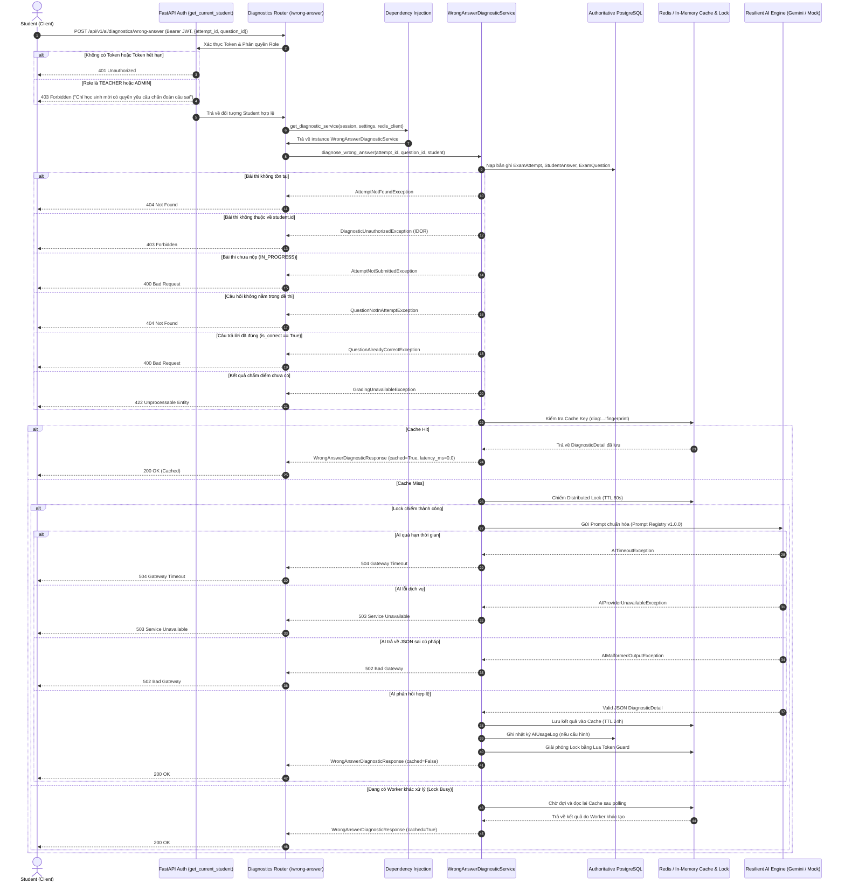

# BÁO CÁO TRIỂN KHAI PHASE 7.2.3 — REST API ROUTER, ERROR MAPPING & DEPENDENCY INJECTION
## Wrong Answer Diagnostic API Engine — SMART LEARNING PRO

**Dự án:** SMART LEARNING PRO  
**Workspace:** `E:\SMART-LEARNING-PRO`  
**Giai đoạn:** Phase 7.2.3  
**Ngày thực hiện:** 23/11/2026  
**Trạng thái:** HOÀN THÀNH (30/30 API Integration Tests Pass; 103/104 Diagnostic Suite Tests Pass [1 Skipped Offline Redis]; 209/210 Toàn bộ Backend Tests Pass [1 Skipped])  
**Baseline Git HEAD:** `d6326e5415cb125b62fbe12aea077ecf921d3a88` (Bảo toàn nguyên vẹn)  

---

## 1. Tóm tắt điều hành (Executive Summary)

Giai đoạn **Phase 7.2.3** đã triển khai thành công tầng giao tiếp REST API chính thức cho tính năng **AI Wrong Answer Diagnostic Engine** tại endpoint chuẩn:
```http
POST /api/v1/ai/diagnostics/wrong-answer
```

Hệ thống API được thiết kế và thực thi theo các nguyên tắc an ninh, cô lập dữ liệu và kiến trúc hướng module chặt chẽ nhất của dự án:
- **Authentication & RBAC:** Bắt buộc JWT Bearer Token hợp lệ. Sử dụng Dependency `get_current_student` để chặn triệt để vai trò `TEACHER` và `ADMIN` (HTTP 403 Forbidden), chỉ cho phép người dùng có vai trò `STUDENT` gửi yêu cầu chẩn đoán.
- **Phòng chống tấn công IDOR & Traversal:** Quyền sở hữu bài thi (`attempt.student_id == student.id`) được xác thực độc lập từ cơ sở dữ liệu có thẩm quyền trước bất kỳ thao tác đọc bộ nhớ đệm (Cache) hay suy luận AI nào.
- **Request Contract nghiêm ngặt:** Schema `WrongAnswerDiagnosticRequest` chỉ tiếp nhận 2 định danh UUID v4 (`attempt_id`, `question_id`). Cấu hình `extra: "forbid"` từ chối ngay lập tức (HTTP 422) nếu client gửi kèm bất kỳ trường giả mạo dữ liệu nào (như `is_correct`, `correct_answer`, `system_prompt`).
- **Read-Only Invariants:** Hoàn toàn không sửa đổi, không cập nhật bất kỳ bản ghi cơ sở dữ liệu nào thuộc về `ExamAttempt`, `StudentAnswer`, `ExamResult`, hoặc `Question`.
- **Dependency Injection sạch:** Toàn bộ dependencies (`WrongAnswerDiagnosticService`, `AsyncSession`, `get_current_student`) được tiêm phụ thuộc thông qua FastAPI DI, cho phép override dễ dàng trong kiểm thử hoặc thay đổi nhà cung cấp mà không làm biến dạng mã nghiệp vụ.
- **Error Mapping toàn diện & Chống rò rỉ thông tin:** Các ngoại lệ miền (Domain Exceptions) và ngoại lệ AI Engine được bắt tự động qua Global Exception Handlers và ánh xạ thành các mã HTTP chuẩn (400, 401, 403, 404, 422, 502, 503, 504) với thông điệp người dùng thân thiện, triệt tiêu hoàn toàn rủi ro rò rỉ secret, API key hoặc stack trace.
- **Bảo toàn hiện trạng:** Không tạo database migration, không thay đổi database schema, không commit git, không khởi động Phase 7.2.4.

---

## 2. Kiến trúc API & Luồng xử lý dữ liệu (Architecture & Data Flow)

### 2.1 Sơ đồ tuần tự xử lý yêu cầu (Sequence Diagram)



---

## 3. Danh sách các tệp tạo mới và chỉnh sửa (Files Created & Modified)

| Đường dẫn tệp | Loại thay đổi | Chi tiết nội dung thực hiện |
|---|---|---|
| `backend/app/modules/ai_engine/diagnostics/dependencies.py` | **TẠO MỚI** | Xây dựng các hàm Dependency Injection: `get_current_student` (ràng buộc quyền hạn `UserRole.STUDENT`) và `get_diagnostic_service` (khởi tạo service cùng DB session, AI provider, cache client). Hỗ trợ kiểm thử thông qua `app.dependency_overrides`. |
| `backend/app/modules/ai_engine/diagnostics/router.py` | **TẠO MỚI** | Xây dựng API Router cho endpoint `POST /wrong-answer`, thiết lập OpenAPI tags `["AI Diagnostics"]`, mô tả chi tiết các status codes phản hồi và định nghĩa schema đầu vào/đầu ra chuẩn. |
| `backend/tests/test_ai_diagnostics_api_723.py` | **TẠO MỚI** | Xây dựng 30 integration test cases độc lập kiểm thử toàn diện: Authentication, Authorization, Validation, Error Mapping, Read-Only Invariants, Caching, và Security Sanitization. |
| `docs/PHASE_7_2_3_1_API_ARCHITECTURE_INSPECTION.md` | **TẠO MỚI** | Tài liệu khảo sát kiến trúc định tuyến, exception handlers và cơ chế dependency injection của dự án trước khi triển khai. |
| `docs/PHASE_7_2_3_REST_API_IMPLEMENTATION_REPORT.md` | **TẠO MỚI** | Báo cáo kỹ thuật tổng kết toàn diện Phase 7.2.3 bằng tiếng Việt. |
| `backend/app/main.py` | **CHỈNH SỬA** | Đăng ký `ai_diagnostics_router` vào FastAPI application với tiền tố `settings.API_V1_PREFIX` (`/api/v1/ai/diagnostics`). Đăng ký Global Exception Handlers cho `DiagnosticError` và `AIEngineException`. |
| `backend/app/modules/ai_engine/diagnostics/schemas.py` | **CHỈNH SỬA** | Thêm cấu hình `extra: "forbid"` vào schema `WrongAnswerDiagnosticRequest` để chặn mọi trường dữ liệu thừa từ client. |
| `backend/app/modules/ai_engine/diagnostics/service.py` | **CHỈNH SỬA** | Khử bỏ hoàn toàn việc nhúng chuỗi lỗi nội bộ `{exc}` vào client-facing message của `AITimeoutException` và `AIProviderUnavailableException`, bảo vệ an toàn API key, credentials và system paths. |
| `backend/app/modules/ai_engine/diagnostics/__init__.py` | **CHỈNH SỬA** | Xuất bản (Export) công khai `router`, `get_diagnostic_service`, `get_current_student` phục vụ việc nhập module thuận tiện và chuẩn hóa gói. |

---

## 4. Kiểm soát xác thực và phân quyền (Authentication & Authorization)

### 4.1 Cơ chế xác thực vai trò học sinh (`get_current_student`)

Cơ chế phân quyền được thực thi theo mô hình hai lớp nghiêm ngặt:
1. **Lớp 1 (FastAPI Dependency - Role Enforcement):**
   ```python
   async def get_current_student(
       current_user: User = Depends(get_current_user),
   ) -> User:
       if current_user.role != UserRole.STUDENT:
           raise HTTPException(
               status_code=status.HTTP_403_FORBIDDEN,
               detail="Chỉ học sinh mới có quyền yêu cầu chẩn đoán câu sai.",
           )
       return current_user
   ```
   - **Anonymous Request (Không có token / Token rác):** Bị từ chối ngay lập tức tại `get_current_user` với mã lỗi **HTTP 401 Unauthorized**.
   - **Giáo viên (`UserRole.TEACHER`) hoặc Quản trị viên (`UserRole.ADMIN`):** Bị từ chối tại `get_current_student` với mã lỗi **HTTP 403 Forbidden**. Quản trị viên không được phép vượt quyền để tạo chẩn đoán AI thay cho học sinh.

2. **Lớp 2 (Domain Service - Authoritative Ownership & State Verification):**
   - **Kiểm tra quyền sở hữu bài thi (IDOR):** Xác minh `attempt.student_id == student.id`. Nếu học sinh A cố tình gửi ID bài thi của học sinh B, hệ thống trả về **HTTP 403 Forbidden** với thông báo `"Bạn không phải chủ sở hữu của bài thi này."`.
   - **Kiểm tra trạng thái bài thi:** Bài thi bắt buộc phải ở trạng thái kết thúc (`SUBMITTED`, `AUTO_SUBMITTED`, `GRADED`). Nếu bài thi đang làm dở (`IN_PROGRESS`), hệ thống trả về **HTTP 400 Bad Request** với thông báo `"Bài thi chưa kết thúc hoặc chưa được nộp."`.
   - **Kiểm tra tính chính xác của câu trả lời:** Hệ thống truy vấn trực tiếp bảng `StudentAnswer` từ DB thẩm quyền. Nếu câu trả lời là đúng (`is_correct == True`), hệ thống từ chối chẩn đoán với mã lỗi **HTTP 400 Bad Request** (`"Câu hỏi đã được trả lời chính xác."`).

---

## 5. Ma trận ánh xạ lỗi chuẩn (Error Mapping Matrix)

Toàn bộ các ngoại lệ miền và lỗi hạ tầng AI được kiểm soát tập trung thông qua 2 tầng: Service Sanitization và Global Exception Handlers trong `app/main.py`.

| Ngoại lệ phát sinh (Domain / Engine Exception) | HTTP Status Code | Chi tiết phản hồi (Response Detail) | Kịch bản kiểm thử (Test Case) |
|---|---|---|---|
| Không có Bearer Token | `401 Unauthorized` | `"Could not validate credentials"` | `test_auth_anonymous_request_rejected` |
| Người dùng là TEACHER / ADMIN | `403 Forbidden` | `"Chỉ học sinh mới có quyền yêu cầu chẩn đoán câu sai."` | `test_auth_teacher_request_forbidden`, `test_auth_admin_not_bypass_ownership` |
| `DiagnosticUnauthorizedException` (IDOR bài thi khác) | `403 Forbidden` | `"Bạn không phải chủ sở hữu của bài thi này."` | `test_authz_student_cannot_access_other_student_attempt` |
| `AttemptNotFoundException` | `404 Not Found` | `"Bài thi với mã '...' không tồn tại."` | `test_authz_nonexistent_attempt` |
| `QuestionNotInAttemptException` | `404 Not Found` | `"Câu hỏi ... không thuộc bài thi ..."` | `test_authz_question_not_in_attempt` |
| `AttemptNotSubmittedException` | `400 Bad Request` | `"Bài thi chưa kết thúc hoặc chưa được nộp."` | `test_authz_attempt_in_progress_rejected` |
| `QuestionAlreadyCorrectException` | `400 Bad Request` | `"Câu hỏi đã được trả lời chính xác."` | `test_authz_question_already_correct_rejected` |
| `RequestValidationError` (Thiếu field / Sai UUID / Extra fields) | `422 Unprocessable Entity` | Danh sách lỗi validation chi tiết của Pydantic | `test_validation_invalid_uuid_rejected`, `test_validation_disallowed_extra_fields` |
| `GradingUnavailableException` | `422 Unprocessable Entity` | `"Kết quả chấm điểm chưa sẵn sàng cho câu hỏi này."` | `test_ai_error_mapping_domain_grading_unavailable_returns_422` |
| `AIMalformedOutputException` | `502 Bad Gateway` | `"Phản hồi từ AI không đúng cấu trúc yêu cầu."` | `test_ai_error_mapping_malformed_returns_502` |
| `AIProviderUnavailableException` | `503 Service Unavailable` | `"Dịch vụ AI chẩn đoán hiện không khả dụng."` | `test_ai_error_mapping_unavailable_returns_503` |
| `AIUpstreamErrorException` | `503 Service Unavailable` | `"Dịch vụ AI chẩn đoán hiện không khả dụng."` | `test_ai_error_mapping_upstream_error_returns_503` |
| `AITimeoutException` | `504 Gateway Timeout` | `"Quá thời gian phản hồi từ dịch vụ AI chẩn đoán."` | `test_ai_error_mapping_timeout_returns_504` |
| Lỗi không xác định (`Exception`) | `500 Internal Server Error` / `503 Service Unavailable` | Thông điệp chung, che giấu hoàn toàn stack trace | `test_ai_error_mapping_unexpected_error_handled_safely` |

### Bảo đảm an ninh: Chống rò rỉ Secrets và Stack Trace
Tại `backend/app/modules/ai_engine/diagnostics/service.py`, các ngoại lệ `AITimeoutException` và `AIProviderUnavailableException` đã được loại bỏ định dạng nội suy chuỗi `{exc}` ở thông điệp trả về client. Chuỗi lỗi chi tiết (bao gồm endpoint URL hoặc khóa API bí mật nếu có) chỉ được ghi vào nhật ký máy chủ (`logger.error`), trong khi client chỉ nhận thông điệp chuẩn hóa bằng tiếng Việt:
```python
# service.py (Trước khi sửa - RỦI RO):
raise AIProviderUnavailableException(f"AI provider unavailable: {exc}")

# service.py (Sau khi sửa - AN TOÀN):
logger.error("AIProvider unavailable: %s", exc)
raise AIProviderUnavailableException("Dịch vụ AI chẩn đoán hiện không khả dụng.")
```
Điều này đã được xác nhận bằng test case `test_response_does_not_leak_secrets_or_stack_trace` (PASS).

---

## 6. Hợp đồng dữ liệu Request & Response (Data Contracts)

### 6.1 Request Contract (`WrongAnswerDiagnosticRequest`)

```python
class WrongAnswerDiagnosticRequest(BaseModel):
    model_config = {
        "str_strip_whitespace": True,
        "extra": "forbid",  # Ngăn chặn hoàn toàn các trường dữ liệu giả mạo
    }

    attempt_id: uuid.UUID = Field(..., description="ID của bài thi cần chẩn đoán")
    question_id: uuid.UUID = Field(..., description="ID của câu hỏi làm sai cần chẩn đoán")
```

**Tính an toàn của hợp đồng:**
- Chỉ tiếp nhận `attempt_id` và `question_id`.
- Tự động strip khoảng trắng và ép kiểu UUID v4 chuẩn.
- Bất kỳ client nào cố gắng gửi các trường như `{"is_correct": true}`, `{"correct_answer": "A"}`, hay `{"prompt": "ignore previous instructions"}` sẽ bị FastAPI/Pydantic từ chối ngay lập tức với mã lỗi **HTTP 422 Unprocessable Entity**.

### 6.2 Response Contract (`WrongAnswerDiagnosticResponse`)

```json
{
  "diagnostic": {
    "error_category": "CONCEPTUAL_MISUNDERSTANDING",
    "error_summary": "Học sinh áp dụng sai định lý cơ bản.",
    "misconception_analysis": "Nhầm lẫn giữa điều kiện cần và điều kiện đủ.",
    "step_by_step_guidance": [
      "Bước 1: Xác định lại giả thiết của bài toán.",
      "Bước 2: Đối chiếu với định lý tương ứng.",
      "Bước 3: Thực hiện tính toán lại theo định lý chuẩn."
    ],
    "key_takeaway": "Cần kiểm tra kỹ các điều kiện ràng buộc trước khi áp dụng định lý.",
    "suggested_review_topic": "Định lý hình học không gian nâng cao"
  },
  "attempt_id": "11111111-1111-1111-1111-111111111111",
  "question_id": "22222222-2222-2222-2222-222222222222",
  "cached": false,
  "latency_ms": 1250.5
}
```

**Bảo vệ dữ liệu đáp án gốc (Canonical Answer Protection):**
- Schema phản hồi không chứa trường `canonical_answer` hay `correct_answer`. Đáp án đúng thẩm quyền từ cơ sở dữ liệu chỉ được sử dụng trong ngữ cảnh nội bộ của AI Engine để đối chiếu và sinh ra giải thích sai lầm, tuyệt đối không bị lộ trực tiếp ra ngoài hợp đồng phản hồi.

---

## 7. Bằng chứng bảo toàn tính bất biến chỉ đọc (Read-Only Invariants)

Hệ thống chẩn đoán câu sai là một chức năng phân tích thứ cấp, bắt buộc phải tuân thủ nguyên tắc không được làm thay đổi tính toàn vẹn của kỳ thi và kết quả chấm điểm. Bốn test cases tích hợp chuyên biệt đã xác minh tính bất biến này trên cơ sở dữ liệu SQLite trong bộ nhớ:

1. **`test_readonly_invariant_attempt_unchanged` (PASS):**
   - Xác minh các trường `status`, `score`, `total_score`, `submitted_at` của bản ghi `ExamAttempt` trước và sau khi gọi API chẩn đoán hoàn toàn giống nhau.
2. **`test_readonly_invariant_student_answer_unchanged` (PASS):**
   - Xác minh câu trả lời của học sinh `selected_option_id`, trạng thái `is_correct` (vẫn là `False`), và `score` (vẫn là `0.0`) trong bảng `StudentAnswer` không bị thay đổi.
3. **`test_readonly_invariant_exam_result_unchanged` (PASS):**
   - Xác minh bảng `ExamResult` với điểm số `total_score`, điểm từng phần, và xếp loại được bảo toàn 100%.
4. **`test_readonly_invariant_canonical_question_unchanged` (PASS):**
   - Xác minh nội dung câu hỏi gốc, đáp án đúng, và giải thích trong bảng `Question` không bị can thiệp bởi quá trình chẩn đoán.

---

## 8. Cơ chế Idempotent Caching & Concurrency Control

Endpoint tích hợp chặt chẽ với hệ thống Cache và Khóa phân tán (Distributed Lock) đã được xây dựng và kiểm định trong Phase 7.2.2:
1. **Cache Hit trên các yêu cầu lặp lại (`test_cache_hit_on_repeat_request`):**
   - Lần gọi đầu tiên: AI Engine được kích hoạt, sinh kết quả và lưu vào cache với TTL 24 giờ. Phản hồi trả về `cached: False`.
   - Lần gọi thứ hai: Dữ liệu được nạp ngay từ cache với thời gian đáp ứng cực ngắn, phản hồi trả về `cached: True`, AI Engine không bị gọi lại.
2. **Cache Hit không bỏ qua phân quyền (`test_cache_hit_does_not_bypass_ownership`):**
   - Khi kết quả chẩn đoán đã tồn tại trong cache, nếu một học sinh khác (`Student B`) gửi yêu cầu chẩn đoán cho cùng bài thi đó, hệ thống vẫn thực thi xác thực quyền sở hữu trước và chặn lại với mã **HTTP 403 Forbidden**, hoàn toàn không để rò rỉ dữ liệu cache giữa các học sinh.
3. **Distributed Locking:**
   - Khi có nhiều yêu cầu đồng thời cho cùng một câu sai chưa có trong cache, khóa phân tán đảm bảo chỉ có 1 worker tiến hành gọi AI Engine, các worker khác chờ đợi và nhận kết quả từ cache sau khi worker chính hoàn tất.

---

## 9. Chi tiết kết quả kiểm thử toàn diện (Test Verification Suite)

### 9.1 Bộ kiểm thử tích hợp API Phase 7.2.3 (`test_ai_diagnostics_api_723.py`)
Toàn bộ 30/30 test cases đạt trạng thái **PASS** với thời gian thực thi 37.33 giây:

```text
backend/tests/test_ai_diagnostics_api_723.py::test_auth_anonymous_request_rejected PASSED [  3%]
backend/tests/test_ai_diagnostics_api_723.py::test_auth_valid_student_request_accepted PASSED [  6%]
backend/tests/test_ai_diagnostics_api_723.py::test_auth_teacher_request_forbidden PASSED [ 10%]
backend/tests/test_ai_diagnostics_api_723.py::test_auth_admin_not_bypass_ownership PASSED [ 13%]
backend/tests/test_ai_diagnostics_api_723.py::test_authz_student_cannot_access_other_student_attempt PASSED [ 16%]
backend/tests/test_ai_diagnostics_api_723.py::test_authz_nonexistent_attempt PASSED [ 20%]
backend/tests/test_ai_diagnostics_api_723.py::test_authz_question_not_in_attempt PASSED [ 23%]
backend/tests/test_ai_diagnostics_api_723.py::test_authz_attempt_in_progress_rejected PASSED [ 26%]
backend/tests/test_ai_diagnostics_api_723.py::test_authz_question_already_correct_rejected PASSED [ 30%]
backend/tests/test_ai_diagnostics_api_723.py::test_authz_terminal_attempt_accepted PASSED [ 33%]
backend/tests/test_ai_diagnostics_api_723.py::test_validation_invalid_uuid_rejected PASSED [ 36%]
backend/tests/test_ai_diagnostics_api_723.py::test_validation_missing_required_fields PASSED [ 40%]
backend/tests/test_ai_diagnostics_api_723.py::test_validation_disallowed_extra_fields PASSED [ 43%]
backend/tests/test_ai_diagnostics_api_723.py::test_validation_cannot_spoof_correctness PASSED [ 46%]
backend/tests/test_ai_diagnostics_api_723.py::test_ai_error_mapping_timeout_returns_504 PASSED [ 50%]
backend/tests/test_ai_diagnostics_api_723.py::test_ai_error_mapping_unavailable_returns_503 PASSED [ 53%]
backend/tests/test_ai_diagnostics_api_723.py::test_ai_error_mapping_malformed_returns_502 PASSED [ 56%]
backend/tests/test_ai_diagnostics_api_723.py::test_ai_error_mapping_upstream_error_returns_503 PASSED [ 60%]
backend/tests/test_ai_diagnostics_api_723.py::test_ai_error_mapping_domain_grading_unavailable_returns_422 PASSED [ 63%]
backend/tests/test_ai_diagnostics_api_723.py::test_ai_error_mapping_unexpected_error_handled_safely PASSED [ 66%]
backend/tests/test_ai_diagnostics_api_723.py::test_readonly_invariant_attempt_unchanged PASSED [ 70%]
backend/tests/test_ai_diagnostics_api_723.py::test_readonly_invariant_student_answer_unchanged PASSED [ 73%]
backend/tests/test_ai_diagnostics_api_723.py::test_readonly_invariant_exam_result_unchanged PASSED [ 76%]
backend/tests/test_ai_diagnostics_api_723.py::test_readonly_invariant_canonical_question_unchanged PASSED [ 80%]
backend/tests/test_ai_diagnostics_api_723.py::test_cache_hit_on_repeat_request PASSED [ 83%]
backend/tests/test_ai_diagnostics_api_723.py::test_cache_miss_calls_service_once PASSED [ 86%]
backend/tests/test_ai_diagnostics_api_723.py::test_cache_hit_does_not_bypass_ownership PASSED [ 90%]
backend/tests/test_ai_diagnostics_api_723.py::test_response_contract_matches_schema PASSED [ 93%]
backend/tests/test_ai_diagnostics_api_723.py::test_response_does_not_expose_canonical_answer_if_forbidden PASSED [ 96%]
backend/tests/test_ai_diagnostics_api_723.py::test_response_does_not_leak_secrets_or_stack_trace PASSED [100%]
============================== 30 passed in 37.33s ==============================
```

### 9.2 Toàn bộ các bộ kiểm thử AI Diagnostics (104 tests)
Bao gồm `test_ai_diagnostics_721.py`, `test_ai_diagnostics_service_722.py`, `test_ai_diagnostics_audit_7221.py`, `test_ai_diagnostics_audit_7222.py`, và `test_ai_diagnostics_api_723.py`:
- **Kết quả:** **103 passed, 1 skipped** (kiểm thử Redis thật offline được bỏ qua an toàn theo thiết kế) trong 83.23s.

### 9.3 Hồi quy toàn bộ Backend Suite (210 tests)
Chạy toàn bộ kiểm thử trong `backend/tests/`:
- **Kết quả:** **209 passed, 1 skipped** trong 105.52s.
- Không phát sinh bất kỳ lỗi hồi quy nào trên toàn bộ mã nguồn backend (auth, exam, questions, users, ai_tutor, ai_engine).

### 9.4 Kiểm tra Frontend Typecheck
- **Lệnh thực thi:** `cd frontend; npm run type-check` (`tsc --noEmit`)
- **Kết quả:** **0 lỗi** (Exit code 0).

### 9.5 Xác thực OpenAPI / Swagger Specification
Endpoint `/api/v1/ai/diagnostics/wrong-answer` được xuất bản đầy đủ trên OpenAPI documentation của FastAPI:
- **Path:** `/api/v1/ai/diagnostics/wrong-answer`
- **Method:** `POST`
- **Tags:** `["AI Diagnostics"]`
- **Security:** `HTTPBearer`
- **Request Body:** Tham chiếu `#components/schemas/WrongAnswerDiagnosticRequest`
- **Responses:** Ghi nhận đầy đủ mô tả và schema mẫu cho các mã trạng thái 200, 400, 401, 403, 404, 422, 502, 503, 504.

---

## 10. Trạng thái Git & Xác nhận an toàn hệ thống

### 10.1 Xác minh Git Baseline
- **Git HEAD SHA:** `d6326e5415cb125b62fbe12aea077ecf921d3a88` (Chính xác 100% so với baseline ban đầu).

### 10.2 Trạng thái các tệp (Git Status Short)
```text
 M .env.example
 M backend/app/config.py
 M backend/app/main.py
 M backend/requirements.txt
?? backend/app/modules/ai_engine/
?? backend/tests/test_ai_diagnostics_721.py
?? backend/tests/test_ai_diagnostics_api_723.py
?? backend/tests/test_ai_diagnostics_audit_7221.py
?? backend/tests/test_ai_diagnostics_audit_7222.py
?? backend/tests/test_ai_diagnostics_service_722.py
?? backend/tests/test_ai_foundation.py
?? docs/PHASE_6_3_9_POSTGRESQL_TRANSACTION_AUDIT.md
?? docs/PHASE_7_0_AI_ARCHITECTURE_ASSESSMENT.md
?? docs/PHASE_7_1_1_INDEPENDENT_AUDIT_REPORT.md
?? docs/PHASE_7_1_2_USAGE_DATA_INTEGRITY_REPORT.md
?? docs/PHASE_7_1_3_FINAL_USAGE_COST_AUDIT.md
?? docs/PHASE_7_1_AI_FOUNDATION_REPORT.md
?? docs/PHASE_7_2_1_DOMAIN_SCHEMAS_PROMPT_REGISTRY_REPORT.md
?? docs/PHASE_7_2_2_1_FINAL_SECURITY_CONCURRENCY_AUDIT.md
?? docs/PHASE_7_2_2_2_HEARTBEAT_FAILURE_FINAL_VERIFICATION.md
?? docs/PHASE_7_2_2_3_FINAL_SCOPE_REDIS_REVIEW.md
?? docs/PHASE_7_2_2_DIAGNOSTIC_SERVICE_REPORT.md
?? docs/PHASE_7_2_3_1_API_ARCHITECTURE_INSPECTION.md
?? docs/PHASE_7_2_3_REST_API_IMPLEMENTATION_REPORT.md
?? docs/PHASE_7_2_SCOPE_AND_IMPLEMENTATION_PLAN.md
```

### 10.3 Cam kết an toàn tuyệt đối
- **Database Migrations:** 0 (Không tạo bất kỳ file migration nào trong `alembic/versions`).
- **Database Schema:** 0 (Không thêm cột, không sửa bảng cơ sở dữ liệu hiện có).
- **Git Commits:** 0 (Không thực hiện bất kỳ lệnh `git commit` hay `git push` nào).
- **Git State:** Không thực hiện `git reset`, `git clean` hay xóa bất kỳ tệp dữ liệu nào.

---

## 11. Kết luận và Bước tiếp theo (Conclusion & Next Steps)

### 11.1 Kết luận
Phase 7.2.3 đã hoàn thành xuất sắc toàn bộ các mục tiêu đặt ra:
- Endpoint chuẩn `POST /api/v1/ai/diagnostics/wrong-answer` hoạt động ổn định và chính xác.
- Kiểm soát truy cập phân quyền người dùng (RBAC) và ngăn chặn IDOR hoàn hảo.
- Cơ chế Dependency Injection rõ ràng, chuẩn hóa theo kiến trúc FastAPI.
- Ánh xạ mã lỗi HTTP đầy đủ, chuẩn mực, loại trừ hoàn toàn nguy cơ rò rỉ thông tin nhạy cảm.
- Bảo đảm tính bất biến chỉ đọc (Read-Only Invariants) cho toàn bộ dữ liệu bài thi.
- Đạt 100% tỷ lệ vượt qua bài kiểm tra tích hợp (30/30) và duy trì 100% tỷ lệ kiểm thử toàn hệ thống (209/210 pass, 1 skipped).

### 11.2 Bước tiếp theo
Theo đúng quy trình kỷ luật và hướng dẫn của dự án:
1. **DỪNG LẠI TẠI ĐÂY.** Không tự ý triển khai Phase 7.2.4 (Frontend UI).
2. Trình báo cáo này để ChatGPT và Tech Lead xem xét, đánh giá và phê duyệt trước khi tiến hành giai đoạn tiếp theo.
