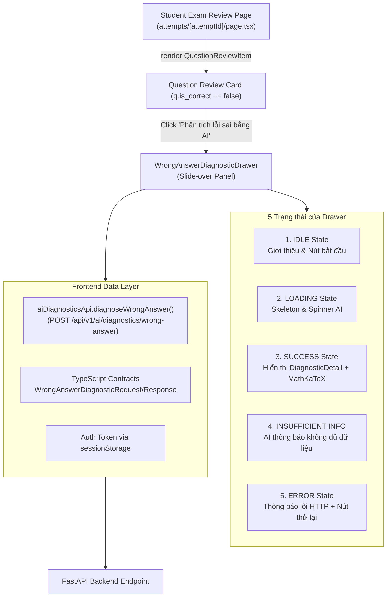

# BÁO CÁO KHẢO SÁT KIẾN TRÚC FRONTEND — PHASE 7.2.4.1
## Khảo sát Frontend Architecture phục vụ Wrong Answer Diagnostic UI

**Dự án:** SMART LEARNING PRO  
**Workspace:** `E:\SMART-LEARNING-PRO`  
**Giai đoạn:** Phase 7.2.4.1 — Frontend Architecture Inspection  
**Ngày thực hiện:** 23/11/2026  
**Trạng thái:** HOÀN THÀNH KHẢO SÁT (Chờ phê duyệt trước khi lập trình)  
**Baseline Git HEAD:** `d6326e5415cb125b62fbe12aea077ecf921d3a88` (Được bảo toàn nguyên vẹn)  

---

## 1. Mục tiêu và phạm vi khảo sát

Trước khi tiến hành xây dựng giao diện AI giải thích câu trả lời sai cho học sinh tại endpoint:
```http
POST /api/v1/ai/diagnostics/wrong-answer
```
Tài liệu này ghi nhận kết quả khảo sát chi tiết 10 nội dung kiến trúc frontend cốt lõi của ứng dụng `frontend/`, nhằm đảm bảo việc tích hợp:
- Tuân thủ chính xác quy ước thiết kế, cấu trúc thư mục và quản lý trạng thái của dự án.
- Tận dụng tối đa các thành phần và thư viện có sẵn (Tailwind CSS, KaTeX, TanStack Query, Lucide icons).
- Bảo đảm an toàn tuyệt đối cho bài thi (không làm gián đoạn hay biến dạng dữ liệu xem lại bài thi).
- Ngăn chặn triệt để lỗ hổng XSS khi render công thức toán và nội dung sinh bởi AI.

---

## 2. Kết quả khảo sát 10 nội dung kiến trúc Frontend

### 2.1 Cấu trúc Next.js App Router
- **Phiên bản:** Next.js `16.4.6` (App Router), React `19.3.0`, TypeScript `^5`, Tailwind CSS `4.3.3`.
- **Cấu trúc tuyến đường (Routing structure):**
  - `frontend/src/app/layout.tsx`: Root Layout cấu hình thẻ `html lang="vi"`, nạp `globals.css` và bọc toàn bộ ứng dụng trong `Providers`.
  - `frontend/src/app/(auth)/`: Nhóm tuyến đường xác thực (`/login`, `/register`).
  - `frontend/src/app/student/`: Khu vực học sinh, bảo vệ bởi `StudentLayout` (`layout.tsx`), kiểm tra vai trò `STUDENT`.
  - Tuyến đường mục tiêu: `frontend/src/app/student/exams/attempts/[attemptId]/page.tsx` — trang làm bài và xem lại bài thi của học sinh.

### 2.2 Trang xem lại bài thi của Học sinh (Student Exam Review Page)
- **Tệp nguồn:** `frontend/src/app/student/exams/attempts/[attemptId]/page.tsx`.
- **Component chính:** `StudentExamAttemptPage({ params }: PageProps)`.
- **Cơ chế phân tách trạng thái (State Separation):**
  - Trang xử lý hai chế độ rõ rệt dựa trên `attempt.status`:
    1. **Active Examination Mode (`IN_PROGRESS`):** Hiển thị câu hỏi làm bài theo thời gian thực, đồng hồ đếm ngược, lưu tự động (autosave), modal nộp bài.
    2. **Graded / Submitted Result & Review State (`submitResult` hoặc `attempt.status !== "IN_PROGRESS"`):**
       - Bắt đầu tại dòng 525 của `page.tsx`.
       - Hiển thị Result Header Banner với điểm số, độ chính xác, số câu đúng/sai/bỏ qua, và nhận xét tổng quan (`feedback_summary`).
       - Nếu `reviewAllowed && reviews.length > 0`, hiển thị danh sách chi tiết các câu hỏi (`reviews.map((q, idx) => ...)`).
- **Điểm gắn giao diện AI Diagnostic (Integration Anchor):**
  - Giao diện chẩn đoán câu sai AI sẽ được tích hợp trực tiếp vào từng Card câu hỏi trong danh sách `reviews` ở chế độ Review, **chỉ hiển thị khi `q.is_correct === false`**.

### 2.3 Component hiển thị từng câu hỏi và đáp án
- Trong khối xem lại câu hỏi (dòng 657-720):
  ```tsx
  {reviews.map((q, idx) => (
    <Card key={q.question_id || idx} className={`border shadow-2xs ${q.is_correct ? "border-emerald-200" : "border-rose-200"}`}>
      <CardHeader className="pb-2">
        <div className="flex items-center justify-between mb-1">
          <span className="text-xs font-semibold text-slate-500">Câu {idx + 1}</span>
          <div className="flex items-center gap-2">
            {q.is_correct ? (
              <Badge variant="success">✓ Đúng (+{q.points_awarded} đ)</Badge>
            ) : (
              <Badge variant="destructive">✕ Sai (0 đ / {q.max_points} đ)</Badge>
            )}
          </div>
        </div>
        <div className="text-sm font-medium text-slate-900 pt-1">
          <MathKaTeX math={q.content} />
        </div>
      </CardHeader>
      <CardContent className="pt-2 space-y-3">
        {/* Câu trả lời của học sinh */}
        {/* Đáp án chuẩn */}
        {/* Lời giải chi tiết từ đề thi */}
        {/* VỊ TRÍ TÍCH HỢP NÚT PHÂN TÍCH LỖI SAI BẰNG AI */}
      </CardContent>
    </Card>
  ))}
  ```
- Dữ liệu `q` thuộc kiểu `QuestionReviewItem` trong `frontend/src/types/index.ts`:
  - `question_id`: UUID của câu hỏi.
  - `is_correct`: boolean (`true` là đúng, `false` là sai).
  - `content`: Nội dung câu hỏi (chứa công thức LaTeX).
  - `student_answer_text`: Câu trả lời của học sinh.
  - `correct_answer_texts` / `correct_option_keys`: Đáp án đúng của đề bài.
  - `explanation`: Lời giải mẫu từ đề thi.

### 2.4 Cơ chế API Client & Authentication
- **Tệp nguồn:** `frontend/src/lib/api/client.ts`.
- **Cấu hình Base URL:** `process.env.NEXT_PUBLIC_API_URL || "http://localhost:8000/api/v1"`.
- **Cơ chế lưu trữ Token:**
  - Token được lưu và đọc từ `sessionStorage` thông qua `getAuthToken()`:
    ```typescript
    sessionStorage.getItem("smart_learning_session_token");
    ```
  - **Lưu ý quan trọng:** Dự án **KHÔNG** sử dụng `localStorage`. Tuân thủ đúng yêu cầu bảo mật: không lưu token vào `localStorage`.
- **Gắn Header tự động:**
  - `request()` tự động gắn `Authorization: Bearer ${token}` khi token tồn tại.
- **Xử lý lỗi tập trung (`ApiClientError`):**
  - Khi `!response.ok`, client bóc tách trường `detail` từ JSON phản hồi (hỗ trợ cả string lẫn mảng lỗi Pydantic) và ném ngoại lệ `ApiClientError(response.status, errorMessage, data)`.
  - Giúp frontend dễ dàng nhận diện mã HTTP status (`error.status: 400, 403, 404, 422, 502, 503, 504`) và thông báo tiếng Việt nguyên gốc từ backend.

### 2.5 Cấu hình TanStack Query
- **Phiên bản:** `@tanstack/react-query: ^5.108.0`.
- **Tệp nguồn:** `frontend/src/lib/providers.tsx`.
- **Thiết lập mặc định:**
  - `staleTime: 60 * 1000` (1 phút).
  - `refetchOnWindowFocus: false`.
  - `retry: 1`.
- **Chiến lược cho AI Diagnostic UI:**
  - Sử dụng TanStack Query hook `useMutation` (hoặc `useQuery` với query key định danh duy nhất `["ai-diagnostic", attemptId, questionId]`):
    - Đặt `retry: false` đối với các lỗi 400, 403, 404, 422 (lỗi nghiệp vụ / phân quyền không thể tự phục hồi bằng retry).
    - Chỉ cho phép người dùng bấm "Thử lại" thủ công khi gặp lỗi hạ tầng (502, 503, 504).
    - Cache kết quả ngay tại client để tránh gọi lại API khi học sinh mở lại Drawer cho cùng một câu hỏi trong cùng phiên làm việc.

### 2.6 Cơ chế Error Handling hiện tại
- Backend trả về cấu trúc lỗi chuẩn FastAPI: `{"detail": "..."}`.
- `ApiClientError` tự động trích xuất `detail` đưa vào `error.message`.
- Mã lỗi được phân loại cụ thể cho tính năng Diagnostic:
  - `400`: Bài thi chưa nộp hoặc câu hỏi đã đúng.
  - `401`: Hết hạn phiên đăng nhập.
  - `403`: Không có quyền truy cập bài thi (học sinh khác hoặc tài khoản giáo viên/admin).
  - `404`: Không tìm thấy bài thi hoặc câu hỏi.
  - `422`: Lỗi dữ liệu hoặc chưa có kết quả chấm điểm.
  - `502`: AI trả về định dạng JSON không hợp lệ.
  - `503`: Dịch vụ AI hiện không khả dụng / quá tải.
  - `504`: Quá thời gian phản hồi từ AI.

### 2.7 Thư viện UI Components sẵn có (Design System)
- Các components sẵn có trong `frontend/src/components/ui/`:
  - `button.tsx`: Hỗ trợ đầy đủ các biến thể (`default`, `destructive`, `outline`, `secondary`, `ghost`, `link`, `success`, `purple`), kích cỡ (`default`, `sm`, `lg`, `icon`), hiệu ứng hover/focus rõ ràng.
  - `badge.tsx`: Hỗ trợ biến thể màu sắc phong phú (`default`, `secondary`, `destructive`, `outline`, `success`, `warning`, `purple`).
  - `card.tsx`: Cung cấp `Card`, `CardHeader`, `CardTitle`, `CardDescription`, `CardContent`, `CardFooter`.
  - `dialog.tsx`: Modal pop-up sử dụng React tiêu chuẩn, xử lý đóng khi bấm Escape và backdrop click, khóa scroll body an toàn.
  - `input.tsx`: Input field tiêu chuẩn.
  - `skeleton.tsx`: Hiệu ứng placeholder khi đang tải.
- **Nhận định về Drawer / Sheet:**
  - Dự án hiện chưa cài đặt `@radix-ui/react-dialog` hoặc thư viện drawer ngoài như `vaul`.
  - Để đảm bảo tính nhất quán và không phát sinh thêm bundle dependency nặng, component `WrongAnswerDiagnosticDrawer` sẽ được xây dựng theo mô hình **Slide-over Drawer thuần Tailwind CSS** (tương tự như `dialog.tsx`), có backdrop mờ, trượt mượt mà từ cạnh phải màn hình trên Desktop và trượt từ dưới lên (Bottom Sheet) hoặc toàn màn hình trên Mobile.

### 2.8 Cấu hình KaTeX & Cách render công thức toán
- **Thư viện:** `katex: ^0.19.1` và `@types/katex: ^0.16.8`.
- **CSS:** Đã được nạp toàn cục tại `frontend/src/app/globals.css`:
  ```css
  @import "tailwindcss";
  @import "katex/dist/katex.min.css";
  ```
- **Component sẵn có:** `MathKaTeX` tại `frontend/src/components/shared/math-katex.tsx`.
- **Đánh giá an toàn và tính năng của `MathKaTeX`:**
  - Phân tách văn bản thông minh bằng regex `(\$\$[\s\S]*?\$\$|\$[^\$\n\r]+?\$)`.
  - **Inline Math (`$formula$`):** Render bằng `katex.renderToString(formula, { displayMode: false, throwOnError: false })`.
  - **Block/Display Math (`$$formula$$`):** Render bằng `katex.renderToString(formula, { displayMode: true, throwOnError: false })`.
  - **Chống XSS tuyệt đối:** Tất cả các phần văn bản không phải công thức toán đều được lọc qua hàm `escapeHtml(token)`, thay thế các ký tự nguy hiểm `&`, `<`, `>`, `"`, `'`.
  - **Xử lý lỗi an toàn:** Khi công thức toán bị lỗi cú pháp, KaTeX không làm sập ứng dụng (`throwOnError: false`), mà trả về chuỗi fallback đã được `escapeHtml`.
  - **Kết luận:** `MathKaTeX` hoàn toàn đáp ứng đầy đủ yêu cầu của Phase 7.2.4.4 để hiển thị công thức toán trong `error_summary`, `misconception_analysis`, `step_by_step_guidance`, và `key_takeaway`.

### 2.9 Responsive Layout
- Sử dụng tiện ích Mobile-first của Tailwind CSS:
  - Mobile (< 640px): Màn hình nhỏ, giao diện câu hỏi xếp dọc, thanh công cụ thu gọn. Drawer hiển thị toàn màn hình hoặc dạng Bottom Sheet với chiều cao 90vh, nút đóng lớn dễ chạm.
  - Tablet / Desktop (>= 640px): Bố cục bài thi rộng tối đa `max-w-4xl mx-auto`. Drawer xuất hiện dưới dạng Slide-over Panel bên phải (`w-full sm:max-w-lg md:max-w-xl fixed inset-y-0 right-0 z-50`).

### 2.10 Design Tokens & UI Conventions
- **Bảng màu chủ đạo:**
  - Primary: Indigo (`#4f46e5`, `indigo-600`, hover: `indigo-700`).
  - Nền & Thẻ: Slate 50 (`#f8fafc`), Slate 900 (`#0f172a`), Card trắng (`#ffffff`), Border Slate 200/80 (`#e2e8f0`).
  - Trạng thái thành công: Emerald (`emerald-50`, `emerald-600`, `emerald-700`).
  - Trạng thái lỗi / Sai: Rose / Red (`rose-50`, `rose-200`, `rose-600`).
  - Trạng thái cảnh báo / Cần lưu ý: Amber (`amber-50`, `amber-500`, `amber-600`).
  - Điểm nhấn AI: Tím / Indigo kết hợp Sparkles / Bot icon (`lucide-react`).
- **Phong cách giáo dục:**
  - Ngôn ngữ giao diện: 100% Tiếng Việt thân thiện, mô phạm, phù hợp đối tượng học sinh THCS/THPT.
  - Trình bày thông tin theo bậc thang nhận thức rõ ràng:
    1. Nhãn phân loại lỗi (`error_category`).
    2. Tóm tắt nguyên nhân sai lầm (`error_summary`).
    3. Phân tích quan niệm sai lệch (`misconception_analysis`).
    4. Hướng dẫn tư duy từng bước (`step_by_step_guidance`).
    5. Bài học cốt lõi cần nhớ (`key_takeaway`).
    6. Đề xuất chủ đề ôn tập (`suggested_review_topic`).
  - Không xây dựng chatbot tự do; tập trung vào trải nghiệm đọc hiểu, tự sửa lỗi và củng cố kiến thức.

---

## 3. Kiến trúc Đề xuất cho Phase 7.2.4



---

## 4. Kế hoạch triển khai các bước tiếp theo (Phase 7.2.4.2 -> 7.2.4.5)

### 4.1 Phase 7.2.4.2 — API Client & Type Contracts
1. Khai báo TypeScript types chuẩn trong `frontend/src/types/index.ts` (hoặc `ai-diagnostics.ts`):
   - `ErrorCategory` (Enum 6 giá trị).
   - `WrongAnswerDiagnosticRequest` (`attempt_id`, `question_id`).
   - `DiagnosticDetail` (`error_category`, `error_summary`, `misconception_analysis`, `step_by_step_guidance`, `key_takeaway`, `suggested_review_topic`).
   - `WrongAnswerDiagnosticResponse` (`diagnostic`, `attempt_id`, `question_id`, `cached`, `latency_ms`).
2. Xây dựng `frontend/src/lib/api/ai-diagnostics.ts` với hàm `diagnoseWrongAnswer({ attempt_id, question_id })`.
3. Tích hợp `ApiClientError` để bóc tách mã lỗi HTTP (400, 403, 404, 422, 502, 503, 504).

### 4.2 Phase 7.2.4.3 — Wrong Answer Diagnostic Drawer
1. Xây dựng component `frontend/src/components/shared/wrong-answer-diagnostic-drawer.tsx`:
   - Quản lý đầy đủ 5 trạng thái: `IDLE`, `LOADING`, `SUCCESS`, `INSUFFICIENT_INFORMATION`, `ERROR`.
   - Có cơ chế chặn duplicate in-flight requests.
   - Nút "Thử lại" cho các lỗi mạng / timeout (502, 503, 504).
2. Tích hợp nút kích hoạt vào `frontend/src/app/student/exams/attempts/[attemptId]/page.tsx`:
   - Nút "Phân tích lỗi sai bằng AI" với icon `Sparkles`.
   - Điều kiện hiển thị nghiêm ngặt: `attempt.status !== "IN_PROGRESS" && !q.is_correct`.

### 4.3 Phase 7.2.4.4 — KaTeX & Educational UX
1. Áp dụng component `MathKaTeX` cho tất cả các trường văn bản trả về từ AI:
   - `error_summary`
   - `misconception_analysis`
   - `step_by_step_guidance` (hỗ trợ hiển thị dạng danh sách đánh số hoặc khối văn bản có công thức toán)
   - `key_takeaway`
2. Bảo đảm không sử dụng `dangerouslySetInnerHTML` với dữ liệu thô chưa qua lọc; tận dụng cơ chế `escapeHtml` sẵn có của `MathKaTeX`.
3. Bố cục trực quan với các màu sắc phân cấp rõ rệt: Badge nhận diện lỗi, khung hướng dẫn, khung bài học ghi nhớ.

### 4.4 Phase 7.2.4.5 — Testing & Verification
1. Viết test Playwright E2E / Component Test kiểm thử giao diện:
   - Hiển thị nút phân tích cho câu sai; không hiển thị cho câu đúng.
   - Thao tác mở/đóng Drawer.
   - Trạng thái Loading và hiển thị kết quả chẩn đoán thành công.
   - Xử lý trạng thái lỗi và thử lại.
2. Kiểm tra `npm run type-check` (`tsc --noEmit`) đạt 0 lỗi.

---

## 5. Kết luận và Dừng để xem xét (Stop & Review)

- **Kết luận:** Quá trình khảo sát kiến trúc Phase 7.2.4.1 đã hoàn thành đầy đủ, xác định rõ ràng các điểm tích hợp, cơ chế an toàn dữ liệu, giải pháp KaTeX và thiết kế Drawer tương thích hoàn toàn với nền tảng hiện tại.
- **Tuân thủ quy trình làm việc:** Theo đúng chỉ thị tại mục 10 của yêu cầu:
  > *"Bắt đầu bằng Phase 7.2.4.1. Sau khi khảo sát kiến trúc, tạo báo cáo inspection và dừng để review. Không tự động triển khai toàn bộ 7.2.4 trong một lần. Chỉ tiếp tục bước tiếp theo khi có phê duyệt."*
- **HÀNH ĐỘNG:** DỪNG LẠI TẠI ĐÂY, trình báo cáo khảo sát kiến trúc và chờ đợi phê duyệt từ ChatGPT / Tech Lead trước khi tiến hành Phase 7.2.4.2 (API Client & Type Contracts).
