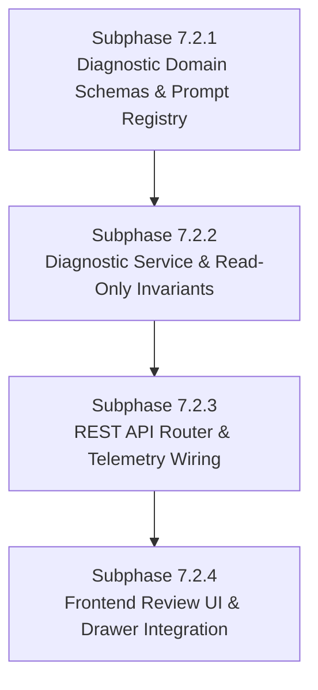

# PHASE 7.2 — SCOPE DISCOVERY & IMPLEMENTATION PLAN
**SMART LEARNING PRO — AI Engine: Wrong Answer Diagnostic Service**  
**Document:** `docs/PHASE_7_2_SCOPE_AND_IMPLEMENTATION_PLAN.md`  
**Date:** 2026-11-20  
**Baseline Git HEAD:** `d6326e5415cb125b62fbe12aea077ecf921d3a88`  
**Status:** SCOPE DISCOVERY COMPLETE — AWAITING REVIEW & APPROVAL

---

## 1. CURRENT ARCHITECTURE FINDINGS

Qua khảo sát toàn diện mã nguồn thực tế và tài liệu dự án (`docs/PHASE_7_0_AI_ARCHITECTURE_ASSESSMENT.md`, `PROJECT_STATUS.md`, `TASK_TRACKER.md`, `DEVELOPMENT_LOG.md`, các báo cáo Phase 7.1 $\rightarrow$ 7.1.3):

1. **Nền tảng Nhà cung cấp AI (Phase 7.1 — Đã hoàn tất và kiểm chứng)**:
   - Module `backend/app/modules/ai_engine/`: Đã hoàn thiện cấu trúc Modular Monolith độc lập, bao gồm `contracts.py`, `exceptions.py`, `config.py`, `factory.py`, `retry.py`, `usage.py`, `providers/base.py`, `providers/mock.py`, `providers/google_genai.py`.
   - SDK: `google-genai==1.75.0` đã được ghim trong `requirements.txt`.
   - Provider Mock: `MockAIProvider` hỗ trợ kiểm thử tự động offline 100% không cần kết nối mạng hay API key thật.
   - Usage Telemetry: Đã hoàn thiện cơ chế phân loại 3 trạng thái và bảo vệ tính toàn vẹn chi phí/token ở Phase 7.1.3 (không lưu token giả bằng 0, không lưu chi phí giả 0.0, tính phí context cache chính xác và không clamp sai lệch).
   - Kiểm thử hiện tại: **62/62 tests** `test_ai_foundation.py` PASS; **106/106 tests** toàn backend PASS; Frontend TypeScript 0 errors.

2. **Hệ thống Thi cử & Xem lại Bài thi (Exams & Review Flow)**:
   - Module `backend/app/modules/exams/`: Đã có các model `ExamAttempt`, `StudentAnswer`, `ExamResult` cùng các endpoint xem lại bài thi `GET /api/v1/exams/attempts/{attempt_id}/review`.
   - Snapshot bảo mật: `ExamAttempt` lưu trữ bất biến `questions_snapshot_json` (đã loại bỏ đáp án đúng khi thi) và `answer_key_snapshot_json` (lưu đáp án chuẩn và lời giải chi tiết do giáo viên thiết lập).
   - Trang xem lại kết quả thi: [attempts/[attemptId]/page.tsx](file:///E:/SMART-LEARNING-PRO/frontend/src/app/student/exams/attempts/[attemptId]/page.tsx) hiển thị danh sách câu hỏi làm sai (`q.is_correct === false`), đáp án của học sinh, đáp án đúng và lời giải chi tiết qua [MathKaTeX](file:///E:/SMART-LEARNING-PRO/frontend/src/components/shared/math-katex.tsx).

3. **Hiện trạng tích hợp AI vào Nghiệp vụ thi cử**:
   - Chưa có router AI nào được đăng ký trong [backend/app/main.py](file:///E:/SMART-LEARNING-PRO/backend/app/main.py).
   - Chưa có service chẩn đoán lỗi sai (`WrongAnswerDiagnosticService`).
   - Chưa có giao diện Drawer chẩn đoán AI trên frontend xem lại bài thi.

---

## 2. EXACT PHASE 7.2 SCOPE DEFINITION

### 2.1 Tên gọi chính thức
**PHASE 7.2 — WRONG ANSWER DIAGNOSTIC SERVICE (BACKEND & REVIEW UI)**  
*(Tiếng Việt: Động cơ Chẩn đoán Câu hỏi sai)*

### 2.2 Các chức năng THUỘC phạm vi (IN-SCOPE)
1. **Hợp đồng Dữ liệu Chẩn đoán (Domain Schemas)**:
   - `WrongAnswerDiagnosticRequest`: Nhận `attempt_id` và `question_id`.
   - `DiagnosticDetail`: Cấu trúc phân tích sư phạm có cấu trúc nghiêm ngặt (Pydantic v2):
     - `error_category`: Phân loại lỗi sai theo danh mục chuẩn (`CONCEPT_MISUNDERSTANDING`, `CALCULATION_ERROR`, `MISREAD_QUESTION`, `INCOMPLETE_STEPS`, `OTHER`).
     - `error_summary`: Tóm tắt ngắn gọn lỗi sai (1-2 câu).
     - `misconception_analysis`: Phân tích sâu ngộ nhận của học sinh dựa trên phương án sai cụ thể mà học sinh đã chọn/nhập.
     - `step_by_step_guidance`: Các bước tư duy và suy luận đúng, hỗ trợ công thức toán học $\LaTeX$ / KaTeX.
     - `key_takeaway`: Lời khuyên cốt lõi giúp học sinh ghi nhớ để không lặp lại lỗi sai.
     - `suggested_review`: Chủ đề / khái niệm kiến thức cần ôn tập lại.
   - `WrongAnswerDiagnosticResponse`: Trả về kết quả chẩn đoán, cờ `cached`, thời gian phản hồi `latency_ms`.
2. **Kho Prompt Sư phạm Khai báo (Declarative Prompt Registry)**:
   - Prompt `WRONG_ANSWER_DIAGNOSTIC:1.0.0` định hình vai trò Giáo viên sư phạm Việt Nam theo chuẩn GDPT 2018.
   - Prompt ép chuẩn đầu ra định dạng JSON tuân thủ schema Pydantic, không lan man, không giải sai.
3. **Dịch vụ Chẩn đoán Câu hỏi sai (`WrongAnswerDiagnosticService`)**:
   - **Xác thực quyền sở hữu & Trạng thái bài thi (Security Barrier)**:
     - Học sinh chỉ được chẩn đoán bài thi của chính mình (`attempt.student_id == current_user.id`), hoặc Giáo viên/Admin của lớp học liên quan.
     - Bài thi bắt buộc phải ở trạng thái kết thúc (`SUBMITTED`, `AUTO_SUBMITTED`, `GRADED`). Cấm tuyệt đối chẩn đoán khi bài thi đang diễn ra (`IN_PROGRESS`).
     - Bài thi phải được phép xem lại (`allow_review == True`).
     - Câu hỏi bắt buộc phải làm sai (`is_correct == False` hoặc bỏ trống). Nếu câu hỏi làm đúng, từ chối với HTTP 400 Bad Request.
   - **Ràng buộc Bất biến Tuyệt đối (Strict Read-Only Invariant)**:
     - Dịch vụ chẩn đoán chỉ đọc dữ liệu bài thi, tuyệt đối không bao giờ cập nhật điểm số (`score`), trạng thái bài thi (`status`), đáp án học sinh (`StudentAnswer`), hay ngân hàng câu hỏi.
   - **Bộ đệm Idempotency / Cache chẩn đoán**:
     - Lưu đệm kết quả chẩn đoán theo `(attempt_id, question_id)` (in-memory LRU hoặc Redis) để khi học sinh bấm lại cùng 1 câu hỏi, hệ thống trả về ngay kết quả đã chẩn đoán mà không gọi lại LLM API, triệt tiêu nguy cơ lãng phí chi phí token.
   - **Tích hợp Usage Telemetry & Cost Accounting**:
     - Ghi nhận sử dụng qua `create_usage_record` và `record_usage_to_db` với `feature="WRONG_ANSWER_ANALYSIS"` theo đúng quy chuẩn Phase 7.1.3.
4. **REST API Endpoint**:
   - `POST /api/v1/ai/diagnostics/wrong-answer`: Xác thực qua Bearer JWT, kiểm tra phân quyền RBAC.
   - Đăng ký router AI vào `backend/app/main.py`.
5. **Giao diện Frontend Review (Wrong Answer Drawer/Modal)**:
   - Module client: `frontend/src/lib/api/ai.ts` (`diagnoseWrongAnswer`).
   - Component: `frontend/src/components/exam/wrong-answer-drawer.tsx` hiển thị Drawer trượt bên phải (hoặc Dialog trên Mobile).
   - Tích hợp nút bấm trong `frontend/src/app/student/exams/attempts/[attemptId]/page.tsx`:
     - Với mỗi câu `q.is_correct === false`, hiển thị nút:
       `<Button variant="outline" className="gap-2 text-indigo-600 border-indigo-200 hover:bg-indigo-50"><Sparkles className="h-4 w-4" /> Phân tích lỗi sai với AI</Button>`.
   - Trạng thái Shimmer Skeleton khi AI đang phân tích và hiển thị thông báo lỗi thân thiện nếu mạng gặp sự cố.
   - Hiển thị công thức toán học sắc nét qua component `MathKaTeX`.

### 2.3 Các chức năng NGOÀI phạm vi (OUT-OF-SCOPE)
- **Không làm Chat hội thoại nhiều lượt**: Chat tự do qua lại thuộc Phase 7.3 (Interactive Socratic AI Tutor).
- **Không làm Streaming Server-Sent Events (SSE)**: Phản hồi chẩn đoán câu sai là cấu trúc JSON hoàn chỉnh, không dùng SSE streaming.
- **Không làm RAG / Vector Store**: Không tải file PDF/DOCX hay nhúng vector ngữ nghĩa (thuộc Phase 7.4).
- **Không làm lộ trình học tập cá nhân hóa tự động**: Thuộc Phase 7.5.
- **Không làm bảng điều khiển chi phí Admin**: Thuộc Phase 7.6.
- **Tuyệt đối KHÔNG chạy Database Migration hoặc sửa đổi schema**: Tái sử dụng 100% các bảng hiện có (`exam_attempts`, `student_answers`, `ai_usage_logs`).

---

## 3. REUSABLE EXISTING COMPONENTS

Hệ thống tái sử dụng triệt để các module đã được kiểm thử vững chắc trong các phase trước:

| Module hiện có | Đường dẫn tệp tin | Khả năng tái sử dụng trong Phase 7.2 |
| :--- | :--- | :--- |
| **AI Foundation Engine** | `backend/app/modules/ai_engine/` | Khởi tạo provider qua `ProviderFactory`, quản lý hợp đồng `NormalizedChatRequest`, xử lý retry/timeout và telemetry `usage.py`. |
| **Mock AI Provider** | `backend/app/modules/ai_engine/providers/mock.py` | Cung cấp phản hồi chẩn đoán mẫu giả lập để chạy unit test và E2E test đạt 100% PASS mà không cần API key Google. |
| **Exam Attempt Services** | `backend/app/modules/exams/service.py` | Tái sử dụng logic xác thực sở hữu bài thi, giải mã snapshot câu hỏi và kiểm tra quyền xem lại bài thi. |
| **Exam Models** | `backend/app/modules/exams/models.py` | `ExamAttempt`, `StudentAnswer`, `ExamResult` được đọc trực tiếp. |
| **Auth & Security** | `backend/app/core/dependencies.py` | `get_current_user`, `require_role`, kiểm tra token JWT hợp lệ. |
| **KaTeX Math Renderer** | `frontend/src/components/shared/math-katex.tsx` | Hiển thị công thức toán học trong phân tích lỗi sai và lời giải từng bước. |
| **UI Design System** | `frontend/src/components/ui/` | Tái sử dụng `Button`, `Badge`, `Card`, `Dialog`, `Skeleton`. |
| **API Client** | `frontend/src/lib/api/client.ts` | Gửi request có đính kèm Bearer token và xử lý refresh token tự động. |

---

## 4. ARCHITECTURE & SECURITY REVIEW

### 4.1 Authentication & Authorization
- Mọi yêu cầu tới `POST /api/v1/ai/diagnostics/wrong-answer` đều bắt buộc phải có Bearer Access Token hợp lệ.
- Vai trò cho phép: `STUDENT` (cho bài thi của chính mình), `TEACHER` (cho bài thi của học sinh trong lớp mình quản lý), `ADMIN`, `SUPERADMIN`.
- Khách vãng lai (chưa đăng nhập) bị từ chối ngay lập tức với mã `HTTP 401 Unauthorized`.

### 4.2 Tenant Isolation & Data Ownership
- Phân lập đa người dùng (Multi-tenant) thực thi ở mức Backend query:
  - Nếu `current_user.role == "STUDENT"`: Kiểm tra `attempt.student_id == current_user.id`. Nếu khác, lập tức ném `HTTP 403 Forbidden`.
  - Nếu `current_user.role == "TEACHER"`: Kiểm tra giáo viên có sở hữu bài thi hoặc lớp học của bài tập đó hay không. Nếu không thuộc thẩm quyền, ném `HTTP 403 Forbidden`.
- **Chống rò rỉ đề thi**:
  - Nếu `attempt.status == "IN_PROGRESS"`: Ném `HTTP 400 Bad Request` ("Không thể chẩn đoán khi bài thi đang diễn ra").
  - Nếu `allow_review == False` (và người gọi là học sinh): Ném `HTTP 403 Forbidden` ("Bài thi này không mở xem lại đáp án").

### 4.3 Ràng buộc Bất biến Tuyệt đối (Strict Read-Only Invariant)
- Chẩn đoán AI là tính năng giá trị gia tăng sau thi, tuyệt đối không được phép có bất kỳ side-effect nào lên điểm thi hoặc kết quả học tập.
- **Tiêu chuẩn kiểm thử bắt buộc**: Test case kiểm chứng giá trị băm (SHA-256) hoặc kiểm tra toàn bộ trường của `ExamAttempt` và `StudentAnswer` trước và sau khi gọi `WrongAnswerDiagnosticService` để khẳng định 100% không có sự thay đổi dữ liệu nào xảy ra.

### 4.4 Prompt Injection & Data Sanitization
- Dữ liệu đưa vào LLM bao gồm: nội dung câu hỏi, các lựa chọn, đáp án học sinh nhập/chọn, đáp án đúng và giải thích chuẩn.
- **Không tạo security boundary chỉ dựa vào prompt**:
  - LLM không được cấp bất kỳ quyền thực thi tool hay truy cập DB nào.
  - Đầu ra của LLM được ép cấu trúc qua JSON Schema và được validate bởi Pydantic v2. Nếu LLM trả về dữ liệu lệch schema hoặc cố gắng chèn lệnh độc hại, response parser sẽ từ chối và kích hoạt retry/fallback an toàn.
  - Trên Frontend, toàn bộ nội dung text hiển thị được React tự động escape, và công thức toán học được xử lý qua `MathKaTeX` (đã được làm sạch ở Phase 6.1 chống XSS).

### 4.5 Rate Limiting & Idempotent Caching
- Để ngăn học sinh bấm liên tục nút chẩn đoán gây quá tải hệ thống và cạn kiệt ngân sách token:
  - Áp dụng cơ chế **Idempotent Diagnostic Cache**: Khóa cache dựa trên `(attempt_id, question_id)`.
  - Lần bấm đầu tiên: Gọi AI Engine $\rightarrow$ Tính toán $\rightarrow$ Lưu kết quả vào Cache $\rightarrow$ Trả về `cached=False`.
  - Các lần bấm tiếp theo: Đọc ngay từ Cache $\rightarrow$ Trả về kết quả trong < 10ms, `cached=True`, không tiêu tốn thêm token nào từ Google API.

### 4.6 AI Failure Isolation & Privacy
- Nếu Google Gemini API gặp sự cố (429 Rate Limit, 503 Server Error, hoặc Timeout 15s):
  - Dịch vụ trả về mã lỗi HTTP 503 với thông báo tiếng Việt có cấu trúc ("Gia sư AI hiện đang bận, vui lòng thử lại sau giây lát").
  - Giao diện xem lại bài thi của học sinh vẫn hoạt động bình thường 100%, không bị ảnh hưởng.
- Không ghi log câu hỏi, câu trả lời của học sinh, thông tin cá nhân (PII), hay API key vào file log.

---

## 5. RISK REGISTER

| STT | Rủi ro (Risk) | Tác động (Impact) | Xác suất (Likelihood) | Biện pháp giảm thiểu (Mitigation) | Mức độ ưu tiên |
| :---: | :--- | :---: | :---: | :--- | :---: |
| **R-01** | **Rò rỉ dữ liệu chéo người dùng (Cross-Tenant / IDOR)**: Học sinh A gọi endpoint chẩn đoán bài thi của học sinh B. | Rất lớn (High) | Thấp (Low) | Kiểm tra quyền sở hữu bài thi chặt chẽ ở cấp DB Service (`attempt.student_id == current_user.id`) trước khi xử lý, trả về HTTP 403 nếu vi phạm. | **P0 (Khẩn cấp)** |
| **R-02** | **Rò rỉ đáp án khi bài thi đang diễn ra**: Học sinh gọi endpoint chẩn đoán khi bài thi đang ở trạng thái `IN_PROGRESS`. | Rất lớn (High) | Trung bình (Medium) | Chặn ngay tại cổng kiểm tra trạng thái: chỉ cho phép chẩn đoán khi bài thi ở trạng thái `SUBMITTED`, `AUTO_SUBMITTED`, `GRADED`. | **P0 (Khẩn cấp)** |
| **R-03** | **Sửa đổi dữ liệu ngoài ý muốn (Data Mutation Side-Effect)**: Dịch vụ AI vô tình thay đổi điểm số hoặc câu trả lời của học sinh trong DB. | Rất lớn (High) | Thấp (Low) | Áp dụng Read-Only session pattern; viết test tự động kiểm chứng hash dữ liệu bài thi không đổi 100%. | **P0 (Khẩn cấp)** |
| **R-04** | **AI ảo giác / Bịa đặt kiến thức sư phạm (Hallucination)**: LLM đưa ra lời giải sai hoặc phương pháp suy luận không chuẩn GDPT 2018. | Lớn (High) | Trung bình (Medium) | Cung cấp đầy đủ ngữ cảnh đáp án chuẩn và lời giải của giáo viên trong prompt; yêu cầu LLM phân tích bám sát lời giải chuẩn. | **P1 (Cao)** |
| **R-05** | **Bùng nổ chi phí do học sinh spam request (Cost Runaway)**: Học sinh bấm liên tục nút chẩn đoán câu sai làm tăng chi phí API. | Trung bình (Medium) | Cao (High) | Áp dụng Idempotent Caching theo `(attempt_id, question_id)` và vô hiệu hóa nút bấm (disabled) khi request đang xử lý. | **P1 (Cao)** |
| **R-06** | **LLM API Timeout hoặc gián đoạn dịch vụ làm đơ giao diện**: Cuộc gọi upstream chậm làm treo trang xem kết quả. | Trung bình (Medium) | Trung bình (Medium) | Timeout 15s, xử lý bất đồng bộ, Skeleton loading mượt mà trên UI; hiển thị Toast lỗi rõ ràng kèm nút "Thử lại". | **P1 (Cao)** |
| **R-07** | **LLM trả về định dạng không đúng chuẩn JSON Schema**: Model sinh markdown hoặc text tự do làm crash frontend parser. | Trung bình (Medium) | Trung bình (Medium) | Ép cấu trúc qua Pydantic schema validation ở backend; fallback parser an toàn loại bỏ markdown code fences (````json`). | **P1 (Cao)** |

---

## 6. PROPOSED SUBPHASES

Phase 7.2 được phân rã thành 4 tiểu pha tuần tự (Subphases), mỗi tiểu pha đều có tiêu chí nghiệm thu và bộ kiểm thử độc lập:



---

### SUBPHASE 7.2.1: Diagnostic Domain Schemas & Prompt Registry
- **Mục tiêu**: Xây dựng toàn bộ các hợp đồng dữ liệu chuẩn hóa Pydantic v2 và kho prompt khai báo sư phạm cho chẩn đoán câu sai.
- **Tệp tin tác động**:
  - `backend/app/modules/ai_engine/diagnostics/__init__.py`
  - `backend/app/modules/ai_engine/diagnostics/schemas.py`
  - `backend/app/modules/ai_engine/diagnostics/prompts.py`
- **Nhiệm vụ triển khai**:
  1. Định nghĩa enum `ErrorCategory`: `CONCEPT_MISUNDERSTANDING`, `CALCULATION_ERROR`, `MISREAD_QUESTION`, `INCOMPLETE_STEPS`, `OTHER`.
  2. Định nghĩa Pydantic schema: `WrongAnswerDiagnosticRequest`, `DiagnosticDetail`, `WrongAnswerDiagnosticResponse`.
  3. Định nghĩa prompt template `WRONG_ANSWER_DIAGNOSTIC_V1`: Thiết lập vai trò giáo viên sư phạm Việt Nam, cung cấp hướng dẫn phân tích ngộ nhận, công thức KaTeX, và yêu cầu trả về JSON schema chuẩn.
  4. Viết hàm build prompt: `build_diagnostic_prompt(question_content, student_answer, correct_answer, explanation)`.
- **Yêu cầu an ninh**: Không chứa API key, không chứa mã độc, kiểm soát chặt chẽ độ dài text đưa vào prompt để chống tràn ngữ cảnh (max length checks).
- **Kiểm thử Unit test**:
  - Kiểm tra validation schema: từ chối các chuỗi rỗng, enum không hợp lệ.
  - Kiểm tra format prompt: xác nhận các trường dữ liệu được lắp ráp chính xác vào prompt.
  - Kiểm tra parse JSON từ phản hồi mẫu của LLM thành Pydantic object.
- **Tiêu chí nghiệm thu (Pass/Fail)**:
  - PASS: 100% unit tests của Subphase 7.2.1 đạt kết quả xanh. Pydantic serialize/deserialize hoàn hảo.

---

### SUBPHASE 7.2.2: Backend Diagnostic Service & Read-Only Invariants
- **Mục tiêu**: Xây dựng nghiệp vụ `WrongAnswerDiagnosticService` kết nối AI Engine với dữ liệu bài thi, bảo đảm tính bất biến dữ liệu và bộ đệm idempotency.
- **Tệp tin tác động**:
  - `backend/app/modules/ai_engine/diagnostics/service.py`
  - `backend/tests/test_ai_diagnostics.py`
- **Nhiệm vụ triển khai**:
  1. Xây dựng class `WrongAnswerDiagnosticService`:
     - Kiểm tra quyền sở hữu bài thi (`attempt.student_id == user.id` hoặc giáo viên lớp học).
     - Kiểm tra trạng thái bài thi: bắt buộc `SUBMITTED`, `AUTO_SUBMITTED`, `GRADED`.
     - Kiểm tra quyền xem lại bài thi: bắt buộc `allow_review == True` (đối với học sinh).
     - Kiểm tra kết quả câu hỏi: bắt buộc `is_correct == False` hoặc chưa trả lời. Từ chối câu hỏi đúng.
  2. Trích xuất dữ liệu câu hỏi từ `answer_key_snapshot_json` hoặc `questions_snapshot_json`.
  3. Tích hợp bộ đệm nhớ đệm: `DiagnosticCache` theo `(attempt_id, question_id)`.
  4. Gọi `BaseLLMProvider` qua `ProviderFactory.get_provider()` sinh nội dung chẩn đoán.
  5. Gọi `create_usage_record` và `record_usage_to_db` để ghi nhận chi phí telemetry (Phase 7.1.3).
- **Yêu cầu an ninh & Bất biến**:
  - Không thực hiện bất kỳ câu lệnh `UPDATE` hay `DELETE` nào lên các bảng `exams`, `exam_attempts`, `student_answers`, `questions`.
- **Kiểm thử tự động**:
  - Test IDOR: Học sinh A gọi chẩn đoán bài thi của học sinh B $\rightarrow$ Bị chặn `PermissionDeniedException`.
  - Test Exam in-progress: Gọi khi bài thi đang làm $\rightarrow$ Bị chặn `ValidationException`.
  - Test Câu hỏi đúng: Gọi chẩn đoán câu hỏi đã làm đúng $\rightarrow$ Bị chặn `ValidationException`.
  - Test Read-Only Invariant: Kiểm tra trạng thái và điểm thi trước và sau cuộc gọi chẩn đoán $\rightarrow$ Khẳng định không đổi 100%.
  - Test Caching Idempotency: Gọi lần 2 với cùng câu hỏi $\rightarrow$ Trả về kết quả từ cache, không gọi thêm LLM provider.
- **Tiêu chí nghiệm thu (Pass/Fail)**:
  - PASS: Toàn bộ các kịch bản phân quyền, an ninh và bất biến vượt qua kiểm thử với `MockAIProvider`.

---

### SUBPHASE 7.2.3: REST API Router & Telemetry Wiring
- **Mục tiêu**: Mở endpoint REST API chính thức `/api/v1/ai/diagnostics/wrong-answer` và đăng ký vào ứng dụng FastAPI chính.
- **Tệp tin tác động**:
  - `backend/app/modules/ai_engine/router.py`
  - `backend/app/main.py`
  - `backend/tests/test_ai_diagnostics_api.py`
- **Nhiệm vụ triển khai**:
  1. Xây dựng router FastAPI cho `ai_engine`:
     `POST /api/v1/ai/diagnostics/wrong-answer` với dependency `get_current_user` và `get_db`.
  2. Đăng ký `ai_router` vào [backend/app/main.py](file:///E:/SMART-LEARNING-PRO/backend/app/main.py) dưới prefix `/api/v1/ai`.
  3. Bổ sung xử lý ngoại lệ chuẩn hóa: Chuyển đổi các exception của AI Engine (`AITimeoutError`, `AIRateLimitError`, `AIEngineException`) thành phản hồi JSON có cấu trúc rõ ràng.
- **Yêu cầu an ninh**:
  - HTTP 401 khi không có token.
  - HTTP 403 khi truy cập trái phép.
  - HTTP 400 khi tham số sai.
  - HTTP 503 khi upstream LLM gặp lỗi (không crash server backend).
- **Kiểm thử Integration test**:
  - Test gọi API qua FastAPI `AsyncClient`.
  - Test đầy đủ luồng từ đăng nhập học sinh $\rightarrow$ nộp bài thi $\rightarrow$ gọi API chẩn đoán câu sai $\rightarrow$ nhận kết quả JSON thành công.
- **Tiêu chí nghiệm thu (Pass/Fail)**:
  - PASS: Endpoint trả về HTTP 200 với đầy đủ các trường của `WrongAnswerDiagnosticResponse` khi dữ liệu hợp lệ.

---

### SUBPHASE 7.2.4: Frontend Review UI & Drawer Integration
- **Mục tiêu**: Tích hợp nút bấm phân tích câu sai vào trang xem lại bài thi và xây dựng Drawer hiển thị chẩn đoán thông minh cho học sinh.
- **Tệp tin tác động**:
  - `frontend/src/lib/api/ai.ts`
  - `frontend/src/types/index.ts` (Bổ sung types cho AI Diagnostic)
  - `frontend/src/components/exam/wrong-answer-drawer.tsx`
  - `frontend/src/app/student/exams/attempts/[attemptId]/page.tsx`
- **Nhiệm vụ triển khai**:
  1. Thêm API client method: `aiApi.diagnoseWrongAnswer(attemptId, questionId)`.
  2. Xây dựng component `WrongAnswerDrawer`:
     - Header: Tiêu đề "Chẩn đoán Lỗi sai cùng Gia sư AI" kèm icon Sparkles.
     - Badge phân loại lỗi: Hiển thị trực quan với màu sắc tương ứng (ví dụ: Vàng cam cho Ngộ nhận khái niệm, Xanh lam cho Sai sót tính toán).
     - Card Ngộ nhận: Phân tích chi tiết tại sao học sinh chọn phương án sai.
     - Card Hướng dẫn từng bước: Hiển thị các bước suy luận đúng với công thức toán KaTeX.
     - Card Ghi nhớ cốt lõi: Lời khuyên sư phạm.
     - Trạng thái Loading: Hiển thị Skeleton shimmer animation.
     - Trạng thái Error: Hiển thị nút Thử lại.
  3. Cập nhật trang [attempts/[attemptId]/page.tsx](file:///E:/SMART-LEARNING-PRO/frontend/src/app/student/exams/attempts/[attemptId]/page.tsx):
     - Với mỗi câu hỏi trong review có `q.is_correct === false`, hiển thị nút bấm mở Drawer.
     - Quản lý state mở/đóng Drawer và truyền thông tin câu hỏi đang được chọn.
- **Yêu cầu UI/UX & Accessibility**:
  - Responsive hoàn hảo trên cả Desktop và Mobile (Drawer trên Desktop, Dialog/Drawer trượt đáy trên Mobile).
  - Tương thích phím tắt: Nhấn `Escape` để đóng Drawer.
- **Kiểm thử Frontend**:
  - Kiểm tra TypeScript (`npx tsc --noEmit` đạt 0 lỗi).
  - Kiểm tra ESLint (`npm run lint` đạt 0 lỗi).
  - Kiểm tra Production Build (`npm run build` đạt Exit code 0).
- **Tiêu chí nghiệm thu (Pass/Fail)**:
  - PASS: Học sinh xem bài thi nộp xong, bấm phân tích câu sai, Drawer trượt ra mượt mà và hiển thị lời giải KaTeX không lỗi font hay lỗi render.

---

## 7. TEST STRATEGY

Chiến lược kiểm thử của Phase 7.2 tuân thủ mô hình kim tự tháp kiểm thử nghiêm ngặt, đảm bảo 100% độc lập với tài nguyên mạng bên ngoài:

```text
       ▲
      / \     E2E Tests (Playwright: Drawer mở, hiển thị phân tích, đóng Drawer)
     /---\    Integration Tests (FastAPI AsyncClient: Auth -> Attempt -> Diagnostic API)
    /-----\   Unit Tests (Pydantic Schemas, Prompts, Read-Only Invariants, Caching)
```

1. **Unit & Invariant Tests (`backend/tests/test_ai_diagnostics.py`)**:
   - Chạy với `MockAIProvider` giả lập phản hồi sư phạm chuẩn.
   - Kiểm tra toàn bộ logic phân quyền (Student, Teacher, Admin, Hacker).
   - Kiểm tra chống sửa đổi dữ liệu (Read-Only State Hash Verification).
   - Kiểm tra bộ đệm Idempotent Caching.
2. **Integration API Tests (`backend/tests/test_ai_diagnostics_api.py`)**:
   - Gọi endpoint HTTP thực tế qua test client.
   - Kiểm tra các mã trạng thái HTTP: 200, 400, 401, 403, 503.
3. **Frontend Quality Verification**:
   - `cd frontend; npx tsc --noEmit` $\rightarrow$ Đảm bảo 0 lỗi kiểu dữ liệu.
   - `cd frontend; npm run lint` $\rightarrow$ Đảm bảo 0 cảnh báo linter.
   - `cd frontend; npm run build` $\rightarrow$ Đảm bảo toàn bộ 23 route build thành công.

---

## 8. ACCEPTANCE CRITERIA MATRIX

| Hạng mục kiểm tra | Tiêu chí ĐẠT (PASS) | Tiêu chí KHÔNG ĐẠT (FAIL) |
| :--- | :--- | :--- |
| **Bảo mật phân quyền** | Chỉ có học sinh sở hữu bài thi (hoặc giáo viên lớp) mới được chẩn đoán câu sai. | Bất kỳ ai cũng gọi được endpoint của người khác (IDOR). |
| **Bảo mật kỳ thi** | Chỉ cho phép chẩn đoán khi bài thi đã nộp xong (`SUBMITTED`, `GRADED`). | Cho phép chẩn đoán khi đang làm bài (`IN_PROGRESS`). |
| **Tính bất biến điểm số** | Điểm số, trạng thái bài thi và đáp án học sinh giữ nguyên 100%. | Điểm số hoặc dữ liệu bài thi bị cập nhật ngoài ý muốn. |
| **Độ chính xác dữ liệu** | Phân loại lỗi và hướng dẫn tư duy bám sát phương án sai cụ thể. | Trả về nội dung chung chung, không liên quan câu hỏi. |
| **Kiểm soát chi phí** | Lần bấm thứ 2 cùng 1 câu hỏi trả về từ cache trong < 10ms (0 token). | Mỗi lần bấm đều gọi lại LLM và tốn thêm chi phí token. |
| **Hiển thị Toán học** | Công thức toán học render sắc nét bằng KaTeX trong Drawer. | Lộ mã nguồn LaTeX thô hoặc vỡ giao diện. |
| **Khả năng cách ly lỗi** | Khi LLM lỗi, hiển thị thông báo rõ ràng; review bài thi không bị đơ. | Toàn bộ trang xem lại bài thi bị sập (White screen). |
| **Chất lượng mã nguồn** | Pytest 100% PASS, `tsc --noEmit` 0 errors, Next.js build Exit Code 0. | Bất kỳ test cũ nào bị fail hoặc TypeScript báo lỗi. |

---

## 9. DEPENDENCIES & BLOCKERS

### 9.1 Dependencies
- **Phụ thuộc nội bộ**:
  - Phase 7.1 Foundation: `BaseLLMProvider`, `MockAIProvider`, `usage.py`.
  - Phase 6.3 Examination Engine: `ExamAttempt`, `StudentAnswer`, snapshot JSON.
  - Frontend Design System: `Button`, `Badge`, `Card`, `MathKaTeX`, `Dialog/Sheet`.
- **Phụ thuộc gói thư viện**:
  - Backend: `google-genai==1.75.0` (đã có), `pydantic>=2.0` (đã có), `sqlalchemy>=2.0` (đã có).
  - Frontend: `@tanstack/react-query` (đã có), `katex` (đã có), `lucide-react` (đã có).

### 9.2 Blockers
- **Hiện tại KHÔNG CÓ rào cản kỹ thuật nào (Zero Blockers)**. Toàn bộ nền tảng nhà cung cấp AI, mô hình dữ liệu bài thi và giao diện review đã hoàn toàn sẵn sàng cho việc triển khai Phase 7.2.

---

## 10. GIT HEAD & REPOSITORY STATUS

### 10.1 Xác minh Git HEAD
- **HEAD Commit**: `d6326e5415cb125b62fbe12aea077ecf921d3a88` (fix(exam): serialize autosave and submission concurrency).
- **Commit mới**: 0 commit được tạo trong phiên này.

### 10.2 Phân loại trạng thái tệp tin (`git status --short`)
- **Modified Tracked Files (3 tệp)**:
  - `.env.example`: Bổ sung cấu hình biến môi trường AI.
  - `backend/app/config.py`: Khai báo Pydantic Settings cho AI Provider.
  - `backend/requirements.txt`: Ghim `google-genai==1.75.0`.
- **Untracked Files & Directories**:
  - `backend/app/modules/ai_engine/` (Mô-đun nền tảng AI từ Phase 7.1).
  - `backend/tests/test_ai_foundation.py` (Bộ kiểm thử 62 test cases).
  - Các tài liệu báo cáo: `docs/PHASE_6_3_9_POSTGRESQL_TRANSACTION_AUDIT.md`, `docs/PHASE_7_0_AI_ARCHITECTURE_ASSESSMENT.md`, `docs/PHASE_7_1_1_INDEPENDENT_AUDIT_REPORT.md`, `docs/PHASE_7_1_2_USAGE_DATA_INTEGRITY_REPORT.md`, `docs/PHASE_7_1_3_FINAL_USAGE_COST_AUDIT.md`, `docs/PHASE_7_2_SCOPE_AND_IMPLEMENTATION_PLAN.md`.
- **Database & Migrations**: 0 migration, 0 schema change.
- **Dự án cũ `E:\SMART-LEARNING`**: Hoàn toàn không bị tác động (READ-ONLY).

---

## 11. KẾT LUẬN & ĐIỀU KIỆN DỪNG (STOP CONDITION)

Nhiệm vụ **SCOPE DISCOVERY & IMPLEMENTATION PLAN CHO PHASE 7.2** đã hoàn tất.
Theo đúng quy định nghiêm ngặt:
- **CHƯA triển khai bất kỳ dòng code tính năng nào cho Phase 7.2.**
- **KHÔNG tạo commit.**
- **KHÔNG tạo migration hoặc chỉnh sửa database schema.**
- **DỪNG LẠI VÀ CHỜ PHÊ DUYỆT CỦA NGƯỜI DÙNG TRƯỚC KHI BẮT ĐẦU THỰC THI.**
