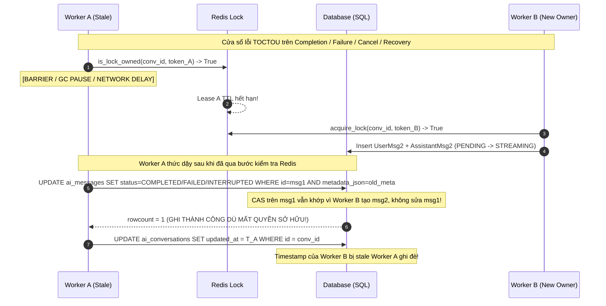

# PHASE 7.3.2.2 — THIẾT KẾ FENCING TOKEN & ATOMIC OWNERSHIP ENFORCEMENT

**Dự án:** SMART-LEARNING-PRO  
**Workspace:** `E:\SMART-LEARNING-PRO`  
**Vai trò:** Senior Backend Engineer (Distributed Systems & Concurrency)  
**Git HEAD tại thời điểm khảo sát:** `bf54c05a73d13c33fc4ef9b46c2d2735a4b9feaf` (`git status --short`: clean)  
**Trạng thái:** **CHỜ PHÊ DUYỆT SCHEMA CHANGE (DỪNG TRIỂN KHAI THEO BƯỚC 4)**  

---

## 1. HIỆN TRẠNG MÃ NGUỒN & VỊ TRÍ CÁC CALL SITES (GIAI ĐOẠN A)

### 1.1. Kiểm tra Git & Scope
- `git rev-parse HEAD`: `bf54c05a73d13c33fc4ef9b46c2d2735a4b9feaf`
- `git status --short`: Không có file modified/untracked trước khi bắt đầu Phase 7.3.2.2.
- Không thay đổi ORM, schema, migration hoặc mã nguồn trong giai đoạn phân tích thiết kế này.

### 1.2. Bản đồ Call Sites thực tế trong `backend/app/modules/ai_tutor/`

| Ký hiệu / Hàm | File & Dòng thực tế | Vai trò hiện tại & Lỗ hổng TOCTOU |
| :--- | :--- | :--- |
| `is_lock_owned()` | [conversation_lock.py#L173](file:///E:/SMART-LEARNING-PRO/backend/app/modules/ai_tutor/services/conversation_lock.py#L173) | Kiểm tra Redis `GET` (hoặc in-memory map). Hoàn toàn tách rời khỏi DB transaction. |
| `is_lock_owned` call sites | [tutor_service.py#L172](file:///E:/SMART-LEARNING-PRO/backend/app/modules/ai_tutor/services/tutor_service.py#L172), [#L237](file:///E:/SMART-LEARNING-PRO/backend/app/modules/ai_tutor/services/tutor_service.py#L237), [#L443](file:///E:/SMART-LEARNING-PRO/backend/app/modules/ai_tutor/services/tutor_service.py#L443), [#L474](file:///E:/SMART-LEARNING-PRO/backend/app/modules/ai_tutor/services/tutor_service.py#L474), [#L674](file:///E:/SMART-LEARNING-PRO/backend/app/modules/ai_tutor/services/tutor_service.py#L674) | Kiểm tra quyền sở hữu ở tầng ứng dụng trước khi thực hiện DB write. Nếu lease hết hạn ngay sau câu lệnh này, DB write vẫn chạy thành công! |
| `_atomic_transition_message()` | [tutor_service.py#L358](file:///E:/SMART-LEARNING-PRO/backend/app/modules/ai_tutor/services/tutor_service.py#L358) (gọi tại `#L175`, `#L252`, `#L455`, `#L497`, `#L680`) | Chỉ nhận `message_id` và kiểm tra CAS trên `AIMessage.metadata_json`. **Không nhận `conversation_id` hay `fencing_generation`**. Không xác minh quyền sở hữu cuộc hội thoại tại tầng persistence. |
| `_update_message_on_failure()` | [tutor_service.py#L428](file:///E:/SMART-LEARNING-PRO/backend/app/modules/ai_tutor/services/tutor_service.py#L428) (gọi tại `#L298`, `#L313`, `#L334`) | Gọi `is_lock_owned` ở `#L443` và `#L474` trước khi gọi `_atomic_transition_message` / `_safe_update_message_status`. Tồn tại cửa sổ TOCTOU giữa bước kiểm tra và SQL `UPDATE`. |
| `_safe_update_message_status()` | [tutor_service.py#L483](file:///E:/SMART-LEARNING-PRO/backend/app/modules/ai_tutor/services/tutor_service.py#L483) (gọi tại `#L475`) | Mở session mới (`AsyncSessionLocal`) và gọi `_atomic_transition_message` mà **không kiểm tra quyền sở hữu tại tầng DB**. |
| `recover_stale_streaming_messages_batch()` | [tutor_service.py#L579](file:///E:/SMART-LEARNING-PRO/backend/app/modules/ai_tutor/services/tutor_service.py#L579) | Kiểm tra `is_locked`, lấy khóa recovery, kiểm tra `is_lock_owned`, rồi mới gọi `_atomic_transition_message`. Nếu khóa recovery hết hạn giữa `#L674` và `#L680` và Worker B tiếp quản, recovery worker vẫn transition message! |
| `AIConversation.updated_at` mutation | [tutor_service.py#L280](file:///E:/SMART-LEARNING-PRO/backend/app/modules/ai_tutor/services/tutor_service.py#L280) và [conversation_service.py#L185](file:///E:/SMART-LEARNING-PRO/backend/app/modules/ai_tutor/services/conversation_service.py#L185) | Tại `tutor_service.py#L277-L283`, `updated_at` được cập nhật trong một transaction **riêng** sau khi `_atomic_transition_message` đã commit tại `#L408`. Nếu crash xảy ra giữa `#L252` và `#L283`, `AIMessage` đã `COMPLETED` nhưng `updated_at` không đổi. |

### 1.3. Biểu đồ luồng thực thi & Cửa sổ TOCTOU hiện tại



---

## 2. PHÂN TÍCH SO SÁNH HAI PHƯƠNG ÁN KIẾN TRÚC

### Phương án A — Database-backed Fencing Generation (Monotonic Generation on `ai_conversations`)
- Lưu trữ một bộ đếm đơn điệu tăng (`fencing_generation: BigInteger NOT NULL DEFAULT 0`) trực tiếp trên bảng cha `ai_conversations`.
- Mỗi worker (normal worker hoặc recovery worker) khi bắt đầu một lượt giữ khóa phải tăng nguyên tử `fencing_generation` trên DB (`UPDATE ai_conversations SET fencing_generation = fencing_generation + 1 WHERE id = :cid RETURNING fencing_generation`) và giữ giá trị `gen` đó làm **fencing token** bất biến cho toàn bộ vòng đời lượt xử lý.
- Mọi thao tác DB mutation (chuyển đổi trạng thái `AIMessage`, ghi `content` / `partial_content` / `error_message`, cập nhật `AIConversation.updated_at`) phải truyền `fencing_generation` và thực hiện **trong cùng một DB transaction nguyên tử** kiểm tra `ai_conversations.fencing_generation == expected_gen` (kèm row-level lock `FOR UPDATE` trên PostgreSQL hoặc conditional `UPDATE` trên `ai_conversations` trước khi mutate `ai_messages`).

### Phương án B — Atomic Lease Validation tại Database Boundary (Không sửa schema)
- Cố gắng xác thực lease Redis hoặc dùng `AIMessage.metadata_json` CAS / timestamp `AIConversation.updated_at` mà không thêm cột `fencing_generation` vào `ai_conversations`.
- Phân tích chứng minh **KHÔNG ĐẠT CORRECTNESS**:
  1. **Không thể atomically verify Redis bên trong SQL:** Redis và SQL là hai hệ thống phân tán độc lập không có giao thức 2PC. Mọi kiểm tra Redis (dù là Lua script) ngay trước câu SQL `UPDATE` vẫn tồn tại cửa sổ TOCTOU giữa lúc Redis trả về kết quả và lúc SQL engine thực thi `UPDATE`. Test A (dừng Worker A tại barrier sau khi check ownership, thay thế lock bằng B, rồi cho A chạy DB mutation) chắc chắn **FAIL**.
  2. **CAS chỉ trên `AIMessage.metadata_json` không chặn được Worker A khi Worker B tạo `AIMessage` mới:** Worker B tạo `M2`, không sửa `M1`, nên `M1.metadata_json` vẫn khớp cũ và stale Worker A vẫn ghi đè thành công `M1` và `AIConversation.updated_at`.
  3. **Kiểm tra chéo bằng subquery `NOT EXISTS (SELECT ... FROM ai_messages ...)` dưới mức cô lập mặc định `READ COMMITTED` vẫn race:** Trong PostgreSQL `READ COMMITTED`, nếu Worker A đang chạy `UPDATE ... WHERE NOT EXISTS (...)` song song với Worker B đang `INSERT M2` chưa commit (hoặc Recovery Worker R **không hề tạo `AIMessage` mới** nào!), subquery không khóa hàng cha và vẫn cho phép stale write hoặc conflict giữa Recovery và Worker B (Test E **FAIL**).
  4. **Lạm dụng cột hiện có (`title`, `updated_at`) hoặc chèn bản ghi giả (`AIMessage` sentinel):** Làm hỏng dữ liệu nghiệp vụ của người dùng, sai lệch `message_count`, và vi phạm yêu cầu không chọn giải pháp yếu để né schema change.

### Bảng so sánh chi tiết Phương án A vs Phương án B

| Tiêu chí đánh giá | Phương án A: DB-backed `fencing_generation` | Phương án B: Không sửa schema (Redis + Subquery/CAS) |
| :--- | :--- | :--- |
| **Correctness (Loại bỏ TOCTOU)** | **Tuyệt đối (100%)**: Kiểm tra `fencing_generation` và mutate dữ liệu diễn ra trong cùng 1 transaction có row lock tại DB. | **Thất bại (FAIL)**: Luôn tồn tại TOCTOU giữa Redis và SQL hoặc giữa subquery `READ COMMITTED` và concurrent inserts/recovery. |
| **Chống Lease Expiration** | **Tuyệt đối**: Ngay khi Worker B nhận lock mới, DB `fencing_generation` tăng từ `N` lên `N+1`. Mọi mutation của Worker A mang `N` bị DB từ chối với `rowcount = 0`. | **Không đảm bảo**: Stale Worker A vẫn ghi được `M1` và `updated_at` nếu Worker B chưa chạm vào `M1`. |
| **Chạy nhiều Process / Multi-instance** | **Hoạt động chính xác** trên PostgreSQL đa worker/đa node nhờ ACID row-level lock trên `ai_conversations`. | **Rủi ro cao**: Lệch đồng hồ giữa các node hoặc race giữa Redis và SQL đa tiến trình. |
| **Hành vi khi Redis Outage** | **An toàn dữ liệu (Fail-safe)**: Ngay cả khi Redis sập hoặc mất dữ liệu `INCR` khi restart, `fencing_generation` trong DB vẫn bảo toàn tính đơn điệu và từ chối stale worker. | **Mất bảo vệ hoàn toàn** giữa các process khi Redis restart hoặc sập. |
| **Database Schema Impact** | **Cần 1 cột mới** `fencing_generation` trên bảng `ai_conversations` (1 migration đơn giản, backfill default `0`). | Không sửa schema, nhưng phải đánh đổi tính đúng đắn (bị cấm theo Mục 4 & Mục 7). |
| **Operational Complexity** | **Thấp**: Chuẩn mực kỹ thuật công nghiệp (Martin Kleppmann's fencing token pattern), không phụ thuộc đồng bộ đồng hồ NTP hay 2PC. | **Cao & Mong manh**: Phải ghép nối nhiều cơ chế vá lỗi dễ vỡ. |
| **Deterministic Testing** | **100% Deterministic**: Barrier test A–J kiểm chứng trực tiếp bằng `asyncio.Event` trước DB mutation và xác nhận SQL trả về `rowcount = 0`. | Không thể pass trung thực Test A, E, F khi dùng barrier. |

**Kết luận chọn phương án:** Chọn **Phương án A — Database-backed Monotonic Fencing Generation (`ai_conversations.fencing_generation`)**.

---

## 3. TRẢ LỜI 12 CÂU HỎI THIẾT KẾ CHO PHƯƠNG ÁN A

1. **Fencing token được tạo như thế nào?**  
   Được sinh nguyên tử ngay tại Database trên hàng của conversation khi worker bắt đầu phiên làm việc sau khi acquire lock:
   - Trên PostgreSQL: `UPDATE ai_conversations SET fencing_generation = fencing_generation + 1 WHERE id = :cid RETURNING fencing_generation`.
   - Trên SQLite (3.35+): hỗ trợ cùng cú pháp `UPDATE ... RETURNING fencing_generation` (hoặc CAS loop trong DB transaction).
2. **Token có tính đơn điệu (monotonically increasing) hay không?**  
   **Có, tăng đơn điệu nghiêm ngặt (`1, 2, 3, ...`)** theo từng conversation. Không bao giờ lặp lại hoặc quay ngược ngay cả khi Redis mất dữ liệu hay khởi động lại.
3. **Token được liên kết với conversation và lock owner ra sao?**  
   - Mỗi `AIConversation` có một `fencing_generation` duy nhất tăng dần theo từng turn hoặc từng lần recovery giành quyền sở hữu.
   - Lock trên Redis lưu `lock_token` (kèm `fencing_generation`, ví dụ payload JSON hoặc chuỗi `f"{worker_uuid}:{fence_gen}"`) giúp dễ truy vết debug trên Redis, trong khi nguồn chân lý (source of truth) quyết định quyền ghi nằm tại cột `ai_conversations.fencing_generation`.
4. **DB persistence layer xác minh token như thế nào?**  
   Mọi hàm ghi (`_atomic_transition_message`, completion, failure, cancellation, recovery) bắt buộc nhận tham số `conversation_id` và `expected_fencing_generation: int`. Trong **cùng một DB transaction**, bước đầu tiên luôn là câu lệnh:
   ```sql
   UPDATE ai_conversations
   SET updated_at = :new_updated_at   -- hoặc giữ nguyên updated_at đối với failure/recovery nếu không muốn đổi
   WHERE id = :cid AND fencing_generation = :expected_gen
   ```
   (hoặc `SELECT fencing_generation FROM ai_conversations WHERE id = :cid FOR UPDATE` trước khi update `ai_messages` và `ai_conversations`). Nếu `rowcount == 0` hoặc `fencing_generation != expected_gen`, transaction **ROLLBACK ngay lập tức** và ném `StaleWorkerException`.
5. **Điều gì xảy ra khi Redis lease hết hạn?**  
   Redis lease hết hạn cho phép Worker B (hoặc Recovery Worker) lấy khóa mới trên Redis. Khi Worker B bắt đầu lượt mới, Worker B tăng `ai_conversations.fencing_generation` từ `G` lên `G + 1`. Kể từ khoảnh khắc đó, Worker A (đang giữ `G`) vĩnh viễn mất quyền ghi vào DB.
6. **Điều gì xảy ra khi worker B tiếp quản sau worker A?**  
   Worker B acquire lock -> tăng `fencing_generation` thành `G + 1` -> tạo message mới của B và stream bình thường. Khi stale Worker A thức dậy (dù vừa đi qua barrier hay timeout muộn) và cố ghi `COMPLETED` / `FAILED` / `INTERRUPTED` / `partial_content` / `updated_at` với `expected_fencing_generation = G`, DB từ chối ngay lập tức (`rowcount == 0`) và rollback, không làm hỏng bất kỳ dữ liệu nào của Worker B.
7. **Recovery worker sử dụng fencing token ra sao?**  
   - Sau khi `is_locked(conv_id) == False` và acquire được `recovery_lock` trên Redis:
   - Recovery worker cũng phải thực hiện tăng `fencing_generation` trên `ai_conversations` (`G -> G_rec = G + 1`) trong DB và giữ `G_rec`.
   - Khi chuyển trạng thái message mồ côi sang `INTERRUPTED`, recovery worker truyền `expected_fencing_generation = G_rec` vào cùng transaction kiểm tra `fencing_generation == G_rec`.
   - Nếu recovery worker bị kẹt trước barrier và lease recovery hết hạn để Worker B tiếp quản (`G_B = G_rec + 1`), recovery worker cũ mang `G_rec` sẽ bị DB từ chối atomically (Test E PASS).
   - Đồng thời, do Worker B tăng generation lên `G_B`, recovery worker không thể quay lại sửa nhầm message mới của Worker B.
8. **Làm thế nào để chống stale worker ghi partial content?**  
   `partial_content`, `error_message`, và `status` (`FAILED`/`INTERRUPTED`) chỉ được ghi thông qua `_atomic_transition_message(..., conversation_id=..., expected_fencing_generation=...)` và `_safe_update_message_status(...)` **cùng bắt buộc kiểm tra `fencing_generation`** trong cùng một transaction với bảng `ai_conversations`. Đường `_safe_update_message_status` không còn cơ hội bypass fencing!
9. **Làm thế nào để bảo đảm conversation timestamp và message state nhất quán?**  
   Loại bỏ hoàn toàn việc tách làm 2 transaction (`commit` message xong mới `update` conversation `updated_at`). Thay vào đó, câu lệnh cập nhật `AIMessage` (`COMPLETED`) và câu lệnh cập nhật `AIConversation.updated_at` (kèm điều kiện `WHERE id = :cid AND fencing_generation = :expected_gen`) được thực thi trong **MỘT TRANSACTION DUY NHẤT** kết thúc bằng một lệnh `await db.commit()`. Nếu bất kỳ bước nào lỗi, toàn bộ rollback (Test H PASS).
10. **Hành vi khi Redis unavailable hoặc chuyển sang in-memory fallback?**  
    - Lock tầng ứng dụng chuyển sang `asyncio.Lock` + bảng nhớ cục bộ TTL (chỉ bảo vệ đồng thời trong 1 process).
    - Tại tầng DB, cơ chế tăng `ai_conversations.fencing_generation` và xác minh nguyên tử `WHERE fencing_generation = :expected_gen` **vẫn hoạt động 100%** ngay cả khi có nhiều process cùng chạy mà không có Redis! Process đến sau sẽ bump generation lên cao hơn, từ đó tự động vô hiệu hóa process chậm trước đó ở persistence boundary (mặc dù hai process có thể song song gọi LLM nếu không có Redis lock điều phối trước khi stream).
11. **Giới hạn của giải pháp trong môi trường nhiều process/multiple instances?**  
    - Khi có Redis cluster ổn định: Vừa chặn được việc gọi LLM trùng lặp (mutual exclusion ở tầng lock), vừa bảo vệ tuyệt đối tầng DB bằng fencing generation (defense-in-depth).
    - Khi Redis sập hoàn toàn trong môi trường multi-instance: Các instance khác nhau không nhìn thấy in-memory lock của nhau nên có thể đồng thời gọi LLM trên cùng conversation, nhưng **tầng Database vẫn đảm bảo tính toàn vẹn dữ liệu** nhờ fencing generation — chỉ worker giữ generation mới nhất được phép persist kết quả, không có hiện tượng xen kẽ/ghi đè stale write.
12. **Có cần thay đổi schema hay không?**  
    **CÓ — BẮT BUỘC PHẢI THAY ĐỔI SCHEMA.** Không có cột lưu trạng thái generation ở cấp độ `ai_conversations` thì không thể loại bỏ cửa sổ TOCTOU tại persistence boundary.

---

## 4. ĐỀ XUẤT THAY ĐỔI SCHEMA & MIGRATION (CHỜ PHÊ DUYỆT)

Theo đúng **Mục 4 (Bước 3–4)** và **Mục 7 (Zero-Migration Policy)**, tôi **DỪNG TRIỂN KHAI CODE** tại đây để trình bày đề xuất thay đổi schema và chờ phê duyệt trước khi chỉnh sửa ORM hoặc database.

### 4.1. Chi tiết thay đổi bảng và cột
- **Bảng:** `ai_conversations` (ORM class: `AIConversation` tại `backend/app/modules/ai_tutor/models.py`)
- **Cột mới:**
  - Tên cột: `fencing_generation`
  - Kiểu dữ liệu: `BigInteger` trên PostgreSQL / `Integer` trên SQLite (SQLAlchemy: `BigInteger().with_variant(Integer, "sqlite")`)
  - Ràng buộc: `nullable=False`, `default=0`, `server_default="0"`
- **Index:**
  - **Không cần thêm index phụ.** Cột `ai_conversations.id` đã là Primary Key (`pk_ai_conversations`). Tất cả các câu lệnh fence check đều truy vấn theo khóa chính `WHERE id = :cid AND fencing_generation = :expected_gen` (độ phức tạp tra cứu `O(1)` qua PK index), không làm tăng chi phí cập nhật index khi tăng `fencing_generation`.

### 4.2. Thay đổi ORM dự kiến (`backend/app/modules/ai_tutor/models.py`)
```python
from sqlalchemy import String, Integer, BigInteger, Float, Text, ForeignKey, DateTime

class AIConversation(Base, TimestampMixin):
    __tablename__ = "ai_conversations"
    ...
    fencing_generation: Mapped[int] = mapped_column(
        BigInteger().with_variant(Integer, "sqlite"),
        default=0,
        server_default="0",
        nullable=False,
    )
```

### 4.3. Phương án Migration cho dữ liệu hiện có
Qua kiểm tra thực tế repository, hiện tại dự án chưa khởi tạo thư mục `alembic/` (dù `alembic>=1.13.0` đã có trong `backend/requirements.txt`), mà đang khởi tạo bảng qua `init_db()` (`Base.metadata.create_all`) trong `backend/app/core/database.py`.

Để tương thích hoàn toàn với cả môi trường hiện có (`smart_learning_pro.db` SQLite và PostgreSQL production) lẫn chuẩn migration tương lai:

1. **DDL chuẩn (PostgreSQL & SQLite):**
   ```sql
   -- PostgreSQL:
   ALTER TABLE ai_conversations
   ADD COLUMN IF NOT EXISTS fencing_generation BIGINT NOT NULL DEFAULT 0;

   -- SQLite (chỉ chạy nếu cột chưa tồn tại qua PRAGMA table_info('ai_conversations')):
   ALTER TABLE ai_conversations
   ADD COLUMN fencing_generation INTEGER NOT NULL DEFAULT 0;
   ```
2. **Cách thức thực thi đề xuất (chọn 1 trong 2 hoặc kết hợp khi được phê duyệt):**
   - **Tùy chọn 1 (Migration script / Idempotent DDL trong `init_db` hoặc script riêng):** Kiểm tra cột `fencing_generation` đã tồn tại chưa qua SQLAlchemy `inspect`; nếu chưa tồn tại trên bảng `ai_conversations` cũ, tự động chạy `ALTER TABLE ... ADD COLUMN fencing_generation ... NOT NULL DEFAULT 0` an toàn (không mất dữ liệu cũ, tất cả conversation hiện có mặc định `fencing_generation = 0`).
   - **Tùy chọn 2 (Khởi tạo Alembic chính thức):** Thiết lập `alembic init` và tạo revision migration cho thay đổi cột `fencing_generation`.

---

## 5. KẾ HOẠCH TRIỂN KHAI SAU KHI ĐƯỢC PHÊ DUYỆT

Ngay sau khi nhận được phê duyệt thay đổi schema cho cột `ai_conversations.fencing_generation`:
1. Cập nhật `AIConversation` model và migration DDL an toàn (không ảnh hưởng dữ liệu cũ).
2. Cập nhật `ConversationLockManager` và `SocraticTutorService`:
   - Bắt buộc `fencing_generation` tại mọi persistence boundary (`_atomic_transition_message`, `_update_message_on_failure`, `_safe_update_message_status`, completion, recovery).
   - Gộp cập nhật `AIMessage` và `AIConversation.updated_at` vào cùng 1 transaction nguyên tử có fence check.
   - Bổ sung hook/barrier testability sạch sẽ mà không làm yếu production code.
3. Viết đầy đủ 10 deterministic race tests (**Test A – Test J**) sử dụng `asyncio.Event` barrier kiểm chứng qua DB persistence thực tế.
4. Chạy toàn bộ test suite, regression, frontend type-check và lập báo cáo `docs/PHASE_7_3_2_2_FENCING_IMPLEMENTATION_REPORT.md`.
