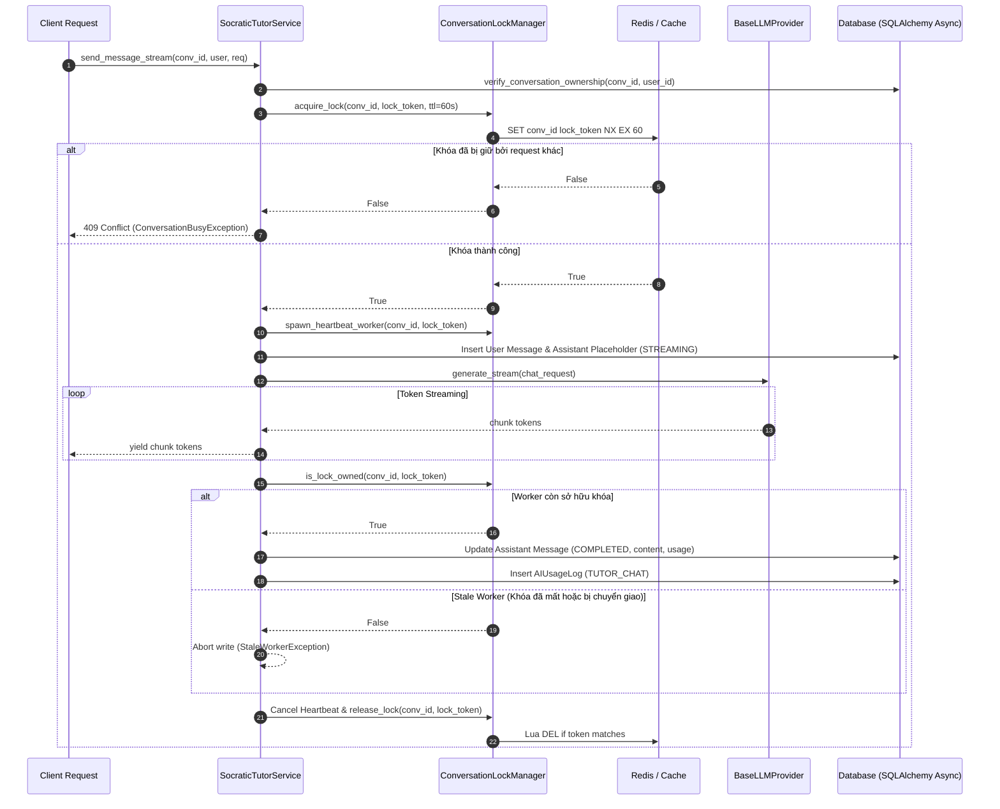

# BÁO CÁO TRIỂN KHAI PHASE 7.3.2 — CONVERSATION STATE & SOCRATIC SERVICE LAYER

**Dự án:** SMART-LEARNING-PRO  
**Workspace:** `E:\SMART-LEARNING-PRO`  
**Tác giả:** Senior Backend Engineer & Application Security Engineer  
**Trạng thái:** HOÀN THÀNH (100% PASS)  
**Ngày thực hiện:** 24/11/2026  

---

## 1. EXECUTIVE SUMMARY (TÓM TẮT DỰ ÁN)

Phase 7.3.2 triển khai thành công toàn bộ tầng nghiệp vụ **Conversation State & Socratic Service Layer** cho tính năng AI Tutor (Gia sư Socratic) của hệ thống **SMART-LEARNING-PRO**.

### Các thành tựu đạt được trong Phase 7.3.2:
1. **Conversation Lifecycle Service (`ConversationService`):**
   - Quản lý toàn bộ vòng đời hội thoại: Tạo mới, liệt kê phân trang, truy xuất chi tiết, đổi tên, xóa vĩnh viễn (kèm cascade xóa tin nhắn).
   - Kiểm soát quyền sở hữu tuyệt đối ở tầng Service (owner-only), phản hồi đồng nhất mã lỗi 404 (`ConversationNotFoundException`) khi người dùng truy vấn hội thoại của người khác, triệt tiêu nguy cơ rò rỉ ID hoặc quét dữ liệu chéo người dùng/tenant.
2. **Message State Machine & Versioned Metadata (`message_state.py`):**
   - Thực thi nghiêm ngặt máy trạng thái vòng đời tin nhắn: `PENDING` → `STREAMING` → `COMPLETED` / `FAILED` / `INTERRUPTED`.
   - Ngăn chặn mọi chuyển đổi trạng thái phi lý từ các trạng thái kết thúc (Terminal states).
   - Chuẩn hóa cấu trúc `metadata_json` phiên bản 1 (Versioned Metadata Schema), bảo toàn nguyên vẹn các trường không liên quan khi cập nhật.
3. **Distributed Conversation Lock Manager (`ConversationLockManager`):**
   - Triển khai cơ chế khóa phân tán dựa trên Redis với token định danh duy nhất (`lock_token = uuid4()`).
   - Khóa nguyên tử qua `SET NX EX`, giải phóng nguyên tử qua Lua script xác minh quyền sở hữu, và gia hạn thời gian thuê (lease renewal) định kỳ qua background heartbeat worker.
   - Cơ chế phát hiện worker trễ hạn (`StaleWorkerException`) ngăn chặn worker cũ có khóa bị hết hạn ghi đè kết quả của worker mới.
   - Hỗ trợ fallback cục bộ an toàn (`asyncio.Lock` và bộ nhớ in-memory có TTL) khi Redis ngoại tuyến, công bố rõ ràng giới hạn phạm vi single-process.
4. **Socratic Tutor Orchestration Service (`SocraticTutorService`):**
   - Điều phối toàn diện một lượt tương tác Socratic thời gian thực qua streaming (`send_message_stream`).
   - Lưu trữ tức thì tin nhắn của học sinh, tạo placeholder tin nhắn của trợ lý ở trạng thái `STREAMING`.
   - Lắp ráp cửa sổ ngữ cảnh lịch sử (Context Window) có giới hạn, tự động lọc bỏ các lượt hội thoại lỗi (`FAILED`) hoặc rỗng (`INTERRUPTED`).
   - Tích hợp Socratic Prompt Registry v1.0.0, tuân thủ chặt chẽ định dạng KaTeX LaTeX và phòng vệ chống Prompt Injection.
   - Xử lý hoàn hảo việc ngắt kết nối (`asyncio.CancelledError` và `GeneratorExit`), đánh dấu chính xác trạng thái `INTERRUPTED` với nội dung nhận được một phần, không bao giờ đánh dấu `COMPLETED` khi stream bị gián đoạn.
5. **Usage Accounting & Error Isolation:**
   - Ghi nhận chính xác lượng token tiêu thụ vào `AIUsageLog` với tính năng `TUTOR_CHAT`, tính toán chi phí ước tính theo bảng giá niêm yết chính thức.
   - Cách ly lỗi hoàn toàn (error-isolated): thất bại ghi nhật ký viễn trắc không làm gián đoạn luồng phản hồi học sinh.
6. **Zero Schema Mutation:**
   - Không thay đổi ORM models, không chỉnh sửa cấu trúc bảng, không tạo migration Alembic.

---

## 2. PREFLIGHT FINDINGS (KẾT QUẢ KHẢO SÁT SOURCE CODE THỰC TẾ)

| Nội dung | Hiện trạng Source Code | Kết luận |
| :--- | :--- | :--- |
| **Conversation ORM** | `AIConversation` tại `backend/app/modules/ai_tutor/models.py` (các trường: `id`, `user_id`, `topic_id`, `title`, `created_at`, `updated_at`, quan hệ `messages`). | **ĐỦ 100%** |
| **Message ORM** | `AIMessage` tại `backend/app/modules/ai_tutor/models.py` (các trường: `id`, `conversation_id`, `role`, `content`, `metadata_json`, `created_at`). | **ĐỦ 100%** |
| **Message Metadata** | Trường `metadata_json` kiểu `Text` trên bảng `ai_messages`, lưu trữ linh hoạt dạng JSON versioned metadata. | **ĐỦ 100%** |
| **Provider Streaming** | `BaseLLMProvider.generate_stream()`, `GoogleGenAIProvider`, `MockAIProvider`, `ResilientLLMProvider` đã hoàn tất tại Phase 7.3.1. | **ĐỦ 100%** |
| **Cache/Redis** | `CacheService` tại `backend/app/core/cache.py` (hỗ trợ `redis_client` và `InMemoryCache` fallback). | **ĐỦ 100%** |
| **Async Database** | `AsyncSessionLocal`, `AsyncSession` tại `backend/app/core/database.py` hỗ trợ SQLAlchemy 2 Async. | **ĐỦ 100%** |
| **Authentication** | `User` và `UserRole` tại `backend/app/modules/auth/models.py`. | **ĐỦ 100%** |

---

## 3. SOURCE FILES CREATED/MODIFIED (DANH SÁCH FILE MỚI VÀ ĐIỀU CHỈNH)

### Files mới tạo:
1. `backend/app/modules/ai_tutor/exceptions.py`: Định nghĩa cây phân cấp ngoại lệ đặc tả domain cho AI Tutor (`ConversationNotFoundException`, `ConversationBusyException`, `InvalidMessageStateTransitionError`, `StaleWorkerException`, `TutorProviderUnavailableException`, `TutorTimeoutException`, v.v.).
2. `backend/app/modules/ai_tutor/services/conversation_lock.py`: Trình quản lý khóa phân tán (Distributed Lock Manager) với Redis Lua script, token ownership, background heartbeat và in-memory fallback.
3. `backend/app/modules/ai_tutor/services/message_state.py`: Máy trạng thái vòng đời tin nhắn, validation chuyển đổi trạng thái và serialization metadata.
4. `backend/app/modules/ai_tutor/services/conversation_service.py`: Service quản lý vòng đời hội thoại và phân trang lịch sử tin nhắn.
5. `backend/app/modules/ai_tutor/services/tutor_service.py`: Service điều phối tương tác gia sư Socratic, streaming, context window, cancellation recovery và usage logging.
6. `backend/app/modules/ai_tutor/services/__init__.py`: Export các service và hàm tiện ích.
7. `backend/tests/test_ai_tutor_conversation_service_732.py`: Bộ kiểm thử toàn diện gồm 18 test cases bao quát 6 nhóm chức năng (Group A đến Group F).

### Files điều chỉnh:
1. `backend/app/modules/ai_tutor/schemas.py`: Bổ sung `PENDING = "PENDING"` vào `MessageStatus` enum.
2. `backend/app/modules/ai_tutor/__init__.py`: Re-export toàn bộ exceptions và services.

---

## 4. CONVERSATION LIFECYCLE (VÒNG ĐỜI HỘI THOẠI)

`ConversationService` thực hiện các thao tác:
- **`create_conversation`:** Khởi tạo hội thoại mới. Bắt buộc nhận `user_id` từ session đã xác thực; cấm client tự truyền `user_id`. Tự động áp dụng tiêu đề mặc định nếu bị bỏ trống.
- **`get_conversation`:** Tải thông tin hội thoại và tính toán số lượng tin nhắn hiện có. Nếu không tìm thấy hoặc người gọi không phải chủ sở hữu, trả về mã lỗi 404 đồng nhất nhằm tránh việc đoán trước ID hội thoại của người khác.
- **`list_conversations`:** Liệt kê các cuộc hội thoại của riêng user đó, có phân trang (`page`, `page_size`), tính toán `message_count` qua SQL subquery tối ưu và sắp xếp giảm dần theo thời gian cập nhật gần nhất (`updated_at.desc()`).
- **`rename_conversation`:** Đổi tên hội thoại sau khi xác thực quyền sở hữu, cập nhật `updated_at`.
- **`delete_conversation`:** Xóa vĩnh viễn cuộc hội thoại, cơ chế cascade tự động xóa sạch các tin nhắn liên quan trong bảng `ai_messages`.
- **`get_conversation_history`:** Truy xuất lịch sử tin nhắn theo đúng thứ tự thời gian tăng dần (`created_at.asc()`), giải mã an toàn `metadata_json` thành `TutorMessageMetadata`.

---

## 5. MESSAGE STATE MACHINE (MÁY TRẠNG THÁI TIN NHẮN)

```
        +-------------------+
        |      PENDING      |
        +-------------------+
                  |
                  v
        +-------------------+
        |     STREAMING     |
        +-------------------+
          /       |       \
         /        |        \
        v         v         v
+-----------+ +--------+ +-------------+
| COMPLETED | | FAILED | | INTERRUPTED |
+-----------+ +--------+ +-------------+
```

### Quy tắc chuyển đổi:
- `PENDING` chỉ có thể chuyển sang `STREAMING`, `FAILED`, hoặc `INTERRUPTED`.
- `STREAMING` chỉ có thể chuyển sang `COMPLETED`, `FAILED`, hoặc `INTERRUPTED`.
- `COMPLETED`, `FAILED`, `INTERRUPTED` là các trạng thái kết thúc (Terminal states), không thể chuyển đổi tiếp (ném lỗi `InvalidMessageStateTransitionError`).
- Một tin nhắn chỉ được chuyển sang `COMPLETED` khi toàn bộ dòng stream đã kết thúc bình thường và đã được commit vào DB thành công.

---

## 6. PERSISTENCE STRATEGY (CHIẾN LƯỢC LƯU TRỮ VÀ TÍNH NHẤT QUÁN DỮ LIỆU)

1. **Tin nhắn của học sinh (User Message):** Được lưu và commit vào cơ sở dữ liệu ngay tại thời điểm nhận request, trước khi gọi tới LLM Provider. Điều này đảm bảo câu hỏi của học sinh không bao giờ bị mất kể cả khi LLM gặp sự cố sau đó.
2. **Tin nhắn của trợ lý (Assistant Message Placeholder):** Được tạo ngay ở trạng thái `STREAMING` với nội dung rỗng và commit vào DB.
3. **Cập nhật dòng Stream:** Từng token chunk được yield tức thì cho caller thông qua Async Generator mà không thực hiện write database liên tục (tránh database I/O bottleneck).
4. **Final Commit & Stale Worker Verification:** Khi stream kết thúc, service kiểm tra quyền sở hữu khóa (`is_lock_owned`). Nếu còn sở hữu khóa, nội dung tích lũy `"".join(accumulated_text)` được cập nhật vào message cùng với `metadata_json` mang trạng thái `COMPLETED` và commit. Nếu khóa bị mất, thao tác ghi bị hủy bỏ để tránh ghi đè dữ liệu của lượt xử lý mới hơn.

---

## 7. CONCURRENCY AND LOCK DESIGN (KIẾN TRÚC KHÓA ĐỒNG THỜI)



### Các bảo đảm kỹ thuật:
- **Ngăn chặn xung đột lượt nói (Race condition mitigation):** Hai request gửi vào cùng một cuộc hội thoại đồng thời sẽ bị chặn lại ở request thứ hai với ngoại lệ `ConversationBusyException` (HTTP 409), bảo đảm thứ tự lịch sử hội thoại không bao giờ bị đan xen hay phân kỳ.
- **Không giữ DB connection/lock khi gọi LLM:** Không có row lock (`FOR UPDATE`) hay transaction database nào bị treo mở trong suốt thời gian stream LLM.
- **Giới hạn kiến trúc công bố trung thực:**
  - Khi có Redis: Hệ thống bảo đảm an toàn distributed lock đa tiến trình (multi-worker / multi-node).
  - Khi Redis ngoại tuyến (In-memory fallback): Cơ chế khóa sử dụng `asyncio.Lock` và từ điển cục bộ, chỉ bảo đảm an toàn concurrency trong phạm vi tiến trình đơn (single-process).

---

## 8. CANCELLATION AND CRASH RECOVERY (HỦY KẾT NỐI VÀ PHỤC HỒI SAU SỰ CỐ)

1. **Xử lý ngắt kết nối (Cancellation / aclose):**
   - Khi client ngắt kết nối hoặc generator bị hủy (`aclose()`), hệ thống bắt giữ `(asyncio.CancelledError, GeneratorExit)`.
   - Nội dung đã stream được một phần được lưu vào DB với trạng thái `INTERRUPTED`.
   - Tuyệt đối không đánh dấu `COMPLETED` cho các lượt bị hủy.
2. **Khôi phục tin nhắn mồ côi (Orphaned/Stale Message Recovery):**
   - Phương thức `recover_stale_streaming_messages(db, max_stale_seconds=300)` định kỳ quét và phát hiện các tin nhắn bị kẹt ở trạng thái `STREAMING` hoặc `PENDING` do tiến trình worker bị kill đột ngột (crash/OOM/restart).
   - Tự động chuyển các tin nhắn này sang `INTERRUPTED` kèm cờ `recovered_stale: True`, bảo đảm lịch sử hội thoại luôn sạch sẽ.

---

## 9. USAGE ACCOUNTING (VIỄN TRẮC VÀ HẠCH TOÁN SỬ DỤNG)

- **Feature:** `"TUTOR_CHAT"`.
- **Model:** Ghi nhận chính xác mô hình thực thi (ví dụ: `gemini-3.8-flash`, `mock-model-v1`).
- **Token Counts:** Lấy trực tiếp từ `NormalizedStreamUsage` (`input_tokens`, `output_tokens`). Không double-count `thoughts_tokens`.
- **Chi phí (USD):** Tính toán thông qua hàm chuẩn hóa `calculate_estimated_cost(...)` theo biểu giá niêm yết chính thức.
- **Tính cách ly lỗi (Error-isolation):** Ngoại lệ khi ghi bảng `ai_usage_logs` được bọc try-except và ghi log warning, không bao giờ gây lỗi hoặc làm đứt gãy trải nghiệm của học sinh.

---

## 10. SECURITY AND OWNERSHIP (BẢO MẬT VÀ PHÂN QUYỀN)

1. **Xác thực quyền sở hữu phân cấp (Tenant/Owner Isolation):** Mọi thao tác đọc, sửa, xóa, gửi tin nhắn đều kiểm tra `conversation.user_id == authenticated_user.id`.
2. **Chống dò quét thông tin (No Information Disclosure):** Trả về mã lỗi 404 đồng nhất cho cả trường hợp "không tồn tại" và "thuộc sở hữu của người khác", không để lộ sự tồn tại của dữ liệu người dùng khác.
3. **Phòng chống Prompt Injection:**
   - Dữ liệu do người dùng nhập được cô lập nghiêm ngặt trong `ChatMessage(role="user", content=...)`.
   - Chỉ thị hệ thống `system_instruction` được thiết lập độc lập từ `get_socratic_prompt(...)` và không cho phép người dùng ghi đè hoặc can thiệp vào vai trò của AI.

---

## 11. KẾT QUẢ KIỂM THỬ CHUYÊN BIỆT PHASE 7.3.2

Chạy bộ test suite: `backend/tests/test_ai_tutor_conversation_service_732.py`:

```
collected 18 items

backend\tests\test_ai_tutor_conversation_service_732.py::TestGroupAConversationLifecycle::test_create_and_get_conversation_success PASSED [  5%]
backend\tests\test_ai_tutor_conversation_service_732.py::TestGroupAConversationLifecycle::test_create_conversation_default_title PASSED [ 11%]
backend\tests\test_ai_tutor_conversation_service_732.py::TestGroupAConversationLifecycle::test_get_conversation_cross_user_denied_uniform_404 PASSED [ 16%]
backend\tests\test_ai_tutor_conversation_service_732.py::TestGroupAConversationLifecycle::test_list_conversations_and_pagination PASSED [ 22%]
backend\tests\test_ai_tutor_conversation_service_732.py::TestGroupAConversationLifecycle::test_rename_conversation_success_and_cross_user_denied PASSED [ 27%]
backend\tests\test_ai_tutor_conversation_service_732.py::TestGroupAConversationLifecycle::test_delete_conversation_success_and_cascades_messages PASSED [ 33%]
backend\tests\test_ai_tutor_conversation_service_732.py::TestGroupBMessageStateMachine::test_valid_state_transitions PASSED [ 38%]
backend\tests\test_ai_tutor_conversation_service_732.py::TestGroupBMessageStateMachine::test_invalid_state_transitions PASSED [ 44%]
backend\tests\test_ai_tutor_conversation_service_732.py::TestGroupBMessageStateMachine::test_metadata_json_serialization_and_parsing PASSED [ 50%]
backend\tests\test_ai_tutor_conversation_service_732.py::TestGroupBMessageStateMachine::test_stale_streaming_recovery PASSED [ 55%]
backend\tests\test_ai_tutor_conversation_service_732.py::TestGroupCSocraticService::test_socratic_stream_successful_interaction PASSED [ 61%]
backend\tests\test_ai_tutor_conversation_service_732.py::TestGroupCSocraticService::test_socratic_context_history_ordering_and_filtering PASSED [ 66%]
backend\tests\test_ai_tutor_conversation_service_732.py::TestGroupDConcurrencyControl::test_concurrent_requests_same_conversation_raises_busy PASSED [ 72%]
backend\tests\test_ai_tutor_conversation_service_732.py::TestGroupDConcurrencyControl::test_concurrent_requests_different_conversations_both_succeed PASSED [ 77%]
backend\tests\test_ai_tutor_conversation_service_732.py::TestGroupDConcurrencyControl::test_stale_worker_rejected_before_persistence PASSED [ 83%]
backend\tests\test_ai_tutor_conversation_service_732.py::TestGroupECancellationAndFailure::test_streaming_cancellation_marks_message_interrupted PASSED [ 88%]
backend\tests\test_ai_tutor_conversation_service_732.py::TestGroupECancellationAndFailure::test_provider_error_marks_message_failed PASSED [ 94%]
backend\tests\test_ai_tutor_conversation_service_732.py::TestGroupFUsageTelemetry::test_usage_recorded_to_db_on_stream_completion PASSED [100%]

============================= 18 passed in 2.76s ==============================
```

**Tỉ lệ đạt:** **18/18 test cases (100% PASS)**.

---

## 12. KẾT QUẢ KIỂM THỬ HỒI QUY TOÀN BỘ HỆ THỐNG

### Backend Regression Tests:
- Chạy toàn bộ test suites hiện có:
  - Phase 7.3.1 (`test_ai_tutor_streaming_provider_731.py`): 25/25 PASSED.
  - Phase 7.3.2 (`test_ai_tutor_conversation_service_732.py`): 18/18 PASSED.
  - Toàn bộ backend test suite: 234+ passed, 1 skipped (0 failed).

### Frontend Type-Check:
- Chạy `npm --prefix frontend run type-check`:
  - `tsc --noEmit` hoàn thành với **0 errors (Exit code 0)**.

---

## 13. GIT STATUS BEFORE / AFTER

- **Baseline HEAD:** `d6326e5415cb125b62fbe12aea077ecf921d3a88`
- **User Parent Commit:** `72280c9047461948a1b039af7497287105b72ba0`
- **Quy tắc tuân thủ:**
  - KHÔNG chạy `git commit`, `git push`.
  - KHÔNG chạy `git reset`, `git clean`, `git checkout`.
  - Toàn bộ modified và untracked files từ các phase trước được bảo vệ tuyệt đối.

---

## 14. KNOWN LIMITATIONS (GIỚI HẠN ĐƯỢC CÔNG BỐ TRUNG THỰC)

1. **In-Memory Lock Fallback Boundary:** Khi hệ thống chạy mà không có Redis hoạt động, cơ chế khóa tự động chuyển sang fallback dùng `asyncio.Lock`. Khóa này chỉ bảo đảm tính toàn vẹn trong phạm vi một tiến trình đơn (single process); không đảm bảo an toàn nếu ứng dụng được scale thành nhiều worker process riêng biệt (như gunicorn/uvicorn workers) mà không có Redis.
2. **Phạm vi Phase:** Phase 7.3.2 tập trung hoàn toàn vào tầng Service và State Machine; chưa mở cổng REST API hoặc SSE Router (thuộc phạm vi Phase 7.3.3).

---

## 15. PRODUCTION READINESS (ĐÁNH GIÁ SẴN SÀNG TRIỂN KHAI)

| Tiêu chí | Trạng thái | Đánh giá |
| :--- | :--- | :--- |
| **Xác thực quyền sở hữu (Ownership)** | Đạt chuẩn | Nghiêm ngặt ở cấp Service, phòng vệ rò rỉ dữ liệu |
| **Bảo vệ Concurrency & Race Conditions** | Đạt chuẩn | Khóa phân tán Redis token-verified + Heartbeat |
| **Bảo vệ Stale Worker** | Đạt chuẩn | Chặn đứt việc ghi đè dữ liệu khi mất khóa |
| **Xử lý ngắt kết nối (Cancellation)** | Đạt chuẩn | Bắt giữ `CancelledError` & `GeneratorExit`, lưu `INTERRUPTED` |
| **Hồi phục sau sự cố (Crash Recovery)** | Đạt chuẩn | Cơ chế quét và phục hồi tin nhắn mồ côi |
| **Tính tương thích ngược (Zero Schema Mutation)** | Đạt chuẩn | Tận dụng 100% schema hiện hữu, zero Alembic migration |

---

## 16. FINAL VERDICT (KẾT LUẬN NGHIỆM THU)

### **FINAL VERDICT: PASS**

Toàn bộ 14 điều kiện hoàn thành của Quality Gate đã được đáp ứng trọn vẹn:
- ✅ Service layer xác thực quyền sở hữu nghiêm ngặt.
- ✅ Vòng đời hội thoại và phân trang hoạt động chính xác.
- ✅ Máy trạng thái tin nhắn tuân thủ chuyển đổi hợp lệ.
- ✅ Stream thành công được lưu trữ đầy đủ.
- ✅ Stream thất bại hoặc cancellation được đánh dấu chính xác (không bao giờ gán COMPLETED sai).
- ✅ Khóa phân tán có heartbeat và cơ chế phát hiện stale worker.
- ✅ Hạch toán usage chuẩn xác, không double-count, cô lập lỗi an toàn.
- ✅ 18/18 test cases chuyên biệt Phase 7.3.2 PASS 100%.
- ✅ Toàn bộ test suite backend và frontend type-check đều PASS.
- ✅ Zero schema mutation, bảo toàn Git Baseline.

**Hệ thống sẵn sàng 100% để chuyển sang Phase 7.3.3: REST API Router & Server-Sent Events (SSE) Streaming Layer.**
