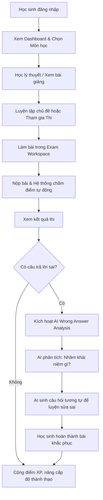

# SITEMAP & USER FLOWS — SMART LEARNING PRO

---

## 1. HỆ THỐNG ĐIỀU HƯỚNG & SITEMAP

### 1.1. Public Website (Khách vãng lai & Giới thiệu)
- `/` — Trang chủ Landing Page (Hero banner, USP, Feature cards, Testimonials, CTA)
- `/about` — Về dự án SMART LEARNING PRO & Đội ngũ phát triển
- `/features` — Tính năng cốt lõi (AI Tutor, Phân tích lỗi sai, Lộ trình cá nhân hóa)
- `/subjects` — Danh mục môn học THCS & THPT (Toán, Lý, Hóa, Sinh, Anh, Văn...)
- `/faq` — Câu hỏi thường gặp
- `/contact` — Thông tin liên hệ & Hỗ trợ kỹ thuật
- `/login` — Đăng nhập hệ thống (Hỗ trợ chuyển hướng theo Role)
- `/register` — Đăng ký tài khoản (Lựa chọn vai trò Học sinh hoặc Giáo viên)
- `/privacy` — Chính sách bảo mật dữ liệu học tập
- `/terms` — Điều khoản sử dụng dịch vụ

### 1.2. Student Portal (`/student/*`) — Dành cho Học sinh
- `/student/dashboard` — Bảng tổng quan năng lực, tiến độ học, streak, nhiệm vụ hàng ngày
- `/student/courses` — Khám phá môn học theo khối lớp (Lớp 6 đến Lớp 12)
- `/student/courses/[subjectId]` — Mục lục chương, chủ đề và danh sách bài học
- `/student/courses/[subjectId]/lesson/[lessonId]` — Trình đọc bài giảng đa phương tiện (Markdown, KaTeX, Video)
- `/student/practice` — Trung tâm luyện tập tự do theo chủ đề
- `/student/practice/[topicId]` — Không gian làm bài luyện tập với phản hồi tức thì
- `/student/exams` — Danh sách bài kiểm tra và bài thi thử có sẵn
- `/student/exams/[examId]/take` — Phòng thi trực tuyến tập trung (Fullscreen, đếm ngược, autosave)
- `/student/exams/[examId]/result/[attemptId]` — Kết quả thi, bảng điểm chi tiết, phân phổ điểm
- `/student/analytics/wrong-answers` — Trung tâm chẩn đoán lỗi sai cùng Gia sư AI
- `/student/analytics/mastery` — Ma trận năng lực và biểu đồ khoảng trống kiến thức (Knowledge Gaps)
- `/student/ai-tutor` — Phòng đối thoại trực tiếp với Gia sư AI Socratic
- `/student/profile` — Hồ sơ cá nhân, đổi mật khẩu, thống kê XP và huy hiệu đạt được

### 1.3. Teacher Portal (`/teacher/*`) — Dành cho Giáo viên
- `/teacher/dashboard` — Bảng điều khiển quản lý lớp, thống kê bài nộp gần nhất
- `/teacher/classrooms` — Quản lý danh sách lớp học, tạo lớp, mã tham gia
- `/teacher/classrooms/[classId]` — Chi tiết học sinh trong lớp, bảng xếp hạng và báo cáo năng lực
- `/teacher/question-bank` — Ngân hàng câu hỏi trắc nghiệm và tự luận đa định dạng
- `/teacher/question-bank/create` — Trình soạn thảo câu hỏi hỗ trợ KaTeX và ảnh minh họa
- `/teacher/exams` — Danh sách bài kiểm tra & đề thi do giáo viên khởi tạo
- `/teacher/exams/create` — Trình tạo đề thi (Random ma trận hoặc chọn lọc thủ công)
- `/teacher/assignments` — Quản lý giao bài tập về nhà theo lớp và hạn chót
- `/teacher/grading` — Bảng chấm điểm và duyệt bài tự luận của học sinh
- `/teacher/analytics` — Báo cáo điểm trung bình, độ hổng kiến thức chung của cả lớp

### 1.4. Admin Portal (`/admin/*`) — Dành cho Quản trị viên
- `/admin/dashboard` — Bảng điều khiển hệ thống, số lượng tài khoản hoạt động, traffic
- `/admin/users` — Quản trị người dùng (Phân quyền Student, Teacher, Admin, Khóa/Mở)
- `/admin/curriculum` — Quản trị chương trình học (Khối lớp, Môn học, Chương, Chủ đề)
- `/admin/ai-monitoring` — Giám sát Gemini API (Số request, token usage, chi phí USD/VND)
- `/admin/audit-logs` — Nhật ký bảo mật và lịch sử thao tác hệ thống

---

## 2. QUY TRÌNH NGƯỜI DÙNG CỐT LÕI (CORE USER FLOWS)

### Flow 1: Quy trình Thi & Chấm điểm Tự động (Exam Flow)
1. Học sinh truy cập `/student/exams`, chọn đề thi (ví dụ: "Đề thi thử học kỳ 1 Toán 11 - 50 câu / 90 phút").
2. Hệ thống kiểm tra điều kiện (số lần thi còn lại, thời gian mở đề).
3. Khởi tạo `exam_attempt` trên backend, lấy snapshot câu hỏi và các phương án (xáo trộn nếu cài đặt).
4. Client mở giao diện thi tập trung `/student/exams/[examId]/take`:
   - Bắt đầu đồng hồ đếm ngược đồng bộ timestamp từ máy chủ.
   - Mỗi lần học sinh chọn đáp án: Gửi API `POST /api/v1/exams/attempts/{attempt_id}/save-answer` ngầm trong nền.
   - Cập nhật màu trên Question Palette (Xanh: đã làm, Vàng: đã đánh dấu cờ, Xám: chưa làm).
5. Khi hết giờ hoặc học sinh bấm "Nộp bài":
   - Gửi yêu cầu `POST /api/v1/exams/attempts/{attempt_id}/submit`.
   - Backend khóa bài nộp, thực thi engine chấm điểm tự động.
   - Tính toán: Điểm tổng, số câu đúng/sai, độ chính xác theo từng chủ đề.
   - Chuyển hướng học sinh đến trang kết quả chi tiết.

### Flow 2: Quy trình Phân Tích Lỗi Sai & Gia Sư AI (AI Tutor & Remediation Flow)
1. Tại trang kết quả bài thi hoặc `/student/analytics/wrong-answers`, học sinh chọn câu sai muốn mổ xẻ.
2. Học sinh bấm **"Phân tích cùng Gia sư AI"**.
3. Frontend gửi request đến `POST /api/v1/ai/analyze-wrong-answer` với payload:
   - `question_id`, `student_answer`, `time_spent`.
4. Backend tổng hợp Context:
   - Nội dung câu hỏi + công thức KaTeX.
   - Các phương án và đáp án đúng chuẩn + lời giải chính thức.
   - Lịch sử các câu sai gần đây của học sinh ở cùng chủ đề này (từ bảng `topic_mastery`).
5. Backend gọi Google Gemini API với System Prompt chuyên biệt cho sư phạm Việt Nam:
   - Yêu cầu đầu ra dạng Structured JSON:
     - `error_category`: Phân loại lỗi (Ví dụ: `CONCEPTUAL_MISUNDERSTANDING`, `CALCULATION_ERROR`, `MISREAD_QUESTION`).
     - `explanation`: Giải thích thân thiện, gợi mở tư duy tại sao phương án của học sinh lại sai.
     - `step_by_step_guidance`: Các bước tư duy để đi đến kết quả đúng.
     - `remedial_concept`: Khái niệm kiến thức cần ôn lại.
     - `similar_practice_question`: Một câu hỏi tương tự có cấu trúc tương đương nhưng số liệu mới để học sinh kiểm chứng lại hiểu biết.
6. Frontend hiển thị thẻ chẩn đoán trực quan, cho phép học sinh giải câu hỏi tương tự ngay tại chỗ.

### Flow 3: Quy trình Quản Lý & Giao Bài của Giáo Viên (Teacher Assignment Flow)
1. Giáo viên vào `/teacher/exams/create`, nhập tiêu đề đề kiểm tra, chọn môn và khối lớp.
2. Giáo viên chọn cấu trúc đề:
   - 20 câu Nhận biết, 15 câu Thông hiểu, 10 câu Vận dụng, 5 câu Vận dụng cao.
   - Bấm "Tự động sinh đề từ Ngân hàng câu hỏi" hoặc tự chọn từng câu trong ngân hàng.
3. Giáo viên bấm "Giao bài tập" (`/teacher/assignments`), chọn lớp học mục tiêu, thiết lập hạn nộp (Deadline), số lần làm tối đa và cho phép xem lời giải sau khi hết hạn.
4. Hệ thống bắn thông báo đến học sinh của lớp đó.
5. Khi học sinh nộp bài, màn hình Gradebook của giáo viên tự động cập nhật biểu đồ thống kê kết quả cả lớp.
